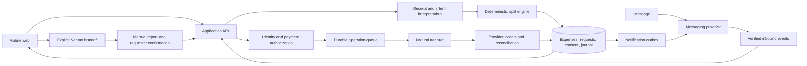

# Peer Payments — Product Requirements Document

**Version:** 1.0 — P2P MVP, signup first with secondary Venmo repayment  
**Date:** September 25, 2026  
**Audience:** Founder, product designer, engineers, payment and messaging partners  
**Platforms:** Mobile web and iMessage for the MVP; native mobile and Messages extension later  
**Working name:** To be chosen. “The app” and “agent” are placeholders, not proposed branding.

**Engineering reference:** [Living technical design](payments-technical-design.md), with decision, verification, and implementation trackers.

The founder has confirmed the first audience: **US friends splitting dinners, trips, and shared purchases**, and has subsequently narrowed the MVP to **peer-to-peer payments without a groups feature**. The product has a receipt-capable iMessage agent, an excellent mobile web app, and Natural underneath. Ad hoc multi-recipient receipt splitting remains in scope as separate P2P requests, as explicitly confirmed by the founder. Recommendations marked **pending** are planning defaults, not approved founder decisions. Provider capabilities were checked against public documentation; items marked **unverified** need partner confirmation.

## 1. The product promise

**Send the receipt. Everyone sees a fair share. Approve, and the app handles the payment.**

One person should be able to photograph a receipt, name the people involved, and hand off the bookkeeping. Each friend should receive a clear, private request that explains their amount and makes paying feel simple. Each person should have a calm, reliable record of their requests, payments, and anything that still needs attention.

The experience should make people feel relieved, in control, and comfortable involving their friends. A successful interaction ends with a useful answer—“Dinner is settled”—and lets everyone get on with their evening.

The iMessage agent and web app are two entrances to the same product. A receipt started in Messages appears as the same draft on the web. An amount corrected on the web updates the authoritative request. A payment approved on the web produces a confirmation in the payer's private agent conversation when they have enabled messages.

The product must support three primary jobs:

1. **Split and collect:** “I paid $117 for dinner. Split it with Maya and Leo; Maya didn’t have wine.”
2. **Send money:** “Send Maya $20 for the tickets.”
3. **Request money:** “Request $20 from Maya for her ticket.”

**There are no persistent groups, shared tabs, net balances, or group settlement rounds in the MVP.** Each request is paid individually when its recipient approves. A recipient may leave it pending and pay later, but that does not combine or offset it against other requests. The future product can support both individual and group settlement, including different debt-simplification policies; those choices are deferred by the founder’s scope change.

## 2. Decisions and assumptions

| Topic | Current direction | Status |
|---|---|---|
| Initial audience | US friends splitting meals, trips, and shared purchases | Confirmed by founder |
| Product priority | Exceptional user experience, little manual entry, approachable payments | Confirmed by founder |
| Channels | iMessage agent plus mobile web; native app later | Requested by founder |
| Payment infrastructure | Natural, with each customer’s own account and delegated permissions | Requested; program approval remains a dependency |
| Sender confirmation | Automatically send clear requests after the sender chooses the split method and all details are resolved | Confirmed by founder |
| Payer confirmation | Explicit approval of every transfer | Confirmed by founder |
| Settlement | Individual requests only; each transfer requires the payer’s approval | Latest founder scope supersedes earlier group-settlement requirement |
| Split method | Ask the sender on every new expense; do not silently choose equal splitting | Confirmed by founder |
| Groups / debt simplification | Removed from MVP; consider both relationship-preserving and whole-group modes later | Confirmed by founder |
| Ad hoc multi-recipient splitting | One receipt can generate separate requests to several friends, with no persistent group | Confirmed by founder |
| Appearance | Minimal and premium, with restrained playful touches | Confirmed by founder |
| Launch sequencing | Build the canonical web journey first; include iMessage in the private beta | Planning default; founder can change launch dependency |
| Funding | Natural wallet/bank methods; signup is primary, Venmo is the secondary repayment option | Confirmed by founder; card/Apple Pay are not launch requirements |
| Guest repayment | Secondary Venmo handoff with amount owed; no app signup required for this external route | Confirmed by founder; exact deep-link prefill requires device validation |
| Signup | Minimal app signup, contextual financial activation, preserved request throughout | Confirmed by founder; provider verification still applies |
| Receipt visibility | Every verified participant can see the full redacted receipt and everyone's shares | Confirmed by founder |
| Pricing | Free private beta, with costs and repeat use measured from the first transaction | Confirmed by founder; later business model remains open |
| Age/currency | Adults 18+, USD; US launch subject to Natural’s eligibility rules | Scope based on current provider terms [N1, N2] |
| Delivery date and team | Not yet provided | Founder decision pending |

The initial build should avoid requiring a product name, a final monetization strategy, or a native app before the core flow can be tested.

## 3. Experience principles

1. **Make value visible before setup.** Show a parsed, editable receipt or the request someone received before asking them to activate payments.
2. **One screen should contain one complete decision.** A payer should see who gets paid, how much, why, and from which source beside the payment action.
3. **Use conversation for intent and direct controls for precision.** A user can say “Maya skipped wine,” then inspect and adjust the exact resulting amounts.
4. **Remember people and context.** Remember confirmed friends, private nicknames, recent participants, and the preferred payment source. Ask the split method for each new expense, as requested by the founder.
5. **Use the fewest necessary questions.** Ask about the specific unreadable amount or ambiguous person, preserving everything already understood.
6. **Make every monetary state truthful.** Approval, payment initiation, provider completion, and withdrawal availability are distinct.
7. **Keep money private.** Payment requests arrive in private conversations. Receipt access is limited to the people involved.
8. **Design both sides equally well.** The recipient’s first experience determines whether the sender will use the app again.
9. **Make correction easy.** Wrong receipt, wrong allocation, duplicate photo, changed plans, and bank delays must feel recoverable.
10. **Use delight to reinforce clarity.** A receipt becoming a clean split card and a settled expense gently closing are useful moments of pleasure.

## 4. Scope and release boundaries

**P0 is the complete private-beta experience.** It includes iMessage. A web-only internal milestone is build sequencing, not a silent reduction of the requested product.

| Capability | P0 private beta | Later |
|---|---|---|
| Receipt intake | Camera/upload on web; image in the agent’s private iMessage conversation | Multiple receipts processed together |
| Typed expenses | Amount, purpose, people, and optional instructions | Recurring expense rules |
| Splitting | Ask method each time; equal, exact amounts, and item assignment; shared items; tax/tip/discount reconciliation | Weighted shares, complex percentage rules, multiple original payers |
| Requests | Send automatically once method and details are clear; recipient review, payment approval, issues, cancellation/revision | More sophisticated request automation |
| Direct payments | Enrolled verified recipient, explicit amount/source approval; wallet-funded send; invite-and-resume for new people | Off-network claim payments; faster funding methods if supported |
| Direct requests | Explicit recipient, amount, purpose; no receipt required | Recurring or scheduled requests |
| Groups | None; ad hoc receipt participants do not create a persistent group | Persistent groups, running tabs, settlement rounds, pairwise offsets, whole-group simplification |
| Contacts | Known friends, verified phone identity, manual number, share links, recent participants | Native contact picker and permissioned device contacts |
| Financial setup | Natural-supported consent/KYC, bank linking when needed, receive/withdraw, preserved originating flow | Fully embedded presentation; optional instant withdrawal if supported |
| Messaging | Receipt intake, concise summaries, request links, status updates, opt-outs | Native interactive Messages extension |
| Reminders | Sender-initiated neutral reminder, with rate limits and recipient preferences | Opted-in automatic digests and scheduled reminders |
| External settlement | Secondary Venmo repayment link; full external payment report and requester confirmation | Automated external verification if a supported integration becomes available; partial external payments |
| Support | Issue from any request, event history, support queue, reconciliation | Expanded self-service recovery |

P0 has no persistent groups, combined settlement, debt offsets, lending, credit, foreign exchange, cross-border transfers, merchant checkout, payment card, public activity feed, incoming-payment auto-approval, pooled funds, or automatic deduction based on a message reaction. Request creation can be automatic; payment approval remains explicit for every transfer.

## 5. What the integrations actually permit

| Area | Current public documentation | Product consequence |
|---|---|---|
| Natural onboarding | A customer accepts a Connect invitation, completes account verification, chooses a wallet, and authorizes permissions. Return redirects are supported. [N3] | Setup can begin inside our flow. Completely hidden account creation and white-label verification are unverified. |
| Verification | Individual verification includes identity and contact information; it can require review. [N2] | Preserve the split through every interruption; show an honest review state. Sensitive identity fields belong in approved secure surfaces. |
| Bank linking | Customers link banks in their Natural dashboard in the documented flow. [N4] | Embedded linking is a provider question; support a clear return to the exact request. |
| Repaying a request | Fulfillment supports a wallet or an eligible verified linked bank. Bank fulfillment is asynchronous. [N5] | A user need not always preload a balance to repay. Approval may start a bank payment rather than finish it instantly. |
| Sending money directly | The documented direct-payment operation draws from a wallet. [N6] | Insufficient wallet funds require a separate funding step; do not present bank-funded request repayment as proof that direct sends work identically. |
| Provider approval holds | Breaching limits can hold a payment; agent keys cannot approve the hold. [N7] | Our payment consent is distinct from a Natural approval. Surface additional provider approval when required. |
| Native request declines | The documented decline operation cannot act on behalf of a customer. [N5] | “Something looks off” uses our issue workflow and an authorized cancellation/reissue path. |
| Messaging | Third-party providers document receipt images, inbound events, outgoing messages, and delivery status. [M1, M2] | Use a dedicated app number and an adapter so transport details do not leak into the product. Production terms and reliability require validation. |
| Buttons inside iMessage | Custom interactive cards require an installed Messages extension. Rich links can open the web experience. [M3, M4] | P0 approval uses a focused web page opened from the message. Native inline approval is a later release. |
| Phone contacts | An inbound message does not expose the user’s address book. Safari contact picking is not a reliable production dependency. [M5, M6] | “Maya” resolves from confirmed app relationships, explicit number entry, or invitations. |
| New recipients | Messaging providers require appropriate opt-in. A sender naming someone does not supply that recipient’s consent. [M7] | Existing opted-in users receive requests automatically. The sender shares an invitation with a new person. |
| Natural notifications | Natural documents its own notifications for payment requests; suppression is not documented in the reviewed create flow. [N8] | Preventing duplicate branded notifications is a partner integration gate. |

**Required commercial confirmation:** Natural’s current agreement restricts products that compete with Natural or its technology. Obtain confirmation that this consumer payments app is an approved Connect use case, along with its onboarding, funding, notification, and commercial terms. This is a specific dependency of using the selected provider; it does not prevent building or testing the product experience. [N1]

### 5.1 Funding decision: Natural plus a secondary Venmo option

The founder asked whether a recipient can repay with a card. **The currently documented request-fulfillment sources are a Natural wallet or verified linked bank account. Card-funded P2P and Apple Pay are not established by those docs.** [N5]

Natural **Accept** is described as upcoming merchant card acceptance; **Cards** is upcoming card issuance for agents. Neither should be treated as proof that an individual can repay a friend with an existing debit/credit card. [N16, N17]

The founder has resolved the launch decision: **prioritize a quick signup into our experience; offer a quieter Venmo repayment link with the amount owed.** Card and Apple Pay support in our app are future investigations. Payment methods and any fees offered inside Venmo are controlled by Venmo; our app must not promise a particular method or fee there.

The UI should receive supported Natural funding methods from server configuration. Do not display a working **Pay with Apple Pay** or **Pay by card** option until its end-to-end P2P flow is verified. The documented off-network bank-push route is not a second guest payment integration for P0. [N9]

### 5.2 Venmo handoff: intended experience and verified limits

Venmo documents sharing a personal profile through a QR/share link and paying a person by username, phone, or email. The reviewed current official documentation does **not** establish a supported ordinary P2P URL contract that prefills recipient, amount, and note. Business-profile price-specific QR codes and merchant checkout APIs do not establish that capability for personal repayments. [V1, V2, V3]

The product requirement is to open the requester's Venmo destination with the **exact amount and a short note prefilled**. Implement the link format only after validating it on supported current devices. Record the working behavior and its limitations; do not present an undocumented URI as a guaranteed platform API. If prefill is unavailable, provide the confirmed profile/QR destination plus **Copy amount** and **Copy note**. This fallback must be visibly disclosed, not silently substituted for a working prefilled experience.

There is no verified current completion callback for ordinary personal payment links. The archived Venmo iOS SDK is not evidence that a new web app can receive payment confirmations. P0 therefore records external payment through a payer report and requester confirmation, as defined in Section 13.4. [V4, V5]

The requester supplies and confirms their receiving Venmo username or shared profile. Never derive it from their app name or assume a phone number is verified on Venmo. Show the actual destination before handoff. The setting is optional and does not interrupt the main signup flow; without a confirmed destination, hide the Venmo action and offer the requester an unobtrusive setup prompt. This is **requester-confirmed identity**, not independently verified Venmo ownership. [V2, V6]

## 6. The signature experience

### 6.1 Returning sender, known friends

Alex sends a photo to the app’s agent number:

> Dinner with Maya and Leo. We shared the food; Maya didn’t have wine.

The receipt contains $60 food, $30 wine, $9 tax, and $18 tip: **$117 total**. The agent asks the required method question and offers a concrete suggestion:

> Dinner · $117  
> How should I split it: equal, by item, or custom amounts?  
> By item fits what you described: you $45.50, Maya $26, Leo $45.50. Tax and tip follow your items.  
> Reply “by item” to send those requests, or review and choose here: [link]

Alex replies **“By item.”** Because the method, total, allocations, and recipients are now clear, the app sends the separate P2P requests automatically. There is no extra “Are you sure?” or “Send” turn.

Before choosing, the user can reply “make the tip equal” or open the web view and adjust an item. The latest draft remains authoritative. If two drafts are active, clarify which one the instruction addresses. Selecting a method must clearly communicate when it will send requests. If “equal” conflicts with an explicit exemption, ask how to reconcile that conflict instead of ignoring it.

For a basic receipt with no special instructions, the method question can be shorter: “$117 for you, Maya, and Leo. Equal ($39 each), by item, or custom? Reply ‘equal’ to send the $39 requests.” If the original message explicitly specifies the method—“Split equally and request”—treat that as the answer for that expense. Every expense therefore has an explicit method choice without repeating a question the user already answered.

When both enrolled recipients’ requests have been created and their delivery is queued:

> Requests sent to Maya and Leo.

If one creation or delivery fails, show the exact partial result and a retry action for that recipient only. Do not label a batch successful while a share is missing.

If a person has not joined or consented to the required notification path, keep their share in **Invite ready** without creating a Natural request, since Natural creation itself can trigger notifications. Example: “Sent Maya’s request. Share Leo’s invite to request his $45.50.” The sender uses a personal share action; provider request creation waits for the intended recipient’s verified setup and the approved notification flow.

### 6.2 Returning recipient

Maya’s private conversation with the same app number receives:

> Alex requested $26 for dinner.  
> Wine excluded; tax and tip included.  
> Review & pay: [link]

The link opens the canonical request, in an existing authenticated session when possible:

```text
Alex paid for dinner                         Receipt ↗

                 Your share
                   $26.00

Food $20.00 · tax $2.00 · tip $4.00
Wine excluded

Pay from     Available balance · $82.00       Change

                 [ Pay $26.00 ]

              Something looks off
```

The final CTA states the amount. The screen also names Alex as the recipient, shows a distinguishing verified identity on inspection, and makes the selected funding source visible. It presents any fee and expected timing before authorization. No subscription upsell, profile completion prompt, or unrelated activity appears between review and payment.

Tapping **Pay $26.00** authorizes that exact request version, amount, payee, currency, and funding source. Require authentication if the session is missing, stale, or otherwise needs re-verification. Prefer a passkey-capable flow; implementation must include an accessible approved alternative.

After a bank payment is accepted for processing:

> Payment started · $26 to Alex.  
> We’ll let you know when it completes.

After provider-confirmed completion:

> Paid Alex $26.

Alex receives a useful completion update. When the last share is confirmed:

> Dinner is settled. You’re all square.

Do not send a separate requester message for every intermediate processing event. The requester can inspect individual status in the expense detail.

### 6.3 What “approve in the message” means for P0

The ordinary iMessage transcript contains text and a tappable link or provider-supported link preview. The web page supplies the actual **Pay** control and authentication. The PRD’s web buttons must not be interpreted as custom buttons available inside a standard iMessage bubble.

If a user replies “approve” or “pay it,” the agent responds with the relevant authenticated review link. A message reaction, incoming phone number, preview fetch, or unbound “yes” cannot execute a transfer in P0.

The later native Messages extension can bring the same request review and transaction-bound approval closer to the conversation, subject to Apple, provider, and authentication constraints. It must use the same backend payment intent.

## 7. Onboarding without losing the moment

### 7.1 Progressive setup

Use three distinct stages:

1. **Try the experience:** Parse a receipt and show a local or short-lived draft; or show a limited invitation preview.
2. **Establish app identity:** Verify the phone number, create the user profile, establish login/recovery, and connect the agent conversation if desired.
3. **Activate payments:** Complete the required Natural account and permissions when the person is ready to request, receive, or pay. Collecting money does not require prefunding. Link a bank when needed to pay or withdraw, unless Natural’s approved onboarding requires it earlier.

Each stage must preserve the exact draft/request and return to the next meaningful action. An interrupted verification flow resumes; it never sends someone to an empty home screen.

The product may coordinate Natural account creation as part of onboarding. It must still present required customer disclosures and consent, and use the onboarding surface Natural supports. Do not ask for an SSN, bank credentials, or identity documents in Messages.

### 7.2 Chat-first sender

1. The user voluntarily messages the agent with a receipt.
2. The agent extracts a draft and offers a review link. Receipt processing does not create a payment request.
3. The user chooses the split method, verifies their app identity, and resolves any unknown people.
4. Before publishing a financial request, a new user sees a concise payment activation explanation and enters Natural’s supported flow.
5. Server-side verification of the completed connection restores the expense. A redirect query parameter alone does not prove financial activation.
6. The app returns to the ready split and shows a clearly labeled resume action if setup interrupted the original instruction. It does not unexpectedly send a days-old draft after a delayed verification callback. For a short uninterrupted completion, it can finish the explicit still-valid send instruction and show the result.

Drafts created before account activation need a short, disclosed expiry and an easy delete path. Proposed default: seven days. This draft retention is separate from any required financial record retention.

### 7.3 New recipient

For a person who has not opted into agent messages, Alex uses the system share sheet or copies an invitation link to send personally. The app does not message arbitrary contacts automatically. Keep the share as an app-only invitation until the intended person joins and the applicable identity, payment, and notification requirements are satisfied; creating a Natural request early could bypass this rule by triggering Natural’s own SMS/email.

The invite initially shows the sender’s display name, a minimal purpose, and the amount. Full receipt contents, other participants’ identities, funding details, and financial history require the appropriate verified identity and permissions. Treat the invitation URL as sensitive; do not expose private data in public link-preview metadata or analytics URLs.

The first screen makes the product's own path primary, with one filled button. Venmo is a clearly labeled, lower-emphasis text action, accessible without joining our app when the requester has configured it:

```text
Alex requested
                  $26.00
                  Dinner

             [ Join & pay $26 ]
        Create your account, then review payment.

           Pay $26 with Venmo ↗

           View receipt and everyone's shares
```

**Join & pay** begins setup; it does not authorize payment. After signup and any required financial activation, a distinct **Pay $26** action provides final approval. The receipt link verifies the intended participant before revealing the full receipt and all shares. A Venmo guest can use request-scoped phone verification to inspect that information or report payment, without creating a permanent app profile or activating a Natural account. Never require a Natural account merely to take the external Venmo route.

After verifying the intended identity, the recipient sees the full amount explanation before financial setup. The recipient can choose to continue, raise an issue, or leave. The product must not charge, auto-enroll, or accept financial permissions merely because someone opens an invitation.

Contextual setup copy:

> Set up payments to pay Alex $26. We’ll bring you straight back here.

On the secondary path, show the requester's confirmed Venmo handle beside **Pay $26 with Venmo** so one deliberate tap can open the validated destination. Avoid an extra confirmation screen when identity, amount, and payment state are already clear. Do not launch another app on page load. Keep amount, note, and copy controls available if Venmo is absent or the handoff fails. After returning, ask only **I paid in Venmo** or **I didn't pay**; returning itself never marks the request paid. See Section 13.4 for cancellation and confirmation rules.

An unchanged, unexpired request invitation can become a provider request after the intended person completes setup, consistent with the sender's original instruction, provided no external payment is pending or confirmed. If the amount or recipient changed, show the updated invitation/request version and collect any necessary fresh confirmation. A direct-send draft is different: it always requires the sender's payment approval after the recipient is ready.

### 7.4 Connecting Messages from the web

Offer **Connect Messages** as a small setup step with a plain explanation of requested transactional messages. A provider-supported flow can display a short code that the user sends to the app number; a verified callback binds that conversation to the expected account. Sendblue documents this pattern. [M8]

Do not infer a binding solely from an unverified phone field or the ability to open an `sms:` link. Opting into Messages is distinct from enabling reminders and from authorizing money movement.

### 7.5 Setup states

Payment setup must represent: not started, in progress, verification pending, additional information needed, active, disconnected, and restricted. Bank setup adds: not linked, verification pending, usable, and needs reconnection.

When setup is pending, retain a calm action card: “Your payment setup is being reviewed. Your dinner request is saved.” Do not repeatedly ask someone to restart verification.

### 7.6 What quick signup means

**September 26 implementation direction:** evaluate Sendblue Verify for phone proof, following the founder's suggestion. The proposed flow is **Continue with Messages → send the prefilled code → return to Tallie**. Actual sending and server-confirmed approval are required. This replaces the planned Twilio-first signup experiment; it does not yet establish device compatibility or a completed authentication integration. Measure completion time and abandonment, validate supported devices, and preserve all account-recovery/payment-approval requirements. See [ADR-019](technical/decision-log.md).

App signup should require only a verified phone identity and a name when one is not already reliably available, plus necessary terms/consent. Use appropriate phone keyboard, country defaults for the US pilot, code autofill where available, preserved input, immediate validation, and recognizable sender context. Reuse an already established verified app identity instead of asking for the phone again. Do not treat a messaging sender number alone as a reusable high-assurance payment credential.

Defer avatar, contact import, optional Venmo profile, notification customization, and preference setup. Offer a passkey at a natural point after the first successful action if the chosen authentication system permits secure signup without it; do not create an unnecessary password-creation screen. Let existing users sign in without accidentally making a second account.

**Target:** median app identity setup under 30 seconds for users completing the selected phone-proof flow normally. Measure Natural verification and bank linking separately. Public Natural requirements include identity information and possible review, so do not promise that a brand-new customer will be payment-ready in 30 seconds. Explain each required transition in one sentence, reuse information only where the approved integration allows, and resume exactly where the person stopped. [N2, N3]

Once a recipient has completed their first action, a quiet invitation can say **Next dinner, send me the receipt** with **Connect Messages**. Do not interpose referral prompts or optional profile tasks before payment confirmation.

## 8. Contact identity and invitations

“Your contacts” initially means confirmed people in the app and numbers the user explicitly supplies. Device-wide address-book import is outside the web MVP.

- Show recent friends first, with recognizable names and avatars when available.
- Allow phone number paste/entry with normalization and format validation.
- Display a distinguishing identifier when confirming a new payment destination; e.g., “Maya Chen · …2048.”
- If two people match “Maya,” ask one focused question with both choices. Never guess based on name similarity.
- Store a private nickname only after the user confirms who it means.
- “Same people as Friday” can use prior context, but the resolved participants appear in the preview.
- Use a verified Natural customer party ID when an enrolled user is the payer/payee. A shared platform agent ID does not identify an individual customer.
- An invitation establishes a person’s connection to a specific request or the app. It never grants access to another person’s financial account or unrelated receipts.
- Invitations are scoped, expiring, and revocable. Expiring an invitation does not erase an underlying expense.
- Rebinding a phone number requires authenticated account recovery. Old private aliases must not silently reroute to a new owner of the number.
- Contact lookup is rate-limited and reveals only what is needed to connect with the intended person.

Remember confirmed people and recent receipt participants for faster selection next time. Do not introduce group creation, group naming, or membership management into the MVP.

## 9. Receipt interpretation and split calculation

### 9.1 Receipt input

P0 accepts common image formats on the web and the formats demonstrated through the chosen messaging provider, including actual iPhone photo behavior. Convert supported HEIC images server-side where necessary. Provide upload limits, clear progress, and a retry that preserves the draft.

Extract merchant/event label, date when present, currency, line descriptions, quantities, line amounts, discounts, tax, service charge, tip, and final total. Retain extraction confidence by field for review; do not surface meaningless confidence percentages to users.

If the image is unreadable, keep the image and offer the smallest recovery: retake, enter the total, or create a manual split. If the total is readable but items are unclear, allow an explicitly confirmed equal split.

A pre-tip receipt requires the sender to confirm the actual tip/final amount. An empty tip line is not a zero tip and is not permission to add a preferred percentage. Distinguish printed gratuity and service charge from an additional tip.

Do not require a receipt for “Split $90 for tickets with Maya and Leo.” A typed expense uses the same review and settlement flow.

### 9.2 Allocation controls

The composer asks **“How should we split this?”** for every new expense, with **Equal**, **By item**, and **Custom amounts** as equally accessible choices and none silently preselected. A method explicitly stated in the initial message counts as that expense’s answer. Natural language can modify the method, but the structured allocation remains visible and editable.

For a complete equal split, use a clearly labeled action such as **“Split equally & request $39 each.”** Choosing it completes the sender’s instruction and sends automatically. For item/custom editing, **“Use these shares & request”** commits the completed allocation. Avoid a separate confirmation modal afterward. The product must not send while someone is still editing or merely taps an unlabeled radio control.

The selected method creates individual requests. Each recipient decides when to approve their payment. There is no settlement-mode selector in the MVP.

By-item interaction:

1. Tap an item.
2. Tap one or more participant chips.
3. See the per-person totals update immediately.

Shared items divide among their assigned people. Quantity handling must be explicit: two identical drinks can belong to different people. Unassigned items are visibly unresolved; they are not silently charged to the original payer.

After the sender selects a method, the original payer is included when the message describes a shared purchase and shown explicitly as **You**. Instructions such as “request the whole amount from Maya” override that participant assumption. If the wording is ambiguous about who participated, ask. No request can be sent before the method is explicit.

### 9.3 Deterministic money rules

The language model proposes interpretation. A deterministic calculation engine produces all monetary amounts.

1. Require an explicit split-method selection for every expense, then use integer cents or exact decimal arithmetic for intermediate calculations.
2. Sum line totals, applicable discounts, tax, fees, and tip to the confirmed receipt total.
3. Apply item-specific discounts to those items. Allocate a receipt-wide discount proportionally across eligible item amounts unless the receipt or sender states another rule.
4. Use the receipt’s actual tax amount. Do not infer tax law or recalculate jurisdictional tax from the merchant address.
5. In by-item mode, distribute tax and tip proportionally to each person’s net item subtotal by default. Show the rule and allow a deliberate override.
6. Do not add tax again to a tax-inclusive total. Do not double-count gratuity or service charges.
7. Require custom amounts to sum to the total, including the payer’s own share. Do not create a hidden remainder assignment.
8. Distribute fractional-cent remainders using a deterministic largest-remainder rule, with a stable tie-breaker. All shares must sum exactly to the expense total.
9. Keep the payer’s own share in the expense, but never request it from themselves.
10. Do not issue zero or negative payment requests. Refunds and corrections are distinct records.

For the signature example, net items are Alex $35, Maya $20, and Leo $35. Allocating the $27 tax-plus-tip proportionally produces $45.50, $26.00, and $45.50. The expense is $117; the two outgoing requests total **$71.50**.

For an equal $10 split among three people, use shares of $3.34, $3.33, and $3.33 according to the stable rounding rule. Reopening the same unchanged split must not change who receives the extra cent.

### 9.4 Duplicate detection and edits

Use exact media/message IDs and image/expense similarity to identify a likely duplicate. A matching receipt is a warning requiring a user choice, not proof that two purchases are identical. The same receipt arriving via Messages and web should attach to the existing draft when confidently linked to the same user operation.

Before sending, edits are free. After sending, revisions follow the cancellation and payment rules in Section 13. Completed transfers are never recalculated retroactively.

## 10. Direct payments, direct requests, and withdrawing money

### 10.1 Send money

The user can type “Send Maya $20 for tickets” in Messages or choose **Send money** on the web.

First check relevant request context. If the instruction clearly refers to Maya's existing ticket request, open that request's review and fulfillment flow. If it could mean either repayment of an open request or a separate new transfer, ask which. Do not initiate an unrelated direct payment and leave the intended request payable. Matching a name and amount alone never proves that a separate transfer settled a request.

1. Resolve Maya to a verified payment destination.
2. Present “Pay Maya Chen $20” with purpose and funding source.
3. Obtain authenticated, transaction-bound approval.
4. Execute the permitted direct-payment operation once.
5. Show its actual state and send a completion message when appropriate.

**P0 direct sends require an enrolled, verified recipient.** For a new person, save the amount and purpose, let the sender share an invitation, and show “Maya needs to finish setup.” No transfer occurs at this stage. Once Maya is ready, notify the sender to review and approve the saved $20 payment. Do not execute an old send instruction automatically.

Natural documents an off-network claim flow, but implementing it would also require claim identity, cancellation, expiry, and sender recovery UX. Defer that path for this MVP. Direct wallet payments cannot be presented with a fictional reversible Undo. [N10]

If the wallet lacks available funds, explain the amount needed and offer supported funding with its estimated availability. The user can leave and return when funds are available. Funding a wallet does not itself authorize the later transfer: when it becomes available, ask the user to approve the saved payment intent again unless a separately approved delayed-payment mandate has been implemented. P0 does not implement that mandate.

The app must not promise instant direct sends from a bank solely because request fulfillment can use a linked bank.

### 10.2 Request an exact amount

“Request Maya $20 for tickets” is a complete direct request. Resolve Maya, check the amount and purpose, and create the request automatically for an eligible enrolled recipient. The explicit amount and destination supply the full custom allocation; there is no receipt to parse and no unnecessary split-method question.

If the recipient is new, use the invitation path before creating the provider request. If the name or amount is ambiguous, ask only for that missing detail. The final message is “Requested $20 from Maya for tickets,” or an accurate invite/failure state.

### 10.3 Receive and withdraw

After receiving a payment, show what is available versus pending. Received funds may be reused only when the provider reports them available. Account value, expected reimbursements, and pending bank payments must never be combined into a misleading spendable balance.

The **Withdraw** flow shows available amount, destination bank with a distinguishing identifier, fee, and estimated timing before explicit authorization. If no eligible bank is linked, preserve the withdrawal draft through supported bank setup. P0 offers standard withdrawal; optional instant withdrawal is deferred unless explicitly supported and its fee/eligibility are verified.

After submission show **Withdrawal started**, then provider-confirmed completion. A failure or return keeps the correct funds/status visible and provides a recovery route. Bank-linking interruptions, insufficient available balance, and provider holds must not discard the amount/destination or create a duplicate withdrawal.

### 10.4 Intent reference

| User message | Response behavior |
|---|---|
| Receipt + “With Maya and Leo” | Ask the split method, then complete allocation and send eligible requests |
| “Split this equally with Maya and Leo and request” | Treat equal as the explicit method; send when total and identities are clear |
| “Request Maya $20 for tickets” | Exact direct request; no split chooser |
| “Send Maya $20 for tickets” | Show exact payment review and require payer approval |
| “Approve” / thumbs-up reaction | Offer the current secure payment review; do not debit from message content alone |
| “Did Maya pay?” | Fetch canonical request/payment status and answer concisely |
| “Remind Maya” | Check current status, preferences, and cooldown before a permitted neutral reminder |
| “Cancel the dinner request” | Resolve the exact request; cancel only if supported; report confirmed outcome |

## 11. People, ad hoc receipts, and shared history

### 11.1 A receipt can include several people

The founder confirmed that P2P-only still includes a receipt split among several friends. One expense therefore creates independent requests: Alex requests $26 from Maya and $45.50 from Leo. There is no group to name, join, administer, or settle.

**Confirmed visibility:** every verified participant sees the full redacted receipt, the expense explanation, and everyone's shares. Highlight the viewer's own amount without hiding how the rest was allocated. The original payer sees participant-visible request statuses. Other participants see allocation transparency; private payment sources, wallet balances, verification details, and funding failures remain restricted to their owner. Seeing all shares does not grant access to anyone's unrelated payments.

The expense itself can be partially reimbursed. “Maya paid; Leo’s request is open” is accurate. The whole expense is settled only when all requested shares are paid, explicitly settled outside the app, or resolved by a documented correction. The original payer’s own share does not count as an unpaid request.

### 11.2 People and person detail

A People screen lists confirmed friends and recent counterparties. Opening Maya shows shared requests and transfers with Maya, plus **Send** and **Request**. Keep outgoing requests, incoming requests, and completed transfers distinguishable.

If Alex owes Maya $20 and Maya owes Alex $50, display both requests separately. The MVP does not substitute a $30 payment or combine them. A projected receivable is not spendable account money.

Removing someone from recent people hides a shortcut, not history. Blocking stops new app requests/notifications from that person according to the policy; it does not cancel already-processing transfers or erase records. Check blocking before provider request creation, including retries and delayed invitation activation, because provider creation can trigger its own notifications. Provide a support route for unwanted or mistaken requests.

### 11.3 Pay later without a group tab

A recipient can leave an individual request pending and return later. It stays the same request with the same original requester and amount until canceled, expired, revised, or paid. There is no extra expense-acceptance step, settlement scheduling, netting, or batch-pay requirement in P0.

**Pay $26** both accepts that request and authorizes its payment. “Something looks off” raises an issue without moving money. The app never interprets silence as acceptance or approval.

### 11.4 Future groups

The founder’s longer-term interest includes both paying each expense and accumulating a tab, with both original-relationship and whole-group debt simplification potentially available. Preserve source expense/share identity and an append-only payment journal so those features can be designed later. Do not build settlement rounds, membership permissions, noncash offsets, or pooled balances as hidden MVP requirements.

## 12. Web screens and visual specification

### 12.1 Navigation

Use three primary destinations: **Home**, **People**, and **Activity**. Put account and payment settings under the avatar. Keep **New split** prominent and reachable with one thumb; **Send money** is a nearby secondary action.

The wallet is available when it affects a decision and in settings. The first screen should help the user complete their next action.

### 12.2 Screen requirements

| Screen | Essential content and behavior |
|---|---|
| Home | Requests requiring action, separate requested-from-you/expected-from-others summaries, recent people, New split. No public feed. Processing items should not look like requests to pay again. |
| New split | Receipt/camera, one instruction field, participant chips, per-person amounts, compact explanation, total request CTA. Advanced edits open focused sheets. |
| Expense detail | Receipt, participants and shares, payment states, issues, corrections, activity. Clearly distinguish expense total from amount requested. |
| Recipient invitation | Requester, purpose, exact amount; primary Join & pay, secondary Venmo if configured; identity-gated full redacted receipt and all shares. No setup action itself authorizes a transfer. |
| Request review | Requester identity, purpose, amount, explanation, funding source, timing/fee, Pay action, issue action. Designed to stand alone from a message link. |
| Send money | Verified contact, amount, purpose, funding source, final approval. New-recipient and insufficient-fund states preserve the intent. |
| People / person detail | Confirmed friends, private aliases, a person’s shared requests and transfers, Send/Request actions. No combined settlement or debt offset. |
| Activity | Chronological financial/request events with distinct labels for completed provider payments and externally recorded payments. |
| Setup/settings | Payment activation, linked banks, available/pending balance, withdrawal, passkeys/recovery, Messages connection, privacy, support. |
| Venmo handoff / return | Confirmed destination and amount, verified prefill or explicit copy fallback, I paid / I didn't pay, awaiting-requester-confirmation status. |

### 12.3 Proposed visual direction

The founder selected minimal and premium with small playful touches. Use a warm near-white background, deep neutral text, one restrained green accent, generous spacing, and rounded cards. Keep amounts as the strongest visual element. Use real names and familiar faces to make financial destinations recognizable. The exact palette remains a design proposal.

Suggested starting tokens:

| Element | Initial specification |
|---|---|
| Background | `#FAF9F6` |
| Main text | `#171A19` |
| Secondary text | `#59645E` |
| Accent / main CTA | `#21684A`, with white text |
| Surface | White; light neutral separators |
| Amount typography | 36–44 px on request review, tabular numerals |
| Body typography | 16 px minimum for primary form inputs and body content |
| Spacing | 4, 8, 12, 16, 24, 32, 48 px scale |
| Touch targets | At least 44 × 44 px; prefer 48 px primary actions |
| Card radius | Approximately 20 px; use hierarchy rather than many nested boxes |
| Motion | Approximately 160–240 ms; honor reduced-motion preferences |

Validate actual color combinations for WCAG AA, including disabled/error/focus states. Provide keyboard operation, visible focus, screen-reader labels, and clear non-color status indicators. Support narrow mobile layouts and large text without hiding the payment amount or destination.

Mobile is the design baseline. On desktop, use the same interaction model with a centered content area and an optional detail panel. Do not stretch a phone card across the whole monitor.

### 12.4 Delight with a purpose

- A receipt thumbnail transitions into the clean split card after extraction.
- Item assignments update amounts immediately and gently highlight the changes.
- A successful submission keeps context in place; a small state change replaces a full-screen celebration.
- When the final payment completes, the expense becomes a compact settled card.
- The agent writes concise, warm sentences and asks one specific question at a time.
- Avoid artificial typing delays. Show progress only while work is actually occurring.

Use “Dinner, sorted,” “Your share is $26,” and “You’re all square” only when their meaning is true. Avoid shaming language, payment-speed rankings, debt streaks, and animations that obscure the outcome.

## 13. Payment states, revisions, and failures

### 13.1 User-facing states

| App state | Meaning | User action/copy |
|---|---|---|
| Draft | No financial request has been sent | Edit or send |
| Invite ready | A new participant has not joined or opted in | Sender shares the invite |
| Requested | An open, payable request exists | Recipient reviews or raises an issue |
| Issue raised | Someone questioned the allocation or obligation | Review the issue; stop reminders |
| Approved | App captured valid consent; submission may still be pending | Usually a brief internal state; no second charge action |
| Additional approval needed | Provider placed a policy/limit hold | Follow supported customer approval flow |
| Processing | Provider accepted the operation but has not confirmed completion | “Payment started”; show expected timing if supplied |
| Paid | Provider confirms payment completion | Receipt and history; availability may be separate |
| Venmo handoff open | An external repayment destination was opened; no evidence of payment | Return to report paid or confirm no payment was made |
| Reported paid elsewhere | Someone reports an external payment | Requester verifies and resolves the open request |
| Settled outside app | External payment recorded as confirmed by the requester | Clearly label that the app did not verify the transfer |
| Failed / returned | Payment failed or funds were subsequently returned | Explain next step privately; restore the correct outstanding obligation |
| Canceled / expired | Request is no longer payable | Old links display current state |

“Paid” is not a promise that every payment is beyond future return or that all funds are immediately withdrawable. A return appends an event and updates the obligation; it does not erase the prior history. Exact bank-return timing, retry rights, and loss allocation require Natural confirmation. [N5, N9, N11]

### 13.2 Revision rules

- Each expense has immutable published revisions and participant allocations.
- A financial approval is bound to one request revision; changing amount, payee, currency, or source invalidates the unsubmitted approval.
- Cancel the affected open Natural requests before replacing them. Cancellation must be confirmed; do not rely on an optimistic local state.
- When any affected payment is processing, lock that affected allocation against replacement until its result is known. Explain why an edit cannot yet be applied.
- Settled allocations remain immutable. A correction creates an explicit adjustment or repayment request referring to the original expense.
- If part of a receipt is already reimbursed, compare each corrected allocation with its original published share. Preserve completed transfers and show each resulting additional request or proposed repayment explicitly. Do not silently move the correction onto unpaid friends or the original payer. The editor reviews the differences before publishing a financial correction; an LLM must not invent a balancing recipient.
- An old message or forwarded link fetches current state and cannot authorize a superseded request.
- Deleting a photo or hiding a person from recent contacts does not delete required financial history.

### 13.3 “Something looks off”

Offer short reasons: **My amount is wrong**, **I wasn’t included**, **I already paid**, and **Ask about this split**. Allow a short note without forcing a confrontation.

Raise an app issue, stop reminders, and disable payment of that request in our interface. Where supported, use the requester’s authorized context to cancel the open provider request so old hosted links cannot remain payable. Do not claim the provider request is paused until the canonical provider state confirms the necessary action. If a payment began concurrently, disclose that it is already processing and route the issue accordingly.

Resolving an issue can retain the original correct request where safe, or create a corrected revision and a new request after cancellation. Delegated provider decline must not be assumed. [N5]

### 13.4 External payment reports

Venmo is a first-class secondary repayment path with explicit external provenance:

1. **Prepare safely.** Check the current share/revision, exact amount, requester-confirmed destination, and any active payment attempt. A guest's app-only invitation needs no Natural request. If an OPEN Natural request already exists, authenticate the intended payer and confirm its cancellation before opening Venmo. An unverified invitation viewer cannot cancel someone else's request. A held, processing, or unknown payment outcome blocks a competing handoff until reconciled. A canceled provider request remains canceled even if the user later returns to Natural.
2. **Open deliberately.** On the user's tap, record the handoff and open the validated Venmo destination. Prefill amount and a short nonsensitive note where supported; otherwise use the disclosed copy fallback. The user reviews and authorizes payment inside Venmo. Never include an invitation token, full receipt, or private participant information in the payment note; Venmo notes have their own privacy settings. [V7]
3. **Preserve uncertainty.** While the handoff is unresolved, show **Payment in Venmo?** with **I paid in Venmo** and **I didn't pay**. Do not start a simultaneous Natural payment or send routine payment reminders. Browser return, an app-open event, elapsed time, and screenshots are not proof of transfer.
4. **Record a payer report.** A request-scoped verified payer may report a full payment. Show **Reported paid via Venmo — awaiting Alex's confirmation** and send the requester one actionable confirmation prompt. P0 does not automatically settle a different or partial amount; surface an issue instead.
5. **Confirm receipt.** Alex checks Venmo and selects **Confirm received $26**. Record the reporter, confirmer, amount, destination, revision, and timestamps. Only then show **Paid via Venmo · confirmed by Alex** and include it in settled-expense completion. This is manually confirmed external settlement, distinct from provider-confirmed Natural payment. A disputed report stays unresolved with a support path. [V8]
6. **Resume after abandonment.** If the payer explicitly says **I didn't pay**, preserve that response and return to the primary review. If needed, create a fresh Natural request only after the previous provider request is conclusively canceled and there is no reported external payment. Remind the payer to check Venmo if they are unsure. Do not automatically resume a financial action on a timer.
7. **Prevent later re-requesting.** An invitation can move directly to reported/confirmed external payment without Natural activation. Later signup or webhook callbacks must never issue a new request for that resolved share. A reported payment blocks new automated collection until resolved.

An exported Venmo link is not assumed revocable; the user can edit an amount or pay independently. The app can serialize its own payment paths, but cannot guarantee exactly-once settlement across unmanaged external payments. If both methods are used anyway, retain both reports/events and guide the parties through a supported return or separate repayment; never invent an automatic reversal.

For cash or other outside payments, use the same report-and-confirm model. Confirming external settlement still requires resolution of an open provider request. If money is already processing through Natural, accept an issue report and explain the possible duplicate, but do not replace the processing state with an external-settled shortcut.

### 13.5 Failure behavior

| Situation | Required behavior |
|---|---|
| Unreadable receipt | Preserve image; ask for the uncertain field or allow manual total |
| Ambiguous contact | Require a choice before requests or transfers |
| Duplicate send/tap/event | Return the existing operation and current status |
| API timeout after submission | Show “Checking payment status”; reconcile before any new attempt |
| Partial request batch failure | List sent, invited, and failed shares; retry only missing operations |
| Two app-controlled payment paths race | A database constraint/lock admits one attempt; the other opens the existing action. External Venmo activity follows Section 13.4's separate confirmation limits. |
| Bank verification pending | Save the request and return path; no false payment success |
| Insufficient funds | Show the payer a private funding/retry option; requester sees a neutral unresolved status |
| Provider hold | Show supported customer approval action; do not let the agent bypass it |
| Late webhook | Reconcile canonical state; stale events cannot regress it, but a verified return may legitimately follow completion |
| Payment returned | Append return, restore correct obligation, notify both sides appropriately, require new consent for any new attempt |
| Messages delivery failed | Preserve web access; show a share action; use approved channel fallback only when consent permits |
| Provider outage | Save drafts and expose known status; no fabricated confirmation or blind transfer retry |
| Wrong completed payment | Support/repayment path; no fictitious Undo action |

A Natural payment request accepts one fulfillment attempt. A transport retry reuses the same operation and idempotency key. After a confirmed terminal failure or return, a permitted recovery creates a fresh provider request mapped to the still-outstanding logical obligation and requires new payer approval. Do not try a new key against the consumed request. Unknown outcomes remain locked while reconciled. Exact recovery rights are a provider confirmation item. [N5]

## 14. Messaging, reminders, and privacy

Use one dedicated persistent app number for P0. Each user has personal context in their private conversation. Actual messages between separate bots or separate phone numbers per user are unnecessary.

The sender’s payment request is routed in the backend to the intended user, then surfaced in that user’s chosen channels. Private iMessage conversations are the default. Adding the agent to a group chat is a later feature requiring separate consent, visibility, and messaging-provider validation.

Message types are: welcome/connection, draft clarification, split preview, request, actionable setup/payment issue, completion, and user-initiated reminder. Notification preferences cover each appropriate category, quiet hours, and whether monetary amounts appear in future message bodies. Previously delivered messages cannot be retracted merely by changing that preference.

P0 automated reminders are off. A sender can request one neutral reminder subject to cooldowns and recipient preferences. Proposed initial cooldown: 24 hours per request. Do not remind about processing, disputed, externally reported paid, unresolved Venmo handoffs, canceled, or expired requests. A recipient can mute or block future requests from someone without granting or erasing financial obligations.

Keep the receipt in controlled storage with authorized access and expiring links. Every verified participant can inspect the full **redacted** receipt and all shares. Create a participant-visible redacted derivative that removes payment-card details, loyalty identifiers, signatures, and unrelated personal contact data while retaining merchant, purchased items, amounts, and tax/tip information needed to explain the split. Allow the sender to preview and correct redactions before sharing. If redaction cannot safely complete, keep the original private, show the amount explanation, and ask for correction; never silently publish the original. Preserve the original only as required by the selected retention policy. Do not put receipt contents, names, or phone numbers into provider tags when opaque internal IDs will suffice.

Messages and receipt images are processed by our service and vendors once sent to the agent. Privacy copy must explain this accurately; do not imply that iMessage transport makes backend processing end-to-end private from the app.

Required financial/audit retention and optional receipt-image retention are different. Final periods must be agreed with the payment program before live launch. Users need access, deletion where permitted, and account-closure support.

## 15. Product requirements and acceptance criteria

| ID | Priority | Requirement and acceptance condition |
|---|---|---|
| ONB-01 | P0 | A new sender can see a receipt split before payment activation; setup returns to the same draft with no lost fields. |
| ONB-02 | P0 | Financial activation is verified server-side; failed or pending setup cannot be mistaken for an active account. |
| ONB-03 | P0 | A new recipient understands requester, purpose, and amount before completing financial setup. |
| ONB-04 | P0 | Signup is the primary guest CTA; unnecessary profile steps are deferred; app signup latency is measured separately from financial verification. |
| ID-01 | P0 | Ambiguous names and changed destinations cannot silently resolve to a payment recipient. |
| ID-02 | P0 | A new friend receives an invitation through a permitted, consented path; arbitrary contact discovery is restricted. |
| SPL-01 | P0 | Image and manual expenses share one canonical composer and calculation engine. |
| SPL-02 | P0 | All shares sum to the confirmed expense total to the cent; no request is issued to the original payer for their own share. |
| SPL-03 | P0 | Ask the split method for every expense unless the sender already explicitly supplied it; equal, exact, and item-based splits work. |
| SPL-04 | P0 | An unresolved total, currency, recipient, or allocation blocks sending and identifies the specific correction needed. |
| REQ-01 | P0 | Once the explicit method and details are ready, automatically create requests for eligible enrolled recipients; new/unconsented recipients remain app-only invitations until their setup and notification conditions are met. |
| REQ-03 | P0 | An exact direct request needs no receipt or redundant split question; ambiguity still blocks sending. |
| REQ-02 | P0 | The recipient can inspect the amount explanation and raise an issue before payment. |
| PAY-01 | P0 | Payment requires authenticated consent bound to amount, payee, payer, request revision, currency, and source. |
| PAY-02 | P0 | Duplicate taps, delivery retries, process restarts, and timeouts cannot cause a second app-executed transfer; external Venmo payments have the explicit limits in Section 13.4. |
| PAY-03 | P0 | Wallet and bank request fulfillment use only confirmed supported paths and accurate processing/availability copy. |
| PAY-04 | P0 | Direct sends handle insufficient balance and new-recipient states without promising unsupported funding behavior. |
| PAY-05 | P0 | A 2xx response or submitted operation is not automatically labeled Paid. Holds and returns have tested paths. |
| PAY-06 | P0 | Received funds distinguish pending/available, and a standard withdrawal survives bank-setup interruption and executes at most once. |
| PAY-07 | P0 | A send instruction referring to an existing request opens that request; ambiguous overlap is clarified, and amount/name similarity alone cannot mark it settled. |
| EXT-01 | P0 | Secondary Venmo repayment works from an app-only invitation without Natural signup; destination is requester-confirmed and exact prefill behavior is device-validated or an explicit copy fallback is shown. |
| EXT-02 | P0 | Handoff/return never implies payment success; a scoped payer report and requester confirmation establish clearly labeled external settlement. |
| EXT-03 | P0 | Existing OPEN provider requests are conclusively canceled before external handoff; held/processing/unknown outcomes block it; abandoned handoffs resume without reviving canceled provider requests. |
| EXT-04 | P0 | Later signup cannot re-request an externally settled share; unconfirmed external reports pause collection; edited/partial external amounts raise an issue. |
| REV-01 | P0 | Canceled or superseded requests cannot be paid through stale app actions; provider cancellation races are handled. |
| REV-02 | P0 | Completed payments stay immutable; partially reimbursed receipt corrections display per-person differences and never redistribute them silently. |
| P2P-01 | P0 | Each request maps to one original requester and one payer; the recipient or amount cannot change after approval. |
| P2P-02 | P0 | Ad hoc receipt participants receive independent requests; one person’s failure cannot duplicate or roll back another’s payment. |
| P2P-03 | P0 | People/history views do not combine requests into an implied net payment or expose unrelated activity. |
| P2P-04 | P0 | A blocked relationship prevents provider request creation, including delayed setup and retries, before provider notifications can occur. |
| MSG-01 | P0 | A real iPhone receipt message creates the same draft visible on the web, with repeat event delivery safely deduplicated. |
| MSG-02 | P0 | Request messages open a focused, authenticated web payment flow; plain replies/reactions cannot move money. |
| MSG-03 | P0 | iMessage, approved fallback, and web notifications reflect canonical status without duplicate payment actions. |
| UX-01 | P0 | Common returning-user journeys avoid a multi-screen form and remain usable one-handed. |
| UX-02 | P0 | Loading, empty, pending, partial failure, error, and recovery states receive visual design before beta. |
| A11Y-01 | P0 | Core flows work with keyboard, screen reader, large text, accessible contrast, and reduced motion. |
| OPS-01 | P0 | Support can trace a request to provider events without seeing bank secrets or identity documents unnecessarily. |
| OPS-02 | P0 | Reconciliation identifies discrepancies among obligations, provider requests, payments, and displayed status. |
| PRIV-01 | P0 | No full receipt, account balance, or funding error leaks through a public link preview or to unrelated users. |
| PRIV-02 | P0 | Every verified receipt participant sees the full redacted receipt and all shares; unsafe or failed redaction never exposes the original. |

## 16. Technical shape for a fast build

Use a responsive web application, a server-side API, a relational database with transactional writes, private object storage, a durable job queue, and payment/messaging adapters. A practical implementation could use TypeScript and a PostgreSQL-backed stack, but the product should not depend on a particular hosting vendor.



### 16.1 One personal experience, controlled shared infrastructure

“Your payment agent” is a product abstraction. The backend stores each user’s identity, preferences, permissions, draft state, and obligations. One or a small number of platform agents can operate through separate Natural customer delegations. Do not route a payment to a generic platform agent when the intended recipient is an individual customer. [N6]

The LLM handles extraction and conversational intent. It does not choose an unconfirmed recipient, perform money arithmetic, grant permissions, or execute a transfer directly. Receipt text and inbound messages are untrusted data, including instructions embedded in images.

### 16.2 Core objects

| Object | Key responsibility |
|---|---|
| User | App identity, verified contact channels, authentication/recovery, payment activation status |
| PaymentConnection | Natural party/wallet references, delegated permissions, connection state |
| FriendRelationship | Confirmed person mapping, private aliases, communication preferences |
| Receipt | Private storage reference, extraction result, corrections, retention state |
| ExpenseRevision | Original payer, currency, total, allocation rules, published version |
| ParticipantShare | Stable participant identity/invitation, original debtor/creditor, amount, request/obligation status |
| PaymentRequest | App share and revision mapped to the corresponding provider request |
| PaymentIntent / Attempt | Exact approved action, authentication/consent evidence, immutable operation ID, source, provider references |
| ExternalPaymentHandoff | Share/revision, requested amount, requester-confirmed Venmo destination, handoff state, payer report, requester confirmation; no provider-verified payment claim |
| JournalEvent | Append-only obligation/payment/adjustment history |
| Conversation | Verified channel binding and active draft/request context |
| ProviderEvent / Notification | Raw-event verification record, deduplication, canonical reconciliation, delivery state |

Account balances come from the provider. Our obligation journal must not pretend that projected reimbursements are available wallet money. Separately track expense shares, payment attempts, and available/pending balances.

### 16.3 Execution guarantees

- Financial state changes occur through an authenticated backend operation, never through a link-preview GET or client-supplied amount alone.
- Bind approvals to immutable request versions and reject changed or already-consumed actions.
- Use permanent local operation IDs and unique constraints; a durable outbox coordinates provider calls and retries.
- Enforce one active provider request/payment execution per logical obligation **across all revisions**, using database transactions. Bind each attempt to its immutable revision separately. A revision number must not let an old and new request execute concurrently. Held, processing, and unknown outcomes block replacement until resolved.
- Reuse the same provider idempotency key for transport retries of the same action. Natural’s documented idempotency retention is finite, so maintain lifetime duplicate protection locally. [N12]
- Verify webhook signatures on the raw payload; tolerate duplicates and out-of-order delivery.
- Subscribe to relevant connected-customer events. A platform connected to both payer and requester can receive multiple views of the same underlying activity; reconcile by canonical resource identity. [N13]
- On uncertain submission, reconcile before issuing another mutation. Do not expose a Retry button that blindly creates a new transfer.
- Keep payment operations and notification delivery independent: failure to send a message never retries a successful payment.
- Store provider secrets only server-side; do not collect customer API keys as a shortcut around supported authorization.
- Use separate development, sandbox, and production credentials and data.

### 16.4 Security that supports the experience

Payment consent must be explicit, but returning users should not encounter an unnecessary login form on every action. Use established authenticated sessions and risk-appropriate reauthentication, with the policy reviewed for the selected payment program. Phone routing alone is insufficient authorization.

Prevent replay, cross-account access, expired-token use, stale-version approval, unsafe media retrieval, and arbitrary webhook callers. Media fetching must use controlled hosts/redirect rules, size limits, content validation, and malware handling appropriate to uploaded files.

Support logs should use internal references and redacted context. Never log bank credentials, SSNs, passkey material, full invite tokens, or full receipt contents in general analytics.

## 17. Instrumentation and success measures

The primary product measure is **provider-confirmed P2P payments per weekly active user**, accompanied by repeat use and receipt-request completion. Report requester-confirmed external settlements separately, and also track the combined share of obligations resolved. Venmo handoffs and unconfirmed reports do not count as completed payments. Track completion and user effort separately: fast approval is different from fast bank settlement.

The private beta is free, as confirmed by the founder. Measure real infrastructure, payment, messaging, and support costs without imposing a subscription or app convenience fee. Disclose any applicable third-party fees before approval where our flow controls them; Venmo presents its own fees and funding choices. A later business model is a separate decision based on observed use.

Proposed beta targets are hypotheses to test, not observed performance:

| Measure | Initial target or use |
|---|---|
| Returning sender time | Median under 30 seconds from readable receipt submission to requests sent, excluding a deliberate pause |
| Returning recipient time | Median under 15 seconds from request opened to authorized submission, measured separately from settlement |
| Receipt/method preview latency | Provisional p95 under 10 seconds on supported images; show honest progress and recovery |
| Web responsiveness | Provisional p95 first meaningful request view under 2 seconds on a representative mobile connection |
| Amount comprehension | At least 90% of pilot recipients can explain their amount without asking the sender |
| Correction rate | Track extraction, contact, allocation, and user-preference corrections separately |
| First-recipient conversion | Measure invite → identity → Natural setup → authorization → completed payment; locate drop-off |
| Signup speed | Median app identity setup under 30 seconds when code delivery is normal; report verification-code delays, Natural review, and bank linking separately |
| External repayment | Invite → Venmo handoff → payer report → requester confirmation; track fallback use, abandonment, disputed reports, and later app signup |
| Repeated use | Measure second and third payments, repeat counterparties, and four-week active-user retention |
| Perceived experience | Ask sender and recipient whether the app made the interaction easier and whether they would use it next time |
| Monetary integrity | Zero known unauthorized or duplicate transfers; any such event halts affected live payment paths until resolved |
| Unit economics | Cost per resolved expense: messages/media, AI, payment fees, infrastructure, and support |

Recommended product events: receipt_submitted, split_method_asked/selected, split_corrected, participant_resolved, split_published, request_created, invite_shared, request_opened, signup_started/completed, payment_setup_started/completed, payment_authorized, payment_processing/completed/returned, venmo_handoff_started, venmo_prefill_fallback, external_payment_reported/confirmed/disputed, issue_raised/resolved, and repeat_payment_completed. These events carry opaque IDs and minimal classifications, not receipt content or financial identity documents.

Track messages sent per expense. Excessive bot traffic can make an otherwise good product feel exhausting.

## 18. Delivery plan

The estimate below assumes a small team with a full-time engineer, founder/product involvement, and prompt design decisions. Team size and launch date remain unanswered. Live payment and messaging availability can change the schedule; no date should be promised before integration access is verified.

| Stage | Suggested window | Deliverable / exit condition |
|---|---|---|
| Product and partner validation | Days 1–3 | Run Natural onboarding/funding, iMessage image/link/auth, and real-device Venmo destination/amount/note spikes; document provider answers |
| Canonical experience | Week 1 | Mobile web receipt composer, explicit method choice, contact resolution, calculations, direct-send/request-review, signup-first invitation and secondary Venmo prototypes |
| Payment foundation | Week 2 | Supported onboarding, individual requests/fulfillment, direct sends, durable operations, events, sandbox reconciliation |
| iMessage and people | Week 3 | Dedicated agent, receipt intake, account binding, notifications, web handoff, personal history and people views |
| Private beta hardening | Week 4 | Error/revision/return and concurrency scenarios, accessibility, support tools, observed usability, gated real-money pilot |

Parallelize design and adapter work after agreeing the canonical expense/request objects. Build request review early: it is both the payment screen and the highest-stakes acquisition screen.

The reduced P2P scope removes group membership, debt netting, and settlement-round implementation from this schedule. Provider access and the team’s actual capacity remain the largest estimation uncertainties.

Start with 30–50 people recruited through existing friend circles, without building a groups feature. Observe the first request and first payment from both sides. Test repeated two-person payments and a receipt producing several independent requests. Recruit people who do not already know the builders; friendly insiders can conceal confusing setup and social friction.

Real-money beta exit criteria:

- Natural confirms the use case and required program terms, supported onboarding, consent, funding, returns, and limits.
- Messaging provider confirms the production use case and the required identity/consent flow works on real devices.
- Venmo handoff has observed destination/amount behavior, an honest fallback, and working external report/confirmation and abandonment paths.
- Core financial acceptance criteria pass in sandbox and the approved pilot environment.
- Request corrections, provider holds, insufficient funds, failed/returned payments, and stale links have working recovery.
- Fee disclosure, support ownership, error reporting, retention, and user recovery are implemented for the selected program.
- No unresolved defect can move money to the wrong person, change an approved amount, or duplicate a transfer.

## 19. Verification plan

Use a small set of meaningful tests that exercise the financial and experiential risks:

1. **Calculation fixtures:** equal split with remainder; shared items; per-item and receipt discounts; tax-inclusive receipt; gratuity plus optional tip; custom amount mismatch; sender-only share; unclear final total.
2. **Receipt examples:** ordinary printed meal, handwritten tip, long grocery receipt, cropped image, duplicate upload, HEIC conversion, unsupported currency, and malicious text embedded in an image.
3. **Identity scenarios:** same-name friends, unknown participant, changed phone number, forwarded invite, wrong account opening a request, and revoked customer delegation.
4. **Money integration:** wallet fulfillment, eligible bank fulfillment, insufficient funds, provider hold, open cancellation, processing cancellation race, return, and failed direct send.
5. **Idempotency/races:** double tap, repeated message, the same request acted on from web and chat, timeout after provider acceptance, old approval after revision, duplicate/out-of-order webhooks, and notification failure after successful payment.
6. **UX observation:** first sender, first recipient, returning pair, participant who disputes an item, and person who does not want agent notifications.
7. **Device/accessibility:** iPhone Safari, another supported mobile browser, desktop, screen reader, large text, keyboard, reduced motion, app switching, and return from provider setup.
8. **Independent receipt requests:** one participant paid, one held, one failed; requester edits only an eligible unpaid share; no retry duplicates the successful payment; each participant sees the correct private status.
9. **Venmo handoff:** iMessage → Safari → Venmo, installed/absent app, signed-in/out payer, recipient/amount/note retention, edited amount, canceled handoff, return without payment, manual report/confirmation, desktop fallback, and prior Natural request cancellation.
10. **Cross-path recovery:** guest pays externally then signs up; signup completes during an unresolved handoff; requester changes Venmo identity; payer reports partial payment; direct-send intent matches an open request; blocked user completes an old invitation. None silently creates a second obligation or treats an unverified report as a provider payment.
11. **Transparency and privacy:** verified guest versus unrelated forwarded-link viewer; everyone sees all shares and the redacted receipt; failed redaction keeps the original private; preview bots and analytics receive no private receipt data.

Do not use generated API success responses as evidence that live settlement or messaging works. Record sandbox/provider behavior separately from observed live-pilot behavior.

## 20. Open decisions

### 20.1 Founder questions

**Answered:** US friends; automatic sending of clear requests; payer approval for every transfer; split-method question for each new expense; minimal and premium with small playful touches; **remove persistent groups, retain ad hoc receipt splits among multiple friends, and focus the MVP on P2P**; quick signup as the primary recipient path; secondary Venmo repayment with amount owed; full redacted receipt and everyone's shares visible to participants; free private beta. The earlier preference for both settlement modes belongs to the future groups roadmap. Card/Apple Pay support is not required for launch.

Already asked and still pending:

1. Is iMessage required for launch, or can a web-only pilot precede it? **This draft retains iMessage in P0 as originally requested.**
2. What is the deadline, who is building, and is Natural or a messaging provider already accessible?

Optional input that can improve the design:

3. Any reference apps or name ideas? The selected visual direction is recorded; the exact palette and brand remain open.

Naming and a later business model should not delay prototyping. Integration access and delivery constraints affect the implementation schedule. The documented wallet-funding step for direct sends is represented honestly in this draft; linked-bank request repayment remains the easier path where supported. If a provider unlocks a simpler direct-send flow, update the experience and acceptance criteria together.

### 20.2 Questions for Natural

- Confirm that this P2P expense-sharing app is an approved Connect use case under current terms.
- Which account creation, KYC, bank-linking, permission, and provider-hold steps can be embedded or branded? Which must be hosted?
- Which exact permissions and server calls support customer-scoped request creation, fulfillment, cancellation, status reads, balances, and external-account reads?
- What evidence is required for app-collected approval of a linked-bank payment? What is the approved reauthentication and recovery policy?
- How can a customer resolve a provider hold or decline a request inside our experience, if supported?
- Can Natural’s own request notifications be suppressed, branded, or coordinated with our iMessage messages?
- What are availability, return, loss-allocation, retry, and cancellation rules for bank-funded request fulfillment?
- What transaction/velocity limits and initial risk controls apply to this program?
- For the later roadmap: is card-funded consumer P2P available privately or planned, including debit, credit, Apple Pay, and guest repayment? What provider-approved flow and pricing would apply? This answer is not a P0 card-launch gate.
- Does consumer pricing apply when our business platform invokes actions for consumers? Are there platform minimums or other charges? [N14]
- Can existing Natural customers connect without creating duplicate accounts, and can they revoke access cleanly?
- What retention, dispute/error handling, support, disclosures, and production certification obligations apply to us?
- Clarify permitted processing of Natural Data by agents; current terms restrict its use for training or improving models. [N1]

### 20.3 Questions for the messaging provider

- Is this consumer payment-request and status-notification use case approved for production?
- Can we retain a dedicated number and port or recover it if needed?
- How are identity binding, opt-in, opt-out, sender verification, media access, and webhook authentication implemented?
- What happens to HEIC/photo messages, group messages, reordered events, delivery failures, and iMessage-to-SMS fallback?
- Which link previews work for saved and unsaved contacts, and what can preview fetches expose?
- What throughput, latency, inactivity rules, per-message costs, and reliability commitments apply?
- Can the provider demonstrate the exact intended experience on current iPhones without a native extension?

## 21. Sources and verification notes

Sources support integration facts; proposed screens, policies, metrics, and prioritization are product recommendations. Public documentation is not a substitute for approval of this specific production program.

| ID | Primary source | Used for |
|---|---|---|
| N1 | [Natural Services Agreement](https://www.natural.com/nsa) | Age, permitted use, competing-product restriction, agent responsibility, data restrictions |
| N2 | [Natural compliance](https://docs.natural.com/guides/overview/compliance) | Individual verification requirements and review |
| N3 | [Invite a customer](https://docs.natural.com/guides/connect/invite-customer) | Hosted acceptance, account creation, permissions, redirects |
| N4 | [External accounts](https://docs.natural.com/guides/concepts/external-accounts) | Bank linking and verification |
| N5 | [Fulfill or decline a request](https://docs.natural.com/guides/payments/fulfill-or-decline-request) | Wallet/bank repayment and delegated decline limitation |
| N6 | [Move money for a customer](https://docs.natural.com/guides/connect/move-money-for-customer) | Customer-scoped actions and direct payments |
| N7 | [Approvals](https://docs.natural.com/guides/concepts/approvals) | Provider holds and customer approval authority |
| N8 | [Request a payment](https://docs.natural.com/guides/payments/request-payment) | Request notifications and cancellation |
| N9 | [Payment requests](https://docs.natural.com/guides/concepts/payment-requests) | Request lifecycle and external bank-push payment |
| N10 | [Payments](https://docs.natural.com/guides/concepts/payments) | Payment destinations, claims, and cancellation |
| N11 | [Deposit and withdraw](https://docs.natural.com/guides/transfers/deposit-and-withdraw), [disclosures](https://www.natural.com/disclosures) | Asynchronous funds availability |
| N12 | [Idempotency](https://docs.natural.com/api-reference/idempotency) | Retry behavior and finite provider retention |
| N13 | [Receive webhook events](https://docs.natural.com/guides/webhooks/receive-events), [event catalog](https://docs.natural.com/api-reference/event-catalog) | Connected-customer events and reconciliation |
| N14 | [Natural pricing](https://www.natural.com/pricing) | Published prices and commercial questions |
| N15 | [Natural OpenAPI](https://docs.natural.com/api-reference/openapi.json) | Canonical request/response schema checks |
| N16 | [Natural Accept](https://www.natural.com/accept) | Planned merchant card acceptance |
| N17 | [Natural Cards](https://www.natural.com/cards) | Planned agent card issuance |
| M1 | [Sendblue receiving messages](https://docs.sendblue.com/getting-started/receiving-messages) | Sender/media events and inbound data |
| M2 | [Sendblue sending messages](https://docs.sendblue.com/getting-started/sending-messages) | Outbound media and fallback |
| M3 | [Sendblue App Cards](https://docs.sendblue.com/api-v2/app-cards/) | Installed-extension requirements |
| M4 | [Blooio custom bubbles](https://docs.blooio.com/guides/custom-bubbles) | Rich links versus native interactive bubbles |
| M5 | [MDN ContactsManager compatibility data](https://github.com/mdn/browser-compat-data/blob/main/api/ContactsManager.json) | Browser contact-picker limitations |
| M6 | [Sendblue Contacts API](https://docs.sendblue.com/api-v2/contacts/) | Provider-managed contacts versus device address book |
| M7 | [Sendblue terms](https://www.sendblue.com/terms-of-service) | Consent and production-use requirements |
| M8 | [Sendblue Verify](https://docs.sendblue.com/api-v2/verify/) | User-initiated message verification |
| M9 | [Apple Messages for Business privacy](https://www.apple.com/legal/privacy/data/en/messages-for-business/) | Official business messaging and authorized updates |
| M10 | [Apple Messages participant identifiers](https://developer.apple.com/documentation/messages/msconversation/remoteparticipantidentifiers) | Native participant identity limitations |
| V1 | [Venmo personal QR codes](https://help.venmo.com/cs/articles/personal-qr-codes-on-venmo-faq-vhel316) | Shared personal profile destinations |
| V2 | [Venmo sending and requesting money](https://help.venmo.com/cs/articles/sending-requesting-money-vhel171) | P2P recipient selection, amount/note, verified phone/email guidance |
| V3 | [Venmo business-profile QR codes](https://help.venmo.com/cs/articles/qr-codes-for-business-profiles-vhel305) | Amount-specific business QR capability; not evidence of personal deep-link support |
| V4 | [Archived Venmo iOS SDK](https://github.com/venmo/venmo-ios-sdk) | Legacy callbacks do not establish a current web integration |
| V5 | [Braintree Venmo overview](https://developer.paypal.com/braintree/docs/guides/venmo/overview) | Merchant integration is distinct from ordinary personal repayment links |
| V6 | [Venmo username settings](https://help.venmo.com/cs/articles/check-or-edit-your-username-vhel208) | Usernames can change; destination maintenance |
| V7 | [Venmo payment privacy](https://help.venmo.com/cs/articles/manage-your-venmo-privacy-settings-vhel351) | Note visibility and external privacy settings |
| V8 | [Venmo transaction history](https://help.venmo.com/cs/articles/transaction-history-vhel281) | Requester can check actual receipt of an external payment |

The messaging recommendation is **evaluate Sendblue first**, based on the documented receipt, verification, and extension capabilities. This is not a completed vendor selection. Apple’s official Messages for Business is another channel with its own enrollment and identity model; suitability for this use case remains to be confirmed. Third-party blue-bubble API documentation does not establish Apple approval of the app.
