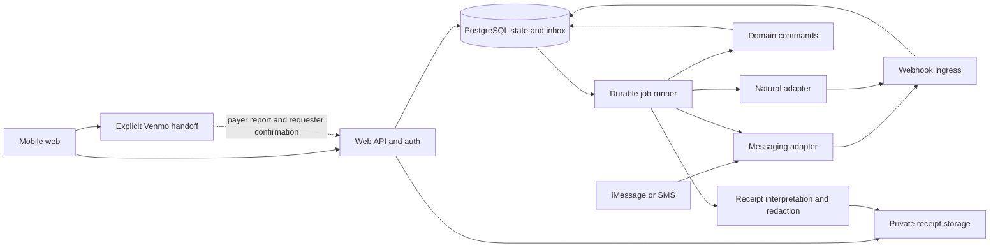
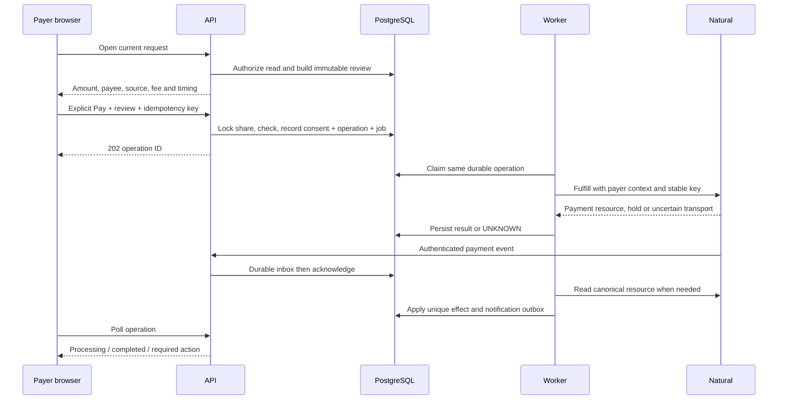

# Peer Payments — Living Technical Design

**Version:** 0.3 · **Updated:** September 26, 2026  
**Status:** Persistent accounts/passkeys, contacts/invitations, real expense records, and durable Messages workflows are implemented with local verification. Four runtime roles and Docker/Render/S3 deployment artifacts are prepared. Natural money movement, hosted/device verification, HEIC, and full redacted image sharing remain gated. See the implementation tracker for current evidence.  
**Product authority:** [Product requirements](payments-prd.md)  
**Companions:** [Decisions](technical/decision-log.md) · [Verification register](technical/verification-register.md) · [Build tracker](technical/implementation-tracker.md)

## 0. How to use this document

This is the engineering reference for the web app, iMessage agent, and payment backend. The PRD defines the experience; this document defines how to implement it and what must be true before it handles money. A selected design is not evidence that a vendor supports it or that code exists.

Use these labels consistently:

- **Selected:** the default implementation decision, including its tradeoff.
- **Documented:** checked against current primary documentation; live behavior still needs validation.
- **Locally tested:** exercised by the attached design models or database experiments.
- **Integration pending:** needs credentials, partner confirmation, or a real device.
- **Implemented locally:** code exists and has linked implementation-test evidence; this does not imply a merged, deployed or production-ready release.

Every material implementation change should update the affected section, its decision record, and the build/verification rows in the same change. Give new decisions and checks stable IDs. Preserve superseded decisions with a replacement link; do not silently rewrite the reasoning. Record actual versions, deployment names, owners, and test dates as they become known. Do not put secrets, live receipts, identity documents, or customer data in these files.

**Reading order:** Sections 1–4 establish the system; 5–10 define money and consistency; 11–15 cover product channels and access; 16–20 cover operations, tests, and delivery.

## 1. Technical direction

Build a **modular monolith** in TypeScript with four runnable roles: Next.js web/API, core maintenance, receipt processing, and messaging. Shared `packages/app-services` connects account, social, receipt, and messaging commands; web and chat do not maintain separate expense records. PostgreSQL owns product state, operation identity, and durable work. The launcher filters secrets per role, and the prepared hosting topology gives each role a separate container. Least-privilege PostgreSQL roles remain a deployment hardening task; the prepared Blueprint still uses one database owner credential.

Natural remains the intended authority for actual balances and money movement, but its sandbox/program access and integration are pending. The real-account app records obligations without activating any financial operation. Receipt AI proposes structured values; deterministic application services validate commands and exact allocations. Current conversation handling uses an explicit intent grammar, not model-issued payment tools.

The hard requirement is that a retry, webhook, stale message, or model output cannot independently authorize another payment. Financial correctness comes from stable identities, immutable approvals, serialized state changes, provider idempotency, and reconciliation together. A queue alone cannot provide this guarantee.

### 1.1 Scope translated into architecture

| Product requirement                     | Technical consequence                                                                                                     |
| --------------------------------------- | ------------------------------------------------------------------------------------------------------------------------- |
| Receipt sent in iMessage or web         | Both adapters call the same expense commands; neither owns a separate expense ledger                                      |
| Ask split method for each expense       | Explicit method choice and its source are stored with the draft/revision                                                  |
| Automatically send complete requests    | Publish command can run after an unambiguous user instruction; debits use a different authorization path                  |
| Every transfer approved by its payer    | Immutable review/consent record, authenticated POST, durable operation                                                    |
| Ad hoc multiple participants; no groups | Expense-scoped participants and independent shares; no group balances or cross-expense offsets                            |
| Signup primary, Venmo secondary         | Guest invitation/read permissions separate from financial account activation; external settlement has separate provenance |
| Full redacted receipt and all shares    | Explicit expense participant authorization, safe image derivative, no public receipt URLs                                 |
| Fast onboarding                         | Phone identity, financial connection, bank setup, and messaging consent are separate state machines                       |
| Premium experience                      | Server-derived next actions, preserved drafts, precise pending states, no fabricated success                              |

### 1.2 Initial operating assumptions

Design for a private beta of 30–50 people, with headroom for roughly 1,000 weekly active users and bursts of 10 API requests/second. These are sizing hypotheses, not measured demand. USD only; integer minor units. Start with one production region in the US. Provider limits and eligibility override app limits.

Initial design envelopes were 20 participants per expense, 200 receipt lines, 20 MiB and 40 megapixels. The implemented September 26 receipt spike deliberately narrows capture to 100 lines, 8 MiB, 24 megapixels, one image per draft, JPEG/PNG/WebP only, ten uploads per workspace per UTC day, fifty globally, and eighty global provider attempts per day. HEIC/PDF are not accepted yet. Validate these limits against real dinner/grocery images and iMessage media behavior before committing them to UI copy. Use a server configuration for per-payment/daily limits; **live payments stay disabled until the approved program limits are entered**. Never interpret an unset limit as unlimited.

## 2. Stack and tradeoffs

| Layer                  | Selected design                                                                                                | Why / cost / reconsider when                                                                                                                                                                                                                                                                         |
| ---------------------- | -------------------------------------------------------------------------------------------------------------- | ---------------------------------------------------------------------------------------------------------------------------------------------------------------------------------------------------------------------------------------------------------------------------------------------------- |
| Language/runtime       | TypeScript strict mode; Node.js 24 LTS family                                                                  | Shared schemas and money rules across processes. Pin exact supported patches at bootstrap; no floating production versions. [Node release policy](https://nodejs.org/en/about/previous-releases)                                                                                                     |
| Web/API                | Next.js App Router, React, explicit REST route handlers                                                        | One deployable serves the mobile web app and API. Domain code stays independent of React/Next. Native clients can reuse REST later. Next supports self-hosting; private pages require explicit cache discipline. [Self-hosting](https://nextjs.org/docs/app/guides/self-hosting)                     |
| Database               | Managed PostgreSQL 17; typed SQL through Kysely; reviewed SQL migrations                                       | Transactions, foreign keys, uniqueness, and row locks are a good fit. Migrations remain inspectable. Check selected hosting support and pin a patched 17.x before deployment.                                                                                                                        |
| Async jobs             | Implemented application-owned PostgreSQL job/inbox/outbox tables, leases and `SKIP LOCKED`                     | Business IDs and transactional reservations protect retries. This supersedes the initial Graphile selection for the current release (ADR-023); maintaining lease/fairness/recovery code is the accepted cost. Graphile remains an option if measured operations justify migration.                   |
| Authentication         | Implemented Better Auth 1.7.6 sessions and maintained passkey plugin; Sendblue reverse-OTP bridge              | Signup requires a passkey before private collaboration access. Existing-account recovery needs fresh phone proof plus a saved one-use recovery code. Local cryptographic tests pass; supported devices/final-domain behavior remain gates. [Identity integration](technical/identity-integration.md) |
| Payments               | Planned Natural adapter; real-account money actions disabled                                                   | Natural sandbox and consumer P2P approval remain prerequisites. Synthetic payment evidence belongs only to the explicit demo.                                                                                                                                                                        |
| Messaging              | Implemented Sendblue adapter, encrypted durable inbox/outbox and draft state                                   | Canonical provider verification, expiring session-bound grants, explicit methods and permanent publication identity; actual routing, media and delivery still need a consented hosted/device test. [Messages integration](technical/messaging-integration.md)                                        |
| Receipt interpretation | One vision extraction provider behind `ReceiptInterpreter`                                                     | Pick the model using a consented/synthetic receipt evaluation set. No model receives money-execution credentials. Store parser/prompt/schema versions.                                                                                                                                               |
| File storage           | Implemented private local/S3 adapters; S3 required for prepared hosting                                        | Fixed source/normalized prefixes, conditional source writes, per-role object permissions, and bounded cleanup. SDK mocks verify contracts; no live AWS bucket is provisioned or tested. [Storage deployment](technical/deployment-storage.md)                                                        |
| Hosting                | Prepared paid Render web, maintenance, receipt and messaging services plus managed PostgreSQL in one US region | One Dockerfile, four service commands; separate containers and provider credentials. No hosting has been provisioned. Native ARM64 container build/runtime passed; native AMD64 target validation remains open. [Deployment guide](technical/deployment.md)                                          |
| UI data                | Implemented bounded polling and React state; authenticated reloadable draft/detail routes                      | Abort stale-account requests, preserve retry identities, and refresh after mutations. TanStack Query remains an optional cache refactor; durable chat drafts live on the server.                                                                                                                     |
| Testing                | Vitest/fast-check, real PostgreSQL integration tests, Playwright                                               | Pure money properties, genuine DB concurrency, browser journeys. Python design models accompany this document but do not replace implementation tests.                                                                                                                                               |
| Observability          | Structured logs + OpenTelemetry; selected error/trace sink at bootstrap                                        | Vendor-neutral correlation. Redaction is applied before export; raw requests and replay recordings are off on financial pages.                                                                                                                                                                       |

**Alternatives considered:** microservices add distributed consistency and deployment overhead too early; an all-serverless backend complicates durable long-running reconciliation; Firebase-style document storage makes relational payment invariants harder; Redis/SQS plus PostgreSQL introduces a second durability boundary before it is necessary; Temporal is attractive if workflows later span many providers and weeks of human steps. Record a new decision before making those transitions.

Rows marked implemented describe current code; other entries remain selected targets. Exact dependency versions are in the lockfile, and the Docker base is digest-pinned. OpenTelemetry, full financial adapters, and deployed least-privilege database roles are not implied by the current build. Record the release commit/image digest and run dependency/security checks before deployment.

## 3. System boundaries and deployment

The following diagram is the **target payment architecture**. Natural execution, Venmo settlement confirmation, and participant image redaction are not enabled by the current real-account implementation. The current four-role boundary is described in section 3.2 and the dated implementation snapshot below.



No line from AI, browser, or inbound message goes directly to a payment API. Web/API enqueues approved operations; the worker executes them with a server-only provider credential. A Natural webhook entering `H` is verified by its own verifier, not the messaging verifier.

### 3.1 Implemented repository layout

```text
apps/web/                  Next.js screens, REST handlers, account/auth endpoints
apps/worker/               maintenance; payment simulation only in demo mode
apps/receipt-worker/       bounded image decoding, extraction, receipt cleanup
apps/messaging-worker/     durable message intake, drafts and delivery
packages/domain/           integer-cent allocation and financial state rules
packages/db/               SQL migrations, demo repositories and DB infrastructure
packages/identity/         persistent identities, passkeys, recovery and assurance
packages/social/           contacts, invitations, participant expenses and claims
packages/channels/         Sendblue Verify adapter and earlier demo phone test
packages/messaging/        message transport, grants, encrypted inbox/outbox/drafts
packages/app-services/     shared account/receipt/social/messaging orchestration
packages/receipts/         extraction jobs, validation, local/S3 storage
scripts/run-service.mjs    role-specific process configuration and secret filtering
Dockerfile, render.yaml    prepared container build and hosted topology
docs/                      product, design, integration and verification records
```

Browser-safe contracts live alongside their domain packages; provider/server modules remain outside browser imports. Natural adapters, expanded observability, guest sessions and redacted derivatives remain planned. The domain layer does not import Next.js, messaging or LLM SDKs. Runtime validation protects external boundaries; TypeScript alone does not validate JSON.

### 3.2 Process permissions

| Role             | Implemented responsibilities                                                                                               | Credential boundary                                                                                                                        |
| ---------------- | -------------------------------------------------------------------------------------------------------------------------- | ------------------------------------------------------------------------------------------------------------------------------------------ |
| Web/API          | Account sessions, passkeys/recovery, social commands, owner receipt upload/preview, messaging ingress and channel controls | Auth/identity/messaging keys, Sendblue verification and callback configuration, source-write/normalized-read S3 permissions; no OpenAI key |
| Core maintenance | Expired identity/phone-proof cleanup; the financial simulator runs only in explicit demo mode                              | Database and app configuration; no external provider or S3 credentials                                                                     |
| Receipt worker   | Durable extraction jobs, bounded normalization, OpenAI interpretation and expiry cleanup                                   | OpenAI key and source-read/normalized-write/delete S3 permissions; no identity, Sendblue or payment keys                                   |
| Messaging worker | Canonically verified inbox processing, chat drafts, social publication, receipt media intake and consent-checked outbox    | Sendblue, identity/messaging keys and source-write S3 permission; no auth-cookie secret, Verify service SID or OpenAI key                  |

These roles share one repository and build but run as separate services in the prepared Docker/Render deployment. Local launches still share an OS user and database role. Environment filtering limits accidental key exposure; it is not an OS or SQL sandbox. The Blueprint also still uses the database owner credential for each service. Separate runtime database grants and migration credentials remain required hardening before live financial operation.

The original three-role design combined future payment and message credentials in the core worker. ADR-023 supersedes that arrangement now that Messages has its own durable workflow. Natural credentials are not configured in any role. See the [deployment matrix](technical/deployment.md) and [storage IAM policies](technical/deployment-storage.md) for exact configuration.

## 4. Core identity and data model

### 4.1 Identity hierarchy

An app `user_id` is an immutable identifier. A phone number is a verified, time-bounded contact method. A Natural `customer_party_id` is a provider identity. A wallet ID is a funding destination. A messaging handle identifies a transport conversation. These are different objects and must never be substituted for each other.

For an invited person, create an expense-specific participant before an app user exists and bind it to the intended phone fingerprint. The implemented flow requires an explicit intended number; name-only claim and guest-session variants are deferred. After enrollment, link the participant to the verified user without changing historical allocations. A new owner of an old phone number must not inherit the old user, receipts, or Natural connection.

Within an expense, resolve two aliases/numbers mapping to the same verified user before publication; do not send duplicate shares to one person accidentally. If duplicate identities are discovered during later invitation claims, freeze the affected claims/requests for an explicit corrected allocation rather than merging financial history automatically.

### 4.2 Tables and important constraints

This table is the **target financial schema**, not an inventory of applied table names. Current real accounts use `auth_user` and `identity_*`; contacts/obligations/invites use `social_*`; chat uses `message_*`. Their exact schemas and migrations are linked in the [identity](technical/identity-integration.md), [social](technical/social-integration.md) and [messaging](technical/messaging-integration.md) guides. They remain separate from demo financial tables, and guest sessions/real provider operations are not implemented.

All tables carry IDs, UTC timestamps, and explicit environment/provider account scope where applicable. Internal UUIDs are opaque identifiers, not authentication secrets. Use integer `bigint` cents and serialize amounts as decimal strings over JSON to avoid precision loss. Currency is `USD` internally; adapter converts provider casing.

| Table                                      | Purpose / constraints                                                                                                                                |
| ------------------------------------------ | ---------------------------------------------------------------------------------------------------------------------------------------------------- |
| `app_users`                                | Immutable user ID, lifecycle state, display name; auth-library identity linked uniquely                                                              |
| `contact_identities`                       | User, encrypted E.164/email as needed, keyed lookup hash, verified_at, revoked_at; one active binding per verified channel; audited recovery         |
| `friend_relationships`                     | Owner user, confirmed other user, private alias, block state; unique directional pair                                                                |
| `payment_connections`                      | User, provider environment/account, customer party, wallet, permission snapshot, state, last verified time; unique active party ownership            |
| `conversations`                            | User or provisional identity, provider account, assigned sending number, external thread identity, consent version, active draft context             |
| `receipts` / `receipt_derivatives`         | Storage keys, media hashes, processing/version state, redaction approval/safety state, retention policy; original never served as fallback           |
| `expenses`                                 | Original payer, draft version, current published revision, lifecycle; direct requests can have a manual expense                                      |
| `expense_revisions`                        | Immutable total, purpose, method, rule version, extraction snapshot, published_at; unique `(expense_id, revision)`                                   |
| `expense_participants`                     | Stable participant/invite identity; optional linked user; receipt-access policy                                                                      |
| `allocations`                              | Revision, participant, amount, item/rule explanation; unique revision/participant; all allocations include original payer and sum to total           |
| `share_accounts`                           | Stable expense/participant/original-payer relationship; one per non-self participant; serialization point across revisions and adjustment directions |
| `obligation_versions`                      | Proposed/requested exact debtor, creditor, amount, revision, purpose, adjustment origin; immutable financial tuple; belongs to one share account     |
| `collection_lanes`                         | At most one active collection/recovery path per share account across **all** revisions; survives timeouts and external handoffs                      |
| `provider_requests`                        | Natural request ID, customer scope, obligation version, decoded status/version, linked payment; one provider resource row per environment/ID         |
| `payment_reviews`                          | Exact financial tuple/source/fee/timing snapshot, digest, expiry, eligibility snapshot; no authority to execute until consent                        |
| `payment_consents`                         | Payer, review digest, session/assurance evidence, auth time, terms/policy version, approval time, one consumed operation                             |
| `operations`                               | Durable logical mutation: create request, fulfill, direct pay, cancel, deposit, withdraw; immutable payload digest and provider idempotency key      |
| `operation_attempts`                       | Transport attempt timestamps/result class; many attempts can refer to the same logical operation/key                                                 |
| `provider_payments` / `provider_transfers` | Canonical resource state and version; independently tracks completion, return, funds availability                                                    |
| `settlement_events`                        | Append-only financial effect on one share account: payment, return, external confirmation, correcting reversal; original event reference             |
| `external_handoffs` / `external_reports`   | Exact Venmo destination/amount/revision, handoff status, report/confirmation actors; manually confirmed provenance                                   |
| `invitations` / `guest_sessions`           | Hashed high-entropy tokens, intended identity, expiry, scopes, revocation, limited participant binding                                               |
| `webhook_inbox`                            | Verified raw-body reference/hash, provider/event identity, receipt time, parse/processing state; deduplication before work                           |
| `notification_outbox`                      | Recipient, logical notification key, template version, state, provider handle; no financial retries coupled to delivery                              |
| `audit_events` / `support_cases`           | Append-only actor/action/reason references; restricted operational repair workflow                                                                   |
| `api_idempotency`                          | Actor + endpoint + client key + body digest + operation/result; same key with different content is a conflict                                        |

Use foreign keys with restrictive deletes for financial references. Financial records are not cascade-deleted when someone closes an account. Keep auth-library tables separate from domain migrations and never edit their internal session format manually.

### 4.3 Constraints beyond single-row checks

An SQL `CHECK` cannot establish that all allocation rows add up to an expense total. The publish transaction locks the expense, checks its expected draft version, loads and validates every allocation, then inserts immutable revision/obligation records together. A deferred constraint trigger may provide defense in depth once schema shape is final; it must be tested on real PostgreSQL. Enforce write access through reviewed repositories/stored functions.

At minimum, database constraints enforce unique operation IDs, provider keys, provider resource IDs, inbox event IDs, and one active lane per share account. Enforce `UNIQUE(consent_id)` on debit-execution operations as well: a different client/provider idempotency key cannot reuse an approval, including direct sends and withdrawals that have no expense share. A partial unique index can support `UNIQUE(share_account_id) WHERE released_at IS NULL`. Row locks on the stable share account serialize transitions; a revision ID alone cannot enforce this rule. Transaction isolation and locks must be tested under concurrent sessions. [PostgreSQL isolation](https://www.postgresql.org/docs/current/transaction-iso.html)

Store provider status strings as validated text with an explicit unknown-state path, rather than allowing a newly added vendor enum to crash ingestion or be treated as success. Unknown statuses freeze new money actions for the affected resource and trigger reconciliation.

## 5. Money model and immutable history

### 5.1 Three distinct views

1. **Expense allocation:** what each participant's fair share is under a published revision.
2. **Settlement history:** what has actually transferred or was manually confirmed outside the app, including later returns.
3. **Provider balance:** what Natural says is available or pending in a wallet.

Do not add expected reimbursements to wallet balances. Our settlement journal is a record of obligations and observed movements; it is not a custodial bank ledger. A full double-entry cash ledger becomes necessary if the product later holds or controls pooled customer funds, which this MVP excludes.

### 5.2 Calculation rules

Use a pure, versioned calculation package. Parse decimal input directly into integer cents; never compute `parseFloat(value) * 100` for authoritative money. Reject excess decimal precision and unsupported currency. Use exact rationals or integer division with remainders for allocation, including proportional tax/tip/discount rules.

Allocate a shared item's line total among assigned participants, preserving quantities. Then allocate receipt-level adjustments according to the explicit rule. Apply largest-remainder rounding with a stable participant-ID tie-breaker and persist the tie-breaker order. The algorithm version is part of the published revision; an upgrade cannot alter old shares.

For $60 food, $30 wine, $9 tax, $18 tip, with Maya excluded from wine: net items are Alex $35, Maya $20, Leo $35. Proportional $27 tax/tip gives **$45.50, $26, $45.50**. Requests total $71.50, not the $117 receipt. An equal $10/3 allocation is $3.34/$3.33/$3.33 in the stored stable order.

The calculation result includes explanations and unresolved fields, not just totals. Redaction failure can block publishing a receipt while allowing draft calculations. An unreadable tip is not zero; a receipt total including service charge must not get the charge twice. Price/quantity/discount inconsistencies require correction rather than a fabricated balancing line.

### 5.3 Corrections, refunds, and returns

For one expense participant, let `A` be the latest explicitly published allocation and `C` the signed sum of confirmed settlement effects: participant→original payer positive, reverse payments negative, verified returns reverse their original effect. The residual `R = A - C` explains the next proposed collection or repayment. **It never authorizes it.** No offsets cross participants or expenses.

Example: a $30 share paid in full is corrected to $20. Preserve the $30 payment and propose a $10 repayment by the original payer, requiring that payer's approval. If that $10 repayment completes and the original $30 later returns, `C = -$10`, so the remaining amount due is $30; the allocation itself remains $20. Flag the situation for explicit review rather than auto-collecting.

Corrections lock affected share accounts in stable ID order. Unknown/held/processing operations block conflicting corrections. Cancel existing OPEN provider requests conclusively before replacements. A settlement effect is unique by canonical payment ID and effect kind; a return references the original effect and cannot reverse more than its remaining unreversed amount. Multiple actor views of one payment do not count twice. External confirmation has an external-report ID and is never relabeled provider-verified.

The initial return model assumes one provider-confirmed full return per payment. Verify that shape in the integration gate. If the provider supports partial/multiple returns, extend effect identity to the canonical return/effect ID or an explicitly tested cumulative-delta projection. Never key multiple return effects only by `payment_id + returned`, and never reverse the full original amount from an ambiguous partial event. Unsupported return shapes retain a reconciliation issue until their economic effect is known.

After a return, a previously settled share may reopen. Append history and show a neutral issue/update to other participants; keep the funding failure reason private. Do not reinterpret late events using a simplistic global status rank in which `paid` can never change.

## 6. State machines and concurrency invariants

### 6.1 State is multidimensional

Keep draft/publication state, collection lane, provider request state, operation outcome, and notification delivery separate. One giant `payment_status` column cannot represent an unpaid request with a failed notification, or a completed payment whose funds are pending withdrawal.

| Aggregate        | Internal states / interpretation                                                                                                                                 |
| ---------------- | ---------------------------------------------------------------------------------------------------------------------------------------------------------------- |
| Receipt          | `quarantined → decoding → extracting → review_needed/ready`; redaction has its own ready/blocked state                                                           |
| Publication      | `draft → preparing → published/partially_dispatched`; corrections have prepare/cancel/rebase/commit states                                                       |
| Collection lane  | `natural_request`, `natural_payment`, `switching_external`, `external_open`, `external_reported`, `reconciliation_required`; one unreleased lane per share       |
| Operation        | `prepared → dispatching → accepted/unknown/rejected`; accepted may then be held/processing/completed/failed/returned on its provider resource                    |
| Provider request | Preserve documented `OPEN`, `PROCESSING`, `COMPLETED`, `FAILED`, `RETURNED`, `CANCELED`, `DECLINED`, `EXPIRED`; unknown value is quarantined                     |
| Provider payment | Preserve `CREATED`, `IN_REVIEW`, `PROCESSING`, `COMPLETED`, `FAILED`, `RETURNED`, `APPROVAL_DENIED`, `CANCELED`; `PENDING_CLAIM` is unsupported for new P0 sends |
| External report  | `reported → requester_confirmed/disputed`; manual correction is an appended event                                                                                |
| Message          | `planned → dispatching → accepted/sent/delivered/failed/delivery_unknown/suppressed`; SMS may not reach delivered                                                |

Documented Natural states are mapped in the [payment audit](research/natural-technical-audit.md). A local operation can be transport-complete while the resulting payment is still processing. `unknown` means evidence is missing; `failed` means authoritative evidence says no successful effect or a documented failed resource exists. They are never interchangeable.

### 6.2 Invariants

| ID     | Must always hold                                                                                                                            |
| ------ | ------------------------------------------------------------------------------------------------------------------------------------------- |
| INV-01 | Published allocations sum to the exact receipt total; self-share never creates a request                                                    |
| INV-02 | Every debit has authenticated payer consent for an immutable amount, currency, destination, source, fee policy, and current request version |
| INV-03 | One active collection lane per stable share account across all revisions and both correction directions                                     |
| INV-04 | Unknown, held, processing, or cancel-pending outcomes retain exclusivity; elapsed time alone never releases it                              |
| INV-05 | Each logical provider mutation has one durable operation ID, actor, immutable payload, instance ID, and idempotency key                     |
| INV-06 | One canonical payment effect is journaled once, even when both connected parties produce different event IDs                                |
| INV-07 | A returned payment reverses only its original recorded effect; prior facts remain visible                                                   |
| INV-08 | A notification retry cannot create or retry a financial action                                                                              |
| INV-09 | Preview GET/HEAD, chat reactions, LLM output, redirects, and webhook arrival cannot authorize a debit                                       |
| INV-10 | External payment report/confirmation is distinguishable from a provider payment; later signup cannot re-request a resolved share            |
| INV-11 | Every protected query and object download checks the current principal and participant ACL                                                  |
| INV-12 | Missing provider actor/source, fee policy, or unresolved identity fails closed before dispatch                                              |

### 6.3 Transaction strategy

Use short `READ COMMITTED` transactions with explicit `SELECT ... FOR UPDATE` on the stable aggregate and unique constraints as the final defense. Lock multiple expense/share records in a documented consistent order: expense first when needed, then share accounts sorted by UUID. Never hold a database transaction open over a provider network call. Re-run a transaction from the beginning after an allowed deadlock/serialization retry; do not retry an external side effect as part of a transaction callback.

Commands record an immutable operation, reserve/change the collection lane, append an audit event, and enqueue the job **in one transaction**. The worker briefly locks the operation, obtains a dispatch lease/fencing generation, commits, calls the provider, then records the response in another transaction. The lease helps coordinate workers; it is not proof that the original network call stopped when the lease expired. A restarted worker reconciles or reuses the same provider key. It cannot create a new key to take over.

Notification or AI jobs may retry independently. Financial jobs use explicit retry classification, not the queue's generic retry policy as their business policy. The sweeper finds persisted operations/inbox rows with missing/stuck jobs and safely re-enqueues by operation ID. Graphile job replacement while a job is locked can create another job, so queue deduplication is never the money invariant. Use a small bounded set of queue names, not one queue per user. [Graphile enqueue semantics](https://worker.graphile.org/docs/sql-add-job)

### 6.4 Publishing and correcting an expense

Initial publication is atomic locally: freeze the revision/allocations, create stable share accounts and obligations, and queue one create-request job for each eligible enrolled participant. Unenrolled participants stay invitation-only. Remote request creation is a **partial-progress workflow**, not an all-or-nothing distributed transaction. Report exact success/pending/failure per share; retry only an existing missing operation. A failed third request does not cancel two valid earlier ones automatically.

Correction is a staged workflow:

1. Prepare a proposed full allocation snapshot against an expected expense version; calculate and show each person's difference.
2. Under aggregate locks, freeze affected lanes for correction and create cancellation operations for their OPEN requests. Unaffected shares retain history and can continue only if the change cannot affect their amount/identity.
3. Wait for canonical cancellation results outside the database transaction. A payment winning the race requires rebase against the new settlement evidence; do not publish stale replacement amounts.
4. Atomically commit the new allocation revision once all affected lanes are safe. Then queue permitted replacement requests or explicit repayment proposals.
5. If preparation is abandoned after some cancellations, retain accurate canceled states and offer a new request for the unchanged intended amount where safe. Never “uncancel” a provider request locally.

## 7. Payment authorization and execution

### 7.1 Review and consent

The server creates a short-lived `payment_review` from canonical state. Proposed review TTL: five minutes. It includes payer/payee app IDs, server-resolved provider identities, amount/currency, request ID and revision, source reference/version, known fee policy, total debit, expected availability text, and permitted next action. A digest is computed over canonical serialization; the client never supplies the authoritative financial tuple.

**Null is not free.** Natural's event catalog allows fees to be unknown until completion. Before showing a final total, the approved consumer program must provide a fixed fee schedule, an enforceable zero-fee arrangement, or a supported quote. If the application absorbs a known provider fee, record that policy. A material fee or source change invalidates the review and requires fresh consent. [Natural event catalog](https://docs.natural.com/api-reference/event-catalog)

The final `POST /v1/payment-reviews/{id}/authorize` carries review digest, client idempotency key, and any required reauthentication grant. The server locks the share/operation, checks current review/version/identity/connection/limits, consumes the grant once, stores consent, reserves the lane, and enqueues. Return `202` plus the operation ID and current truthful state. Repeated submissions with the same key and body return the same operation; changed content returns `409`.

Passkey authentication proves control of an account credential. It does not automatically mean an authenticator displayed or signed the payment amount. The server binds a recent, one-use assurance grant to the review and records the explicit **Pay $26** action. Do not claim cryptographic transaction signing unless a separately implemented and verified ceremony actually binds the transaction that way.

### 7.2 Normal request fulfillment



Immediately before first dispatch, revalidate that consent is still eligible, delegation is active, the request/source match, and no kill switch or conflicting state applies. An operation that has already been submitted may outlive review expiry; reconcile it rather than interpreting expiry as cancellation. An approved operation never submitted before its dispatch deadline expires without a debit and returns to fresh review.

### 7.3 Direct sends, deposits, and withdrawals

Direct sends require an enrolled verified recipient and documented wallet funding. First resolve whether the instruction refers to an existing request; ambiguous overlap asks the user. A newly created direct transfer is not automatically matched against an open debt by equal amount/name.

Direct transfers, wallet deposits, and withdrawals each have their own review, consent, immutable operation, deduplication, and unknown-state recovery. They do not use an expense lane unless explicitly fulfilling an expense-linked repayment. Deposit completion does not authorize a later saved send. Withdrawal reads current provider **available** balance and destination ownership; cached UI balance is informational. Never create a pooled platform balance to hide delays.

Concurrent direct sends/withdrawals can race for wallet funds. Reserve local pending amounts under a wallet-action lock to reduce avoidable failures, but do not pretend that reservation controls spending outside the app. Natural remains final authority; failure/hold paths preserve the operation and show current availability. Apply actor-wide app velocity checks under the same consistent locking policy.

### 7.4 Retry classification

| Observation                                       | Action                                                                               |
| ------------------------------------------------- | ------------------------------------------------------------------------------------ |
| Validation/authorization rejected before dispatch | Correct inputs or setup; no assumed money movement                                   |
| Documented terminal provider rejection            | Store failure; a later new attempt needs supported recovery and fresh consent        |
| Timeout, connection loss, 5xx, ambiguous conflict | Keep unknown/reserved; inspect canonical resource and same-key behavior              |
| Same-key in-progress conflict                     | Reconcile/back off; do not generate a new key                                        |
| Same-key payload mismatch                         | Treat as programming/integrity incident; stop affected path                          |
| Rate limit                                        | Respect retry hint with jitter; retry only while safe under same immutable operation |
| Confirmed completion then return                  | Append reversal; reopen correct obligation through the recovery policy               |
| Unknown beyond safe idempotency window            | Stop mutation retries; retain lock and escalate for positive resolution              |

Natural retains idempotency records for 48 hours after terminal outcome. Since the terminal time can be unknown, set a conservative automatic mutation cutoff **before 48 hours from first submission**, with a configured safety margin; initial proposal 47 hours. Never reset this clock on a process restart. Permanent local dedup prevents new app operations but cannot make a provider's expired key safe. The documented API does not provide a general “lookup by idempotency key” endpoint. [Idempotency](https://docs.natural.com/api-reference/idempotency)

Natural requests permit one fulfillment attempt. A consumed request is never retried with a new key. If the payment fails/returns, issue a fresh request only after the provider-approved recovery rule has been verified, with the same stable obligation context and new payer approval.

## 8. Natural adapter and reconciliation

### 8.1 Consumer actor is mandatory in our interface

```ts
type ConsumerContext = {
  appUserId: string;
  customerPartyId: string;
  delegationId: string;
  connectionVersion: number;
};
type MutationIdentity = {
  operationId: string;
  idempotencyKey: string;
  instanceId: string;
  immutablePayloadDigest: string;
};
// Illustrative internal interface, not a claim about SDK method signatures.
interface PaymentProvider {
  createRequest(
    actor: ConsumerContext,
    request: ApprovedRequest,
    op: MutationIdentity,
  ): Promise<RequestSnapshot>;
  fulfillRequest(
    actor: ConsumerContext,
    payment: ApprovedFulfillment,
    op: MutationIdentity,
  ): Promise<PaymentSnapshot>;
  cancelRequest(
    actor: ConsumerContext,
    requestId: string,
    op: MutationIdentity,
  ): Promise<RequestSnapshot>;
  getRequest(actor: ConsumerContext, requestId: string): Promise<RequestSnapshot>;
  getPayment(actor: ConsumerContext, paymentId: string): Promise<PaymentSnapshot>;
}
```

Request creation/cancellation acts for the original requester. Fulfillment acts for the payer. Direct pay/deposit/withdraw acts for the customer whose funds move. The browser provides an app-owned source handle; the adapter resolves actual wallet/bank IDs from that user's current connection. Missing `customerPartyId` is rejected locally because omission can select platform context. Supply a stable `X-Instance-ID` on agent money operations even though the generic schema marks that header conditionally optional. [Customer operations](https://docs.natural.com/guides/connect/move-money-for-customer), [authentication](https://docs.natural.com/api-reference/authentication)

Maintain separate validators for REST resources and webhook objects. REST amount/status fields and webhook `amount.minorUnits`/status casing differ. Normalize raw provider state, currency, amount, resource ID, actor-view provenance, linked IDs, and source-specific freshness fields. Catalog webhook objects expose a version; reviewed REST payment/request objects expose updated timestamps without the same numeric version. Make provider version optional and never fabricate one from local row order. Do not overwrite sender-only fields with nulls from a recipient view. Reject mismatched actor/amount/payee/request responses and reconcile; never merely trust an HTTP success code.

### 8.2 Webhook inbox

Natural uses Standard Webhooks headers and raw-body verification. Validate timestamp and signatures with the maintained verifier, using overlapping rotation keys where supported. Register connected-customer event sources explicitly; own-only defaults are insufficient. [Webhooks](https://docs.natural.com/guides/webhooks/receive-events)

The handler enforces body limits, verifies raw bytes, inserts a durable inbox record and processing job in a transaction, then returns 2xx. If durable storage is unavailable, return a retryable error. A duplicate verified event returns success after finding the original persisted record. Valid unknown event types are stored/quarantined; invalid signatures never enter the trusted inbox.

Ingestion uniqueness is provider environment/account + event ID. An existing event ID with a different raw payload hash is quarantined as an anomaly rather than silently accepted as the original. Financial projection uniqueness is canonical payment ID + effect identity. Distinct actor events can legitimately describe the same movement. Request failed/returned event names must not be invented; reconcile linked payment events and current request state according to the current catalog. Record event version, received time, provider event time, and processing time separately.

### 8.3 Scheduled reconciliation

Initial schedules, to tune against provider limits:

- Unknown submissions: exponential polling starting at seconds and capped at several minutes; alert when unresolved for five minutes, without changing state to failed.
- Held/processing/open active resources: poll by priority and age; waiting for an ordinary ACH completion is not itself an incident.
- Recently completed return-capable payments: reconcile for the provider-agreed return window; its length is a launch configuration dependency, not an invented constant.
- Daily: compare active app obligations against provider requests/payments and inspect inbox/outbox gaps.
- After outage/revocation recovery: backfill documented event history by customer and event type, with overlapping windows and deduplication. Never advance a watermark until all pages for that range are durably processed.

Resource IDs are the best recovery keys. For a lost create response, use verified metadata/canonical listing to locate the operation; listing may require paginated scans because server-side tag filters are not documented. A scan that finds nothing does not prove the call failed. Stop and ask provider support for positive resolution when evidence is insufficient. Preserve unresolved records after delegation revocation; lack of permission to read is not a canceled payment.

Reconciliation emits a discrepancy with expected/observed state and a safe proposed action. Support cannot mark a Natural payment paid by editing a column. Any manual external confirmation is a different journal event with a reason and actor.

Fence reconciliation reads as well as writes: allocate a per-resource reconciliation generation before a network read and apply its result only if that generation is still current under the resource lock. Newer authoritative observations invalidate in-flight older reads. A stale GET completing later cannot regress a completed/returned state, release a lane, or add another journal effect. Unknown/conflicting freshness triggers a new canonical read and transition validation; timestamps and a global enum rank alone are insufficient. Restored processes cannot reuse an old lease as proof of freshness.

The latest local generation proves only that a response has not been superseded locally; the provider can still serve an old snapshot. Independently validate provider versions when present and permitted transitions, retaining stronger established evidence when a later fetch conflicts.

## 9. Venmo and external settlement

Venmo prefill remains an empirical integration requirement, not a verified public P2P API guarantee. Store a requester-confirmed handle/profile and version. Derive allowed URLs server-side; reject arbitrary schemes/hosts and never put receipt tokens or sensitive text in the note. Show the destination before the user taps. See [Venmo evidence](research/channel-identity-audit.md).

### 9.1 Switching payment paths

`POST /v1/obligations/{id}/external-handoffs` validates actor/guest scope, expected version, destination, and current lane. Under the share lock, reserve `switching_external`. If an OPEN Natural request exists, enqueue its cancellation under requester authority. This app-authorized cancellation policy is distinct from allowing the payer to issue arbitrary provider cancellations. Do not return a usable Venmo destination until canonical cancellation succeeds. A concurrent fulfillment that wins keeps the lane in Natural processing and blocks the handoff.

When safe, change the lane to `external_open`, return the current destination/amount/note, and record the handoff. A guest invitation can take this path with no Natural request/account using its limited handoff capability. Even for a guest, reveal the app-generated destination only after this explicit POST and lane check; do not put a static pay link in public metadata or bypass the cancellation gate. Canceling an existing enrolled request requires payer authentication. A forwarded link never grants full participant or account rights.

When the handoff is unresolved, pause collection/reminders. **I paid** requires a verified scoped payer and creates `external_reported`; requester confirmation records a full external payment effect. **I didn't pay** records that explicit assertion, releases the external lane if no report exists, and allows fresh Natural review/request creation. Do not automatically expire a handoff into a new collection path after a timeout.

An old exported Venmo URL can still be paid independently; no server lock can prevent that. The app guarantees serialized app actions, not exactly-once external settlement. Edited/partial amounts, reports disputed by the requester, and possible double payment enter the issue workflow. No provider-verified badge is shown for manual confirmation. An app-only invitation already externally settled stays settled after signup.

### 9.2 Redirect constraints and iPhone behavior

The prefill capability flag is scoped to tested platform/app combinations. On unsupported combinations provide a confirmed profile/QR destination and explicit Copy amount/Copy note. App launching must follow a user gesture; an async cancellation can require a second **Open Venmo** tap because browsers may block a deferred app launch. Design that wait state honestly rather than trying to bypass browser controls. Test app installed/absent, signed in/out, in-app browser/Safari, desktop, return without paying, and edited amount.

## 10. API contracts

### 10.1 Conventions

Use `/v1`, JSON validated by shared schemas, opaque IDs, ISO-8601 UTC timestamps, string integer cents, and cursor pagination. Mutations use POST/PATCH with session authentication, CSRF protection, origin validation, and a client-generated idempotency key where they create commands. Include an expected version or `If-Match` for editable resources. Do not accept an actor ID from the browser as authorization.

Return stable error codes: `AUTH_REQUIRED`, `STEP_UP_REQUIRED`, `VERSION_CONFLICT`, `REQUEST_NOT_PAYABLE`, `COLLECTION_IN_PROGRESS`, `PAYMENT_OUTCOME_UNKNOWN`, `CONNECTION_REQUIRED`, `SOURCE_UNAVAILABLE`, `FEE_POLICY_UNAVAILABLE`, `IDENTITY_AMBIGUOUS`, `REDACTION_REQUIRED`, `RATE_LIMITED`. Error bodies include `requestId`, safe message, current version/state, and allowed recovery action; no raw bank or provider error dumps.

| Endpoint                                                           | Authority / behavior                                                                             |
| ------------------------------------------------------------------ | ------------------------------------------------------------------------------------------------ |
| `POST /v1/receipts/uploads`                                        | User or bounded anonymous draft capability; issue restricted upload intent                       |
| `POST /v1/receipts/{id}/complete`                                  | Upload owner; verify actual object metadata/hash and queue processing                            |
| `POST /v1/expenses`                                                | User/provisional draft owner; typed or receipt draft                                             |
| `PATCH /v1/expenses/{id}/draft`                                    | Owner, expected draft version; structured edit/interpretation proposal                           |
| `POST /v1/expenses/{id}/publish`                                   | Owner or verified bound chat command; explicit method, recipients and total resolved             |
| `POST /v1/expenses/{id}/corrections`                               | Original payer; staged revision against expected version                                         |
| `GET /v1/expenses/{id}`                                            | Verified participant; full redacted receipt metadata and all allocations, filtered private state |
| `POST /v1/invitations/{id}/verify`                                 | Valid invitation capability; intended identity challenge; no debit                               |
| `POST /v1/connections/natural`                                     | Signed-in user; create targeted onboarding session/invitation                                    |
| `POST /v1/connections/natural/{id}/reconcile`                      | Same user; fetch authoritative acceptance; never trust redirect parameters                       |
| `GET /v1/requests/{id}`                                            | Intended payer/requester; canonical view and permitted actions                                   |
| `POST /v1/payment-reviews`                                         | Payer; server computes exact request/direct/deposit/withdraw review                              |
| `POST /v1/payment-reviews/{id}/authorize`                          | Payer + required assurance; one immutable consent/operation                                      |
| `GET /v1/operations/{id}`                                          | Authorized involved user; their safe operation projection                                        |
| `POST /v1/obligations/{id}/external-handoffs`                      | Intended payer or scoped invitation principal; serialize/cancel before handoff                   |
| `POST /v1/external-handoffs/{id}/reports`                          | Verified scoped payer; full payment report or no-payment assertion                               |
| `POST /v1/external-reports/{id}/confirm`                           | Requester; manually confirm actual receipt                                                       |
| `POST /v1/requests/{id}/issues`                                    | Relevant participant; pause appropriate collection/reminders                                     |
| `POST /v1/requests/{id}/reminders`                                 | Requester; cooldown/current status/channel consent checks                                        |
| `POST /v1/channels/messages/verify`                                | User/session-bound channel challenge                                                             |
| `POST /hooks/natural`, `/hooks/messages`, `/hooks/messages-verify` | Separate provider-specific verifiers; durable inbox                                              |

Views return `allowedActions` derived from canonical state, such as `review_payment`, `finish_setup`, `wait_for_provider`, `report_external`, `confirm_received`. The frontend should not reconstruct eligibility from loosely related flags. Recheck on every mutation regardless of what a previous view displayed.

Illustrative review response:

```json
{
  "id": "review_opaque",
  "requestVersion": 3,
  "amount": { "minorUnits": "2600", "currency": "USD" },
  "fee": { "minorUnits": "0", "policyId": "approved-consumer-policy-v1" },
  "payee": { "id": "user_opaque", "displayName": "Alex" },
  "source": { "id": "app_source_opaque", "label": "Checking ••1234" },
  "reviewDigest": "sha256:illustration",
  "expiresAt": "2026-09-25T18:05:00Z",
  "allowedActions": ["authorize_payment", "raise_issue"]
}
```

This zero-fee illustration requires an approved zero-fee policy; it is not a current Natural fee quote. Production schemas replace illustrative ID formats with the selected UUID/opaque identifiers.

## 11. Authentication, onboarding, and account recovery

### 11.1 Four independent permissions

Keep **app login**, **messaging consent**, **Natural delegation**, and **approval of a specific transfer** independent. An active Natural connection does not mean the user approved today's payment. Receiving a text does not establish a browser session. A guest capable of reading one receipt cannot enumerate contacts or request a wallet balance.

The implemented Sendblue reverse-OTP bridge binds provider proof to a server-created browser/account transaction, exact expected phone, purpose, service, verification SID and expiry. Approval is checked server to server and consumed once. Better Auth 1.7.6 supplies signed HttpOnly sessions and its maintained passkey plugin verifies WebAuthn. A new account receives only an `onboarding` session until it enrolls a passkey with device user verification. Opaque placeholder emails are non-deliverable implementation identifiers, not evidence of email ownership. [Identity integration](technical/identity-integration.md).

**Required passkeys supersede the initial optional-after-first-action design (ADR-021).** This adds an enrollment step while preventing phone possession alone from exposing saved contacts, invitations and receipts. Returning users authenticate with a passkey; recovery requires fresh phone proof plus an unused saved recovery code. Interrupted enrollment can resume only with its original restricted session and fresh phone proof. Device coverage, actual Safari enrollment/recovery and the final HTTPS relying-party domain remain release gates.

App creation, invitation claim and expense publication are idempotent. Pending invitation and message-draft context survives the signup route; account setup does not automatically connect Natural or authorize payment. Support recovery and phone changes remain separately designed work.

### 11.2 Sessions and assurance

Use secure, HttpOnly, host-only cookies; explicit SameSite policy, rotation, server-side revocation, CSRF defenses, and exact allowed origins. Store auth-managed session material only as required by the pinned library; never expose it in localStorage, URLs, logs, or analytics. Disable unused password/reset/account-linking endpoints. Native app authentication is a future design, not a reason to expose broad bearer credentials now.

Implemented account assurance distinguishes `onboarding`, `passkey` and `recovery` sessions. Private social/receipt commands require an established passkey/recovery session; security-sensitive endpoints require assurance within 15 minutes and credential removal specifically requires a recent user-verified passkey. Transactional session locks serialize mutations against revocation.

The following financial policy remains selected and subject to provider approval: a returning established session may navigate normally; a money action needs fresh assurance within 15 minutes, using a passkey or an approved fallback. The assurance grant is single-use per payment review. New device, phone/source changes, recovery, or suspicious activity requires stronger review. The explicit Pay button remains required for each payment even during a fresh session.

An SMS code alone on an unfamiliar device must not restore any existing account containing private drafts, receipts, or history, including accounts that never activated Natural. Mark that session `recovery_required`; restrict historical receipt/account access and money actions until an existing credential/trusted session or the approved recovery process validates ownership. Apply this authorization above the auth library, which may otherwise consider successful phone login fully authenticated. This protects against recycled phone numbers and SIM takeover at the cost of an additional recovery step.

Every protected domain route, including People, Activity, receipts, and operation reads, requires the appropriate assurance record in addition to an auth session. Missing assurance defaults to restricted, even if session creation succeeded before an assurance hook crashed. Test this failure boundary explicitly. A guest proof remains invitation-scoped and does not bypass this restriction for an existing account.

Phone change requires current strong authentication plus verification of the new number. Revoke prior channel bindings and relevant sessions, notify existing verified channels, and preserve immutable user/payee relationships. If no independent recovery factor is available, support follows an approved identity-verification process; an administrator cannot simply attach the old Natural account to a new caller. The exact recovery evidence/hold policy is an integration gate.

### 11.3 Implemented invitation binding; guest access deferred

A link uses 256 bits of random entropy in a URL fragment and expires after seven days. Store a SHA-256 lookup digest and purpose-bound encrypted token solely to reproduce the exact response after a retry; never store a plaintext token. Anonymous inspection reveals only generic availability. It reveals no requester name, amount, contact, receipt or other participant. A token does not create account or financial authority.

Claim requires a strong account session and the intended verified phone fingerprint. The transaction locks the session, account pair, invitation, contact and matching share. Concurrent claims return one result; wrong-phone, forwarded, expired, revoked and canceled-share claims fail. Friendship acceptance connects both accounts for future expenses; it does not reveal previous unclaimed expenses. An expense invitation grants only its matching share. Private contact aliases remain visible only to their owner. [Social integration](technical/social-integration.md).

ADR-022 defers the earlier phone-only guest capability and limited anonymous amount preview. The implementation takes the primary signup path through verified phone plus passkey enrollment, while retaining the invitation through signup. A future guest flow must separately prove bounded participant scope, avoid downgrading existing-account assurance, and never expose history based only on a recycled phone number. Its original separation principle remains in ADR-011; it is not an implemented route.

Name-only invitations are not accepted. Contacts require an explicit intended number, and messaging resolves only exact, unambiguous saved labels. Sender confirmation cannot be replaced with fuzzy matching or a first-claimant-wins link.

### 11.4 Natural connection binding

Create a targeted Connect invitation associated with an authenticated local onboarding session and expected identity. Use a server-generated return nonce and allowlisted return path. On return or acceptance event, fetch the accepted invitation/customer and verify its relationship to that session before attaching party/wallet/delegation IDs. A successful redirect or a user-supplied `customerPartyId` is not evidence. Wrong-session acceptance becomes a recoverable connection issue, never a guessed attachment. [Connect invitations](https://docs.natural.com/guides/connect/invite-customer)

Store granted permissions and delegation state/version. Revalidate before new money commands and react to revocation. Existing unresolved operations still need evidence and reconciliation; disconnecting the UI is not cancellation. Bank-linking and account verification occur on provider-approved surfaces; no SSNs, bank credentials, or identity documents are collected through the agent.

## 12. Messaging adapter and conversation processing

**Current implementation:** ordinary ingress/status adapters, encrypted durable inbox/outbox/drafts, session-bound seven-day channel grants, exact contact clarification, explicit split methods, receipt hydration and shared social publication are implemented. Equal splits require an expiring `CONFIRM` review; item/custom methods continue in authenticated web review. Chat and web completion share one permanent `message_<draftId>` publication identity, so a lost response cannot create two expenses. Sending is disabled by default. Hosted callback, device media, shared-line routing and delivery evidence remain open. [Messages integration](technical/messaging-integration.md).

The broader request/payment grammar below remains a target: the current agent cannot move money or infer approval from text/reactions. Group-message payloads are ignored without retaining content or replying with private context. Verify signup uses authoritative polling; its separately signed callback verifier is not implemented or substituted by ordinary-message authentication.

### 12.1 Endpoint-specific webhook authentication

| Endpoint                          | Documented authentication                              | Our handling                                                                                                              |
| --------------------------------- | ------------------------------------------------------ | ------------------------------------------------------------------------------------------------------------------------- |
| Natural hooks                     | Standard Webhooks raw-body signature headers           | Maintained verifier, replay window, key rotation, durable inbox                                                           |
| Ordinary Sendblue messages/status | Configured `sb-signing-secret` header                  | Required constant-time secret comparison, TLS, endpoint/account/receiving-line checks; do not call this an HMAC signature |
| Sendblue Verify                   | `X-Sendblue-Signature`, timestamped HMAC over raw body | Separate verifier, bounded timestamp skew/replay handling, fetch authoritative challenge status before binding            |

The distinction is supported by [Sendblue security](https://docs.sendblue.com/security/) and [Verify](https://docs.sendblue.com/api-v2/verify/). A missing/changed authentication contract is a disabled integration, not a reason to accept unverified events.

### 12.2 Inbound pipeline

1. Authenticate and durably store the event. Reject unexpected receiving lines, malformed media references, and unsupported event shapes.
2. Deduplicate incoming commands by provider account + message handle. Delivery updates use event identity or handle/status/update-time/payload hash; deduplicating all updates by handle would lose later delivery states.
3. Process STOP/START and channel restrictions before AI parsing. STOP updates consent immediately and suppresses pending outbox sends. A provider-generated opt-out event must use the same suppression path.
4. Resolve verified conversation identity and active draft context. To publish/change financial requests from chat, fetch canonical message details with the provider API and compare sender/line/content when supported; an unavailable/mismatching canonical record holds the command.
5. Parse into a small intent grammar: create draft, assign items, choose method, publish ready requests, request exact amount, open send review, show status, raise issue, request reminder. Validate all arguments through domain services.
6. Apply against expected conversation/draft version under a per-conversation lock. Late AI responses cannot overwrite newer edits. If several drafts plausibly match, clarify.

Plain “approve,” reactions, and the receipt's printed text never execute payment. The agent responds with the appropriate secure review link. The implemented P0 ignores group-chat payloads; no financial contents are echoed into the group. Inbound participants are not an address book.

### 12.3 Channel assurance and number ownership

A conversation binding is not permanent account authority. Store a revocable channel grant created from an established app session plus the provider's expected-number challenge, with binding epoch, scope, issued/last-trusted times, and expiry. Implemented beta maximum: seven days for private status queries and request-publication commands, shortened or revoked on recovery, phone change, suspicious activity, provider restriction, or a dormant binding. Incoming phone possession or a new Sendblue challenge alone cannot renew access to an old account.

Every private read and mutation from chat checks this grant, including “Did Maya pay?” When expired/restricted, preserve new input as a provisional draft if permitted and return a generic secure reconnect link; reveal no historical receipt/contact/payment context until established-account assurance is restored. A recent established app session plus fresh, purpose-bound phone proof can create or renew the grant with explicit channel consent. The grant is also invalid when its originating session is deleted; logging out or recovering the account does not leave that chat authority active. All debits still require web approval.

Notification dispatch also checks current binding/identity eligibility. Expired or doubtful channel authority suppresses sensitive details; use only an allowed generic web link where current notification consent still permits it, otherwise stop until reconnection. Retire old number bindings promptly on known changes. Reassignment inside an apparently valid grant cannot always be detected; this is a residual phone-channel limitation. Keep financial account details and sensitive recovery information on the authenticated web surface, and include number-reassignment scenarios in pilot review.

### 12.4 Outbound delivery

Keep one assigned sending line per conversation/contact. Text and links must work over SMS because the provider documents automatic fallback; message consent/copy must reflect both transports. Do not promise iMessage-only privacy or substitute a new phone line to evade opt-out. [Sending behavior](https://docs.sendblue.com/getting-started/sending-messages/)

Each notification has a stable semantic key: recipient + domain event + template/version. Before dispatch, check current state and opt-out/cooldown again. A stale “please pay” notification for a now-processing or externally reported payment is suppressed. Delivery confirmation does not mean read, approved, or paid.

The reviewed ordinary send API has no verified provider idempotency parameter. A timeout after possible acceptance becomes `delivery_unknown`; retrieve history/handle if supported. Matching text/time alone may be ambiguous. A deliberate later resend can duplicate a message, so keep it separately labeled and never couple it to another request/payment creation. Native App Card update idempotency does not establish ordinary-send idempotency. [Send contract](https://docs.sendblue.com/api/resources/messages/methods/send)

Natural's own request notifications need separate integration coordination. Do not create a provider request for an unconsented/unbound new participant and hope suppressing our message is sufficient. Recheck blocks at request dispatch, not only at draft time.

## 13. Receipt pipeline, AI, and redaction

### 13.1 Upload and media ingestion

Web uploads use a short-lived restricted upload intent into a quarantine prefix: generated object key, size/content constraints, no public ACL, and owner/draft binding. Marking upload complete verifies the actual object; client-declared metadata is insufficient. An overwriteable presigned upload is not inherently single-use. Copy/freeze the verified input into an immutable processing key before extraction to avoid a content-change race. [S3 presigned behavior](https://docs.aws.amazon.com/AmazonS3/latest/userguide/using-presigned-url.html)

Provider media is fetched promptly by a restricted server fetcher. Only allow known HTTPS media hosts, validate every redirect/resolved address, block private/link-local/metadata destinations and userinfo, cap bytes and time, and do not accept arbitrary URLs from message text. Allowlisted hostnames alone do not defeat DNS rebinding; connect only to validated resolved addresses or a controlled egress service.

Sniff formats, bound decoded dimensions, normalize orientation, strip EXIF/GPS, and re-encode pixels in an isolated decoder. JPEG/PNG and device-tested HEIC are the initial supported formats; unsupported documents/SVG/HTML are rejected with clear recovery. Set CPU, memory, wall-time, pixel, and output-size limits. Decoder crash cannot affect the payment worker or reveal its secrets.

### 13.2 Extraction contract

The interpreter returns versioned structured data, for example:

```ts
type ReceiptProposal = {
  schemaVersion: 1;
  merchant?: string;
  currency: 'USD' | 'unknown';
  lines: Array<{
    sourceLineId: string;
    description: string;
    quantity?: string;
    lineAmountMinor?: string;
    boundingBox?: [number, number, number, number];
    uncertaintyReasons: string[];
  }>;
  taxMinor?: string;
  tipMinor?: string;
  serviceChargeMinor?: string;
  discounts: Array<{ amountMinor: string; scope: string }>;
  statedTotalMinor?: string;
  unresolvedFields: string[];
};
```

It does not return a trusted payment amount, authorized recipient, or a command that bypasses normal validation. Model confidence is only an input to review policy; reconcile line/component totals deterministically. Keep source regions and extraction corrections so the sender can see why the system asks a question.

Prompt/model/schema/normalization versions and input hashes are recorded with the result. A model retry can create another proposal for the same receipt, but only the current draft version can accept it. Limit automated retries (initial proposal: one format repair and one transient retry), then offer manual entry. No autonomous recursive agent loop is needed.

Receipt text and chat contents are untrusted. The interpreter has no network browsing, payment tools, credentials, or ability to follow instructions embedded in an image. Conversation context is limited to this user's authorized draft and recent relevant turns. Pick a vision provider after evaluating accuracy, structured output reliability, latency, cost, and approved data handling; do not lock the product to a model based on a marketing benchmark.

### 13.3 Redaction and access

Generate a separate shareable derivative. Detect and mask payment-card details, loyalty identifiers, signatures, customer contact details, and sensitive machine-readable codes in pixels **and** extracted text. Keep merchant/items/tax/tip/total visible. Store source/derivative hashes, mask regions, redaction engine version, and review state. Sender can adjust masks.

An uncertain redaction blocks the image from participant access; show the structured explanation and ask the sender to correct the image before publishing the full receipt. Do not silently serve the original or label it redacted. Automatically safe results need no extra user confirmation, preserving automatic request publication where the rest is complete.

Protected receipt URLs are issued only after current participant authorization, with a proposed 60-second lifetime, or served via an authenticated proxy for immediate revocation needs. Signed URLs are bearer access until expiry. Use original/derivative IAM separation; web participant rendering cannot read the original prefix. Avoid general public image optimization/CDN caches for private receipts.

### 13.4 Evaluation dataset

Start with at least 50 synthetic or explicitly consented diverse receipts: clear dinner, handwritten tip, service charge plus tip, tax included, shared items, discounts, long grocery receipt, crop/blur, HEIC, duplicates, sensitive identifiers, and malicious printed instructions. Annotate correct totals/lines and redaction regions. Measure total accuracy, line accuracy, split correctness, sensitive-data misses, clarification rate, p50/p95 latency, and cost. A model change must pass the same regression set; do not use real customer financial data for training without a separately permitted basis.

## 14. Frontend state and perceived speed

The browser renders server-derived states and allowed actions. Optimistic UI is allowed for reversible draft edits with version conflict handling; payment success is always authoritative. A disabled Pay button is a convenience, not duplicate-payment protection.

Preserve server drafts and intended return paths across auth, Natural onboarding, app switching, reloads, and deploys. Local browser storage may hold a nonsensitive draft ID/navigation pointer; do not persist receipts, contact lists, session credentials, or payment authorizations there. Use session-safe upload capabilities for pre-signup drafts. Private pages/API responses are `private, no-store`; test HTML, route data, image, and CDN responses for cross-user leakage.

Use fast initial request rendering and poll only active operation views: initial proposal every two seconds while visible, backing off to 10–30 seconds for long processing; refresh on return/visibility change and pause when hidden. Polling fetches canonical app projections, not a new provider read on each user poll. Workers handle provider rate limits. Later SSE can reduce perceived delay if measured polling cost warrants it.

Define UI states explicitly: loading, setup required, amount/source changed, submitting, checking status, provider approval needed, processing, completed, returned, externally reported, manually confirmed, and issue raised. A browser timeout displays **Checking payment status** with the same operation ID. Offline cannot authorize/queue a payment to run later without a current review; P0 does not implement background offline financial actions.

Use the PRD's tokens and components: amount hero, participant chip, allocation sheet, source selector, state banner, review CTA, and receipt viewer. Skeletons must not show guessed amounts. Returning from Venmo or Natural always re-fetches current state; never trust query parameters like `success=true`. Screen-reader announcements follow actual state transitions and do not spam on every poll.

## 15. Security, privacy, and abuse controls

### 15.1 Authorization matrix

| Principal                 | Can do                                                                       | Cannot do                                                       |
| ------------------------- | ---------------------------------------------------------------------------- | --------------------------------------------------------------- |
| Anonymous draft owner     | Upload bounded draft, edit own draft via capability                          | Read participant receipts or operate money                      |
| Limited invitation viewer | See minimum invitation, start intended verification                          | See all shares, cancel an enrolled request, act as another user |
| Verified scoped guest     | Read assigned expense, report external payment                               | Read wallet/contacts/history or execute Natural payment         |
| Requester                 | Edit/publish own eligible expense, confirm outside receipt, request reminder | Approve/debit another user's funds                              |
| Payer                     | Review own obligation, authorize exact payment, raise issue                  | Change payee or request amount through fulfillment              |
| Other expense participant | Full redacted receipt and all shares                                         | Unrelated financial history, others' bank/error details         |
| Support                   | Redacted diagnostics and audited allowed repair commands                     | Arbitrarily mark provider money paid or impersonate a payer     |
| Model/decoder             | Produce bounded proposals/derivatives                                        | Select final identities, grant access, execute commands         |

Queries enforce membership in SQL/repositories as well as route checks. Never load a whole object and rely on frontend hiding. Use separate DTOs for requester/payer/participant/guest. Object storage authorization derives from the same ACL.

### 15.2 Secrets and sensitive data

Provider keys stay in deployment secrets, with separate sandbox/production accounts and minimal per-role permissions. Pin allowed provider endpoints and never log authorization headers. Administrative provisioning keys are absent from normal runtime. Rotate webhook secrets with an overlap procedure and verify cutover; use keyed hashes for guessable phone lookup values.

Domain contact fields should be encrypted with a versioned application key and indexed via HMAC. Auth-library tables may require normalized phone fields; verify adapter compatibility before claiming field-level encryption there. At minimum isolate that schema/role, require encrypted storage/backups and TLS, and exclude it from general queries/logging. Never bolt on an untested encryption adapter that breaks auth uniqueness or verification.

Financial operations bind consent to source ownership; destination/source IDs supplied by users are looked up under their identity. Enforce action-specific roles on support tools, strong support login, an audit trail, reason codes, and no generic production SQL editor in the product. A dangerous repair affecting money requires independent review when staff permits; no repair replaces missing payer authorization.

### 15.3 Threats and controls

| Threat                           | Required control / test                                                               |
| -------------------------------- | ------------------------------------------------------------------------------------- |
| Forged/replayed webhook          | Endpoint-specific verification; payload hash anomaly checks; inbox uniqueness         |
| Forwarded invite / ID guessing   | High-entropy token plus intended identity; participant ACL; no enumeration            |
| Preview crawler or CSRF          | Side-effect-free GET/HEAD; same-origin authenticated POST, CSRF/origin validation     |
| Prompt injection                 | Data-only AI boundary, no provider tools, typed commands and deterministic checks     |
| Malicious image/SSRF             | Quarantine, bounded isolated decoding, verified host/IP egress                        |
| Double click/retry/worker crash  | Unique consent/operation, stable lane, provider key, unknown-state reconciliation     |
| Recycled number/account recovery | Immutable identities, restricted unfamiliar-device sessions, strong recovery          |
| Cross-user cache leak            | Private no-store responses and receipt delivery; cache inspection tests               |
| OTP abuse / contact enumeration  | Per-phone/IP/session/provider-account limits, generic responses, spend caps           |
| Payment spam/harassment          | Known/bound identities, request velocity limits, block check before provider mutation |
| Sensitive analytics leakage      | Allowlisted event properties; no request bodies/tokens/images/session replay          |

Limits are enforced in shared server storage, not only per process. A DB-backed counter is adequate initially; move high-volume rate limiting to a dedicated shared service when measured contention justifies it. Expensive anonymous OCR has a tighter daily budget/capability limit and optional challenge before abuse can create an unbounded bill.

### 15.4 Retention and deletion

Set explicit policy fields by data class: unauthenticated drafts (proposed seven days), original images, redacted derivatives, chat content, financial/audit records, and operational logs. Final image/chat periods require product and provider data-policy agreement before real-user ingestion; seven-day draft expiry is not a universal financial-record deletion policy.

Deletion revokes access and removes eligible storage objects/derivatives plus search/extraction copies. Financial obligations and required audit facts remain with restricted/minimized identity under the selected policy. Backups expire on their own defined schedule; a restore reapplies deletion tombstones before access is enabled. Deleting our copy does not prove a messaging/model provider has deleted theirs. Record provider retention terms and deletion capabilities in the verification register.

## 16. Deployment, migrations, and operations

### 16.1 Environments and network boundaries

Local development uses synthetic fixtures and disposable PostgreSQL. Staging uses provider sandbox credentials and approved test contacts only. Production has separate provider accounts/keys, database, storage bucket/prefix policy, domain, auth secrets, passkey relying-party configuration, and webhook endpoints. Preview deployments cannot access production data or send real messages. No real customer database is copied into development.

The prepared Blueprint defines web, core maintenance, receipt and messaging workers, and PostgreSQL in one supported US region. It has not been provisioned. Use the internal DB connection and disable public DB access by default. Render private networking is workspace/region scoped, so isolate staging/production with an actual environment network boundary or separate workspaces rather than assuming different service names provide isolation. [Render network](https://render.com/docs/private-network), [Postgres connections](https://render.com/docs/postgresql-creating-connecting)

Use paid services without intentional sleep for webhooks/workers. Start with one instance of each of the four roles; measure resource use, then scale roles independently. A single DB instance/region is an explicit beta availability tradeoff. Enable the chosen provider's HA option before committing to a public availability promise that needs it.

**Required hardening, not yet implemented in the Blueprint:** application DB credentials must differ from migration-owner credentials. Web uses reviewed functions/repositories and auth access. Core owns payment jobs and controlled financial writes. Receipt role can claim only receipt tasks and write proposal results; it cannot query auth tables, payment operations, or arbitrary queue jobs. Use a narrow receipt task table and grant-limited claim/result functions if the selected queue cannot prove schema/task isolation. Receipt leases may retry extraction; the core validates version/hash before accepting a result.

If Graphile is adopted later, its SQL enqueue may require an owner-level function. Wrap it in narrowly scoped `SECURITY DEFINER` functions with fixed `search_path`, qualified identifiers, revoked public execution, allowlisted task types, and payload validation. Do not grant the web or receipt runtime generic database-owner access to solve this. Pin/test the queue schema during bootstrap. [Graphile SQL permissions](https://worker.graphile.org/docs/sql-add-job)

The prepared Docker image excludes secrets/private runtime files, runs as the unprivileged Node user, and uses runtime-only secrets. Only the web service runs the advisory-locked migration pre-deploy command; all workers use role-specific launcher commands. S3 supplies cross-service receipt storage without shared Render disks. Native Linux ARM64 build and isolated-schema four-container smoke passed; AMD64 emulation failed in QEMU after compilation, so native AMD64 validation remains open. No Render/AWS resources or provider callbacks were created. [Deployment evidence and procedure](technical/deployment.md).

### 16.2 Build and migration discipline

- Pin runtime/dependency versions and image digests; use a lockfile and reproducible build.
- CI runs static checks, unit/property tests, real DB tests, adapter fixture checks, and affected browser flows.
- Migrations use expand/backfill/contract: add compatible fields, deploy readers/writers, backfill with checkpoints, verify, then remove old fields in a later release.
- Test constraints/index creation against representative data and set lock/statement timeouts. Long index operations need the appropriate online/concurrent migration handling, not a surprise blocking deployment.
- Run migrations once with a deployment lock; do not let every web instance race them at startup.
- Web and worker builds support the current and immediately preceding job/schema payload versions during rolling deployment. Unknown job versions quarantine safely.
- Drain workers on shutdown; unfinished operations keep durable state. A process exit never marks a provider action failed.
- Roll back application code only when schema-compatible. Do not reverse a financial migration by dropping audit data.

Expose liveness separately from readiness. Readiness checks DB/schema/required configuration without executing financial or message actions. If the provider is down, keep the app available for draft/history/status information while disabling affected commands. Health checks do not call a payment mutation.

### 16.3 Observability and initial SLOs

Targets are proposed beta objectives, not vendor guarantees:

| Signal                      | Initial target / alert                                                                                                 |
| --------------------------- | ---------------------------------------------------------------------------------------------------------------------- |
| API availability            | 99.5% monthly for beta; revise with actual HA budget before public launch                                              |
| Request page                | p95 meaningful view under two seconds on representative mobile network                                                 |
| API command acknowledgement | p95 under one second excluding explicit provider/identity setup                                                        |
| Webhook durable acceptance  | p95 under 500 ms at expected beta load; alert on sustained non-2xx                                                     |
| Core job start              | p95 under five seconds; alert if oldest ready financial job exceeds 60 seconds                                         |
| Receipt proposal            | p95 under ten seconds for supported images; evaluate against real provider latency                                     |
| Unknown financial operation | Alert after five minutes unresolved; severity depends on state and provider evidence                                   |
| Reconciliation              | No unreviewed monetary discrepancy older than one business day; urgent duplicate/unauthorized signal pages immediately |
| Backup recovery             | Proposed RPO ≤ five minutes, RTO ≤ one hour; validate with selected plan and a timed restore drill                     |

Bank settlement timing is not an API-latency SLO. Dashboards separate accepted payment, provider completion, return, withdrawal availability, manual external settlement, and notification delivery.

Correlate request ID, operation ID, expense/share ID, provider resource ID, and trace ID. Keep user-facing names, phone numbers, receipt text, auth cookies, invite tokens, and bank details out of general logs. Include queue age, webhook lag, reconciliation generations, attempts, idempotency cutoffs, unknown counts, outbox unknown counts, redaction failures, and per-component costs. Mask source IDs in screenshots/support exports where possible.

### 16.4 Kill switches and incident playbooks

Feature gates independently control request creation, fulfillment, direct send, deposit/withdraw, Venmo handoff, receipt AI processing, and message dispatch. All default off in a new production environment until configured. Always keep verified event ingestion and read/reconciliation paths running when safely possible; pausing new payments must not blind the app to existing money.

| Incident                                  | Immediate response / safe recovery                                                                                                                                            |
| ----------------------------------------- | ----------------------------------------------------------------------------------------------------------------------------------------------------------------------------- |
| Suspected duplicate or unauthorized debit | Disable affected execution path, preserve evidence, reconcile both actors/resources, contact payment partner through authorized operations, resolve without invented reversal |
| Provider accepted but app lost response   | Keep UNKNOWN/lane, recover via same identity and positive provider evidence; no new key                                                                                       |
| Bad deployment or state decoder           | Pause relevant commands, persist valid inbox raw events, fix/replay projection idempotently                                                                                   |
| Messaging outage or lost send response    | Keep canonical web flow available; preserve delivery_unknown; no payment retry                                                                                                |
| Webhook endpoint disabled/outage          | Restore authenticated ingress, inspect provider configuration, backfill by documented cursors/types                                                                           |
| Credential compromise                     | Disable affected integration, rotate keys/secrets, audit operations during exposure, revalidate delegated access                                                              |
| Database restore                          | Restore with all outbound mutations disabled; reconcile provider effects since before restore point; reapply deletion tombstones before opening reads                         |
| Receipt data exposure                     | Revoke tokens/URLs where possible, isolate object access, preserve audit, repair ACL/redaction before restoring sharing                                                       |

### 16.5 Recovery after data loss

Managed backups and point-in-time recovery need a paid supported plan and an actual restore exercise. Record the selected retention/recovery window and access controls; do not claim RPO zero from a backup checkbox. [Render backup documentation](https://render.com/docs/postgresql-backups)

After restore, payments accepted after the backup point may exist at Natural without their corresponding local operation rows. Leave all mutation workers disabled. Recover provider resources/events using an overlapping interval, stable metadata, prior exports/audit evidence, and partner support. Reconstruct missing facts as audited recovered records. If uncertainty remains, hold affected accounts/operations; do not reissue new keys based on a restored table's apparent absence. A provider idempotency window may have elapsed during downtime.

Run a restore drill into an isolated environment that cannot send messages or money, prove reconciliation and deletion handling, and record observed RTO/RPO. Operational exports must be encrypted, access-controlled, and scoped; they are not a second uncontrolled customer dataset.

### 16.6 Costs and scaling

Track actual monthly hosting/database/storage/observability costs and per-action variable costs: OTP, inbound/outbound message/media, image/model processing, payment fees, and support time. Use current vendor quotes when accounts are provisioned; this design does not invent a fee schedule. During the free beta, set service budgets and spend alerts to avoid anonymous receipt/OTP abuse.

First scaling actions: indexes for current-user pending requests, participant membership, active lanes, due operations, and unprocessed inbox; cursor pagination; bounded jobs; separate receipt concurrency; archive eligible old delivery records. Reserve core worker capacity for payment reconciliation so slow AI work cannot starve it. Keep database connection pools bounded by total service replicas.

Consider Redis/rate-limit services when measured counter contention is meaningful; SSE when polling overhead is material; separate services only when independent scaling, ownership, or security boundaries justify them. Split storage/compute by region only after designing consistency and data-residency requirements. Never add another financial writer region casually.

## 17. Testing and verification strategy

### 17.1 Evidence collected for this design

The attached [validation guide](technical/validation/README.md) contains executable money/state models and PostgreSQL experiments. The [public-contract checker](technical/verification/README.md) downloads Natural's official OpenAPI, records a SHA-256, and validates the assumptions it can actually check. See the verification register for current results and limits.

Local models validate invariants under modeled transitions; real PostgreSQL checks validate selected constraints and concurrency behavior. Neither proves the application, auth plugin, payment SDK, live settlement, messaging delivery, or iPhone deep links work. These are deliberately separate evidence categories.

### 17.2 Implementation test layers

| Layer                       | Required high-value checks                                                                                                                                                   |
| --------------------------- | ---------------------------------------------------------------------------------------------------------------------------------------------------------------------------- |
| Pure money/property tests   | Cent conservation, stable rounding, discounts/tax/tip, zero/negative rejection, participant identity stable after signup                                                     |
| State/model tests           | Cross-revision lane, unknown/hold retention, cancellation race, external handoff, correction/refund/return, stale read fencing                                               |
| Real PostgreSQL integration | Contending transactions, unique consent, same/different idempotency payload, duplicate inbox/actor views, atomic outbox, crash/restart, restricted DB roles                  |
| Auth/access tests           | Forwarded/name-only invites, guest account API denial, consumed/expired OTP, session created without assurance, phone recovery, revoked participant access, source ownership |
| Adapter contract tests      | Pinned REST/event fixtures, actor selection, optional versions, unknown states, signature rotation, same-key serialization, current OpenAPI drift                            |
| Provider sandbox            | Targeted account binding, wallet/bank fulfillment, holds, cancel-vs-pay race, fees, returns/recovery rights, out-of-band actions                                             |
| Browser/device              | iPhone Safari primary journey, provider returns, Venmo installed/absent, prefill fields, app switching, accessibility, double tap, stale tab                                 |
| Fault injection             | Kill worker before/after call, lose response, duplicate/reorder hooks, DB unavailable before acknowledgement, delayed AI result, disconnected delegation                     |
| Security/privacy            | CSRF/IDOR, malformed image/SSRF, pixel/text redaction, cross-user caching, logs with no tokens, restricted image worker access                                               |
| Restore/replay              | Provider effects after backup, deletion tombstones, old key expiry, safe inbox replay, no unauthorized resend                                                                |

Use deterministic fake clocks/provider simulators for rare scenarios and real DB concurrency for locks. Sandbox observations get sanitized fixtures and dates. Test codes are mapped to invariant IDs and PRD requirement IDs so future changes can run the affected subset.

### 17.3 Release gates

Before enabling real money: consumer-program acceptance and fee policy; targeted identity binding; current scopes; every critical payment/cancellation/recovery path observed in sandbox or explicitly approved; raw-event verification; privacy/role access tests; concurrency/crash tests; operational ownership and support; configured limits; restore evidence. Provider functions that cannot be validated remain disabled individually rather than being simulated as live.

Before enabling real receipt sharing: image-role isolation, participant authorization, redaction fixtures, storage retention/access, approved model/provider data handling. Before enabling iMessage beta: production use-case permission, account/channel binding, automatic SMS fallback consent, authenticated hooks, real iPhone media/link checks, unknown-delivery behavior. Venmo's tested fallback may launch without automatic confirmation because manual confirmation is the selected product design.

## 18. Implementation sequence

Use dependency-based milestones; do not treat the PRD's illustrative four weeks as a committed deadline. Each vertical slice has a reviewable UX and observable backend state.

| Milestone                    | Build                                                                                                                | Exit evidence                                                                                  |
| ---------------------------- | -------------------------------------------------------------------------------------------------------------------- | ---------------------------------------------------------------------------------------------- |
| M0: contract spikes          | Natural signup/request/bank/fee/cancel tests; auth plugin/guest scope; Sendblue webhook/Verify; device Venmo prefill | Verified capability matrix and fixtures; unresolved gates clearly disabled                     |
| M1: foundation               | Workspace, pinned runtime, Postgres/migrations, roles, auth/assurance, CI, structured logging                        | Restricted and full sessions tested; no production secrets in previews                         |
| M2: deterministic core       | Drafts/revisions/participants, calculation package, obligations/lanes, operation/outbox/inbox                        | Property and concurrent DB tests pass; complete manual-expense request journey with simulator  |
| M3: receipt experience       | Isolated ingestion/extraction/redaction, composer, method choice, minimal signup, transparent invite                 | Evaluated receipts; privacy/error flows; no draft loss across setup                            |
| M4: real payment integration | Connect binding, request create/fulfill, reviews/consent, webhook normalization, reconciliation                      | Sandbox exact payment plus crash/hold/failure paths; unknowns stay blocked                     |
| M5: complete P2P             | Direct sends, deposits/withdrawals, corrections, external Venmo handoff/reports, issue/reminder flows                | No overlapping collection; exact direct-request/send behavior; participant-facing status truth |
| M6: iMessage channel         | Dedicated line, consent/Verify, canonical message intake, conversation versioning, web handoff/status                | Real devices, media, SMS fallback, opt-out and delivery_unknown verified                       |
| M7: pilot readiness          | Support tools, recovery/restore, budgets/alerts, accessibility, observed user journeys                               | Approved limited real-money pilot, first cohort, incident owner and tested switches            |

UI and provider spikes can proceed in parallel against shared contracts. Prioritize receipt→request→pay as the first vertical slice; complete direct send/withdraw/iMessage before declaring the full P0 delivered. The architecture must not quietly reintroduce groups or an aggregate wallet to simplify implementation.

## 19. Living status, ownership, and change policy

The [implementation tracker](technical/implementation-tracker.md) is the current progress record; this document must not imply that planned services have already been deployed. The [decision log](technical/decision-log.md) records tradeoffs and revisit triggers. The [verification register](technical/verification-register.md) distinguishes primary-doc evidence, local experiments, and missing sandbox/device evidence.

For every PR or substantial implementation change:

1. Link the PRD requirement and affected design/decision ID.
2. State which invariant or interface changes, or explicitly record that none changes.
3. Include migration/backward-compatibility and operational impact when relevant.
4. Link tests/observations and update verification status only to the level actually demonstrated.
5. Update example payloads/state diagrams/role definitions if implementation differs.
6. Add a dated change-log entry; name owner and next check for unresolved assumptions.

When product choices change, update the PRD and technical design together. A payment/provider/security constraint is not silently removed to match a prettier prototype. A source that changes creates a contract-review task; automatically downloading a new schema does not automatically change production behavior.

### Change log

| Date       | Version | Change                                                                                                                                                                                                                                                                                               |
| ---------- | ------- | ---------------------------------------------------------------------------------------------------------------------------------------------------------------------------------------------------------------------------------------------------------------------------------------------------- |
| 2026-09-25 | 0.1     | Initial architecture, data model, workflows, API/security/operations design; primary-provider audits; executable design and PostgreSQL checks; implementation remains pending                                                                                                                        |
| 2026-09-25 | 0.2     | Tallie local vertical slice implemented: responsive web UI, deterministic allocation, isolated demo sessions, immutable reviews, durable payment simulation, and actual implementation tests; live provider gates remain open                                                                        |
| 2026-09-26 | 0.3     | Persistent passkey-required accounts, private contacts/invitations, real shared expenses, durable Messages and shared application services; four-role runtime; S3 and Docker/Render preparation. Local verification and container smoke do not close Natural, hosted/device or redacted-image gates. |

## 20. Evidence and supporting references

- [PRD](payments-prd.md): agreed product scope, experience, and requirement IDs.
- [Natural audit](research/natural-technical-audit.md): checked wire contracts, actor mapping, provider states, idempotency, webhook differences, and outstanding program questions.
- [Channel/identity audit](research/channel-identity-audit.md): Sendblue endpoint security, message limits, scoped guest access, receipt safety, and Venmo evidence.
- [Validation guide and runners](technical/validation/README.md): deterministic models and disposable real PostgreSQL checks.
- [Natural public-contract checker](technical/verification/README.md): reproducible schema verification with exact source hash and negative control.
- [PostgreSQL concurrency](https://www.postgresql.org/docs/current/transaction-iso.html), [Graphile Worker](https://worker.graphile.org/docs/sql-add-job): transaction/job behavior underpinning selected local consistency design.
- [Identity integration](technical/identity-integration.md), [social integration](technical/social-integration.md), [Messages integration](technical/messaging-integration.md): implemented contracts and local verification, with hosted/device gates.
- [Deployment guide](technical/deployment.md), [private S3 storage](technical/deployment-storage.md): prepared topology, exact permissions, container evidence and unverified hosting/storage behavior.
- [Better Auth passkeys](https://better-auth.com/docs/plugins/passkey): maintained plugin; pinned package source and synthetic cryptographic tests underpin the implemented account bridge.
- [Next.js hosting](https://nextjs.org/docs/app/guides/self-hosting), [Render networking](https://render.com/docs/private-network), [backups](https://render.com/docs/postgresql-backups), [S3 presigned URLs](https://docs.aws.amazon.com/AmazonS3/latest/userguide/using-presigned-url.html): deployment/storage mechanics, with proposed policies explicitly separated from vendor guarantees.

## Implementation snapshot — Tallie, September 25, 2026

**Historical milestone.** Retained to preserve its evidence scope; the September 26 accounts/Messages snapshot below supersedes its current-status statements.

The first local vertical slice is now implemented. The [tracker](technical/implementation-tracker.md) records exact evidence and remaining work; [root README](../README.md) provides reproducible startup and test commands. This snapshot supplements the target design above and does not mark unimplemented production controls complete.

- The application uses Node 24, Next.js 16.3.6, React 19.3, PostgreSQL 17, Kysely 0.29.6 and npm workspaces. Money calculations live in `packages/domain`; persistence and public JSON types in `packages/db`; HTTP authorization/commands in `apps/web/src/server`; UI in `apps/web/src/components`; asynchronous simulator in `apps/worker`.
- Transport amounts are canonical integer-cent strings. Pure domain calculations use bigint. Algorithm version and deterministic tie-break order are recorded; each item/adjustment rounds independently. Confirmed missing tax/tip is not silently zeroed by the item-split API.
- Demo session tokens are opaque, hashed, HttpOnly, host-only and SameSite Strict; HTTPS adds Secure. They belong to a private synthetic workspace. Persona switching revokes the previous session. This is not verified user identity or production session assurance.
- Published expense allocations and participant sets are immutable, with deferred conservation checks and composite workspace foreign keys. Zero non-payer shares create no money request and retain participant visibility as `no_payment`.
- Reviews include immutable payer/payee/source/amount/fee/session/version/digest/expiry. Authorization reserves a request and persists consent plus operation in one transaction. A uniqueness constraint enforces one operation per review; current state/version checks prevent competing reviews from paying one request twice.
- The simulator worker uses `FOR UPDATE SKIP LOCKED` and unique settlement identity, commits activity and payment effect atomically, and resumes pending work after process restart. No external provider or bank balance exists in this slice.
- Dashboard reads use repeatable read. Monetary summaries and per-friend balances aggregate full records independently of bounded display lists. Expense detail reads load complete authorized request actions independently of dashboard pagination. Complete history pagination is deferred and must precede an unrestricted beta.
- UI displays pending/paid/canceled/issue/zero-share states separately. Complete requests create individual in-app records; no outbound notification is claimed. All financial actions in this slice are simulated and explicitly labeled.
- Origin checks, bounded JSON parsing, strict schemas and participant/workspace authorization are implemented. Full production abuse limiting, role separation, receipt worker isolation, retention/restore and monitoring remain future gates.

See [data layer guide](../packages/db/README.md), [domain guide](../packages/domain/README.md) and [provider setup](technical/provider-setup.md) for implementation contracts.

## September 26 implementation addendum — provider integration boundaries

**Earlier milestone on this date.** This records the original development adapters, not the later real-account architecture. The snapshot below records their extension without promoting demo identities/proofs into real accounts.

The local application now has three runnable roles and two migrations beyond the simulator: `003_receipts.sql` and `004_phone_verification.sql`. This is implementation evidence, not a production release. [Tracker and test evidence](technical/implementation-tracker.md).

### Receipt pipeline implemented

`POST /api/receipts` authenticates the demo principal before bounded upload parsing. An immutable photo hash, session/person/workspace binding, retry key, quota reservation and durable receipt job are stored in one transaction. Source files are private runtime data. Lost commit responses preserve a potentially committed source. The receipt worker claims one job with a bounded lease and generation token, normalizes outside the web process, reserves a provider attempt and requests a strict structured proposal with no tools. Completion is fenced by lease token and expiry.

All successful extractions are `review_needed`, regardless of confidence or mathematical consistency. Missing is distinct from zero. The client requires explicit correction/confirmation, exact cents and explicit split choice; existing server allocation independently validates every published expense. AI output never enters the payment authorization path. Reviewed receipt data currently becomes an ordinary entered expense, without a persistent source-image/proposal provenance relation; production revision/audit association remains to implement.

The initial pinned model is `gpt-4.1-mini-2025-04-14`, prompt `receipt-extract-1`. Three real synthetic examples and one browser example passed; this is a starting implementation choice, not a final model benchmark. The model did not infer the obscured tip from a residual. Missing discounts/service charges still required confirmation. [Exact results and limits](technical/receipt-evaluation.md).

An owner-only normalized JPEG may be viewed while reviewing. No public/participant image endpoint or derivative exists. Photo access expires at 24 hours; worker sweeps remove original/normalized bytes and proposals, including stale orphan files. `store:false` is not a zero-provider-retention claim. Sensitive-text filtering is deliberately conservative and cannot establish complete PII redaction. Full redacted-image sharing remains a product requirement and a release gate.

### Phone test implemented

Sendblue Verify is connected through a fixed-origin, bounded adapter using a generated development service. `connect_test` challenges bind current demo session/person/workspace, exact expected phone, service, provider challenge, purpose and expiry. Phone/code values are encrypted at rest with purpose-bound AES-GCM and an independently derived lookup HMAC. Provider polling is reserved/rate-limited, happens outside transactions and consumes matched approval atomically. Delayed terminal results without the expected phone fail closed. Signed Verify webhook handling is not implemented yet.

The UI asks the user to send a prepared code; opening the composer alone has no authority. Successful test proof confers no real signup, invitation access, account recovery, messaging consent, Natural linkage or debit permission. Closing/reopening can resume an existing pending test. Real device completion and Android/SMS behavior remain to verify before selecting a sole onboarding path. [Implementation details](technical/sendblue-integration.md).

### Local tradeoffs versus deployment target

The root launcher passes only needed provider credentials to each process. The web still handles authenticated private-image access and the receipt worker shares the local database role and operating-system user. This provides separation of responsibilities, not production security isolation. Runtime files are not build assets; build tracing explicitly excludes secrets/private receipt files. Use restricted DB roles, OS resource limits and private object storage/shared persistent volume before public uploads.

Durable application tables with `SKIP LOCKED` implement this narrow local queue instead of installing Graphile Worker yet. Leases, business idempotency and quotas remain explicit. Graphile Worker remains a deployment option when measured queue/operational needs justify it. The UI uses bounded polling and local React state in this slice; production draft persistence and query-cache synchronization remain separate work.

## September 26 implementation snapshot — persistent accounts, social and Messages

This is the implemented real-account boundary. Exact commands, per-package evidence and current integration results live in the [tracker](technical/implementation-tracker.md), [verification register](technical/verification-register.md) and linked guides. Local test counts do not establish partner, hosted or device readiness.

- **Accounts:** real UUID identities and encrypted/HMAC phone bindings live separately from demo data. New phone proof creates a restricted enrollment session; a user-verified passkey establishes access. Returning sign-in, recovery with fresh phone proof plus a one-use saved code, revocation and passkey management are implemented. Tests use real PostgreSQL and cryptographically valid synthetic authenticators. The founder's earlier successful phone test is separate evidence, not real-device signup/recovery verification. [Identity contracts](technical/identity-integration.md).
- **Friends and requests:** owner-private phone contacts, exact-name resolution, no account enumeration, fragment invitation links, strong intended-recipient claims, mutual connections and participant-scoped expense detail are implemented. Equal/item/custom splits reuse integer-cent allocation; cancellation preserves history. Invitation retries and claims are serialized; the token alone exposes no expense. These are real app obligations with payment setup pending, never simulated money. [Social contracts](technical/social-integration.md).
- **Messages:** encrypted inbox/outbox/drafts, canonical provider checking, expiring channel grants tied to an established session, STOP/START ordering, bounded receipt intake, explicit methods and immutable chat/web publication are implemented. `packages/app-services` connects these to the same social commands and receipt jobs as web. Unknown delivery is retained for reconciliation and never blindly resent. Sending remains explicitly gated. [Messaging contracts](technical/messaging-integration.md).
- **Runtime and storage:** web, maintenance, receipt and messaging roles have separate launch commands and filtered secrets. S3 adapters and per-service object policies are prepared; local development may retain private local storage. Source/normalized objects remain owner-private and are excluded from the image/build context. Full redacted participant images are not implemented. [Storage contracts](technical/deployment-storage.md).
- **Deployment preparation:** digest-pinned Node 24 Dockerfile, a schema-checked Render Blueprint, web-only migration command and health route exist. A native Linux ARM64 image and isolated PostgreSQL/four-container smoke passed with fake provider configuration and sends disabled. Native AMD64, actual Render deployment, live S3/IAM, public callback routing and device behavior remain unverified. [Deployment handoff](technical/deployment.md).

**Remaining gates:** Natural sandbox and consumer P2P approval/integration; explicit financial review/consent wired to real provider operations; final-domain passkey/signup/recovery device coverage; consented two-person hosted invitations and iMessage/SMS media/delivery; HEIC support; benchmarked receipt extraction and full redacted receipt sharing; production role grants, monitoring, restore and approved support recovery/phone-change policies. No hosting/domain has been chosen or paid resource created by this implementation.
