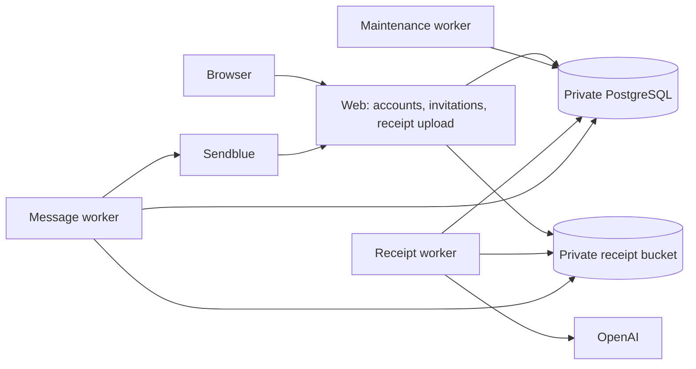

# Hosted private beta deployment

Updated September 26, 2026. **The free preview is live at [tallie-web.onrender.com](https://tallie-web.onrender.com); source is published to private GitHub. AWS storage is deferred under the $0 constraint.** Natural payments remain unavailable regardless of hosting configuration.

## Authorized first deployment: $0 preview

The founder authorized private `kavin1001/tallie`, Render hosting with a temporary Render address, and private AWS storage within a strict $0 infrastructure budget. The default `render.yaml` selects a free web service and free PostgreSQL only. The original paid topology is retained in `deploy/render-paid.yaml`; applying that file is outside the current authorization.

- **Available:** phone signup, passkeys, recovery, contacts, private invitations and manually entered equal/custom/item splits.
- **Disabled:** receipt uploads/extraction, messaging enrollment/intake/delivery, simulated and real money movement. Sendblue Verify credentials remain necessary for phone proof. Its provider usage is separate from infrastructure hosting.
- **Startup:** migrate before accepting traffic because free Render services cannot use pre-deploy hooks. Run bounded proof cleanup inside the web instance, with no separate worker service. Cleanup resumes after a sleeping instance wakes; expired proofs already fail authorization independently of deletion.
- **Origin:** use Render's platform-supplied HTTPS external URL until a final origin is chosen. Never derive passkey/cookie trust from an incoming request header. Credentials enrolled on the temporary hostname will not automatically transfer to another domain.
- **Storage:** this preview stores no receipt files and needs no S3 credentials. Create the requested private bucket only after account access and free-plan coverage are verified. Do not silently enable paid AWS features or treat a billing alert as a spending cap.
- **Access:** GitHub CLI and Render/AWS browser sessions are authenticated. An ignored, owner-only `.env.hosting.local` template remains available as an optional API alternative; it is not required for the current browser deployment.
- **Cost limitations:** [free Render](https://render.com/docs/free) sleeps after 15 idle minutes, may take about a minute to wake, and provides a 1 GB PostgreSQL database that expires after 30 days with no backups. A free compute selection is not an unconditional spending cap if a payment method and usage overages are enabled. Check the workspace's actual billing configuration before deployment.

The full-topology sections below describe the retained paid design and its earlier local container checks. The following release record describes the actual free deployment; paid resources remain outside the current authorization.

### Free-preview verification and release record

- **Current release: `12da4b2` — interrupted signup repair.** Manual Render deployment `dep-darmrpu0tbcc73c84fig` succeeded in 1m44s; [CI passed](https://github.com/kavin1001/tallie/actions/runs/36225515944). Signup now resumes pending/verified proof or first-passkey enrollment on reload; Back preserves the restricted session; the existing ten-minute enrollment deadline directs expired enrollment into fresh phone verification. No migration, account reset or authorization-window extension. Local formatting, TypeScript, **291 tests in 21 files** and production build passed; synthetic browser workflows verified name/passkey/reverification resumption without provider calls. [Identity evidence](identity-integration.md). Live readiness, anonymous identity bootstrap and home returned 200; the founder's affected real-device flow still needs their retry.
- **Earlier release: `0da4950` — frontend refinement.** Manual Render deployment `dep-darmkp17lnhs73e0pf2g` succeeded in 1m44s; [CI passed](https://github.com/kavin1001/tallie/actions/runs/36224784242). Corrected the landing wrapper/gutters, narrow-screen grid, signup rhythm and brand sizing; unavailable Messages navigation now follows server configuration. Local responsive inspection covered 320/390/768/1280px; live 1280px landing and 390px landing/signup confirmed balanced margins and no horizontal overflow. Live readiness returned 200. No provider message or financial action was triggered. Hosting plans and feature availability are unchanged.
- Source published to private [kavin1001/tallie](https://github.com/kavin1001/tallie). Initial release `3a9ef38`; free-plan configuration correction `d06a780` removes `maxShutdownDelaySeconds`, which Render's actual planner rejects on free services even though the general schema accepts it.
- Local formatting, all-workspace TypeScript, **278 tests in 20 files**, and Next production build passed. Four duplicate generated `.next/types/* 2.ts` files caused the first local typecheck to fail; removing only those ignored generated duplicates restored the clean check. No source type errors were suppressed.
- Both native Linux GitHub CI runs passed: [initial release](https://github.com/kavin1001/tallie/actions/runs/36223099150) and [deployed correction](https://github.com/kavin1001/tallie/actions/runs/36223159534).
- Native Linux ARM64 Docker image `tallie:free-preview` built successfully. A hard **512 MiB / 0.1 CPU / no-swap** runtime test used an isolated schema, fresh throwaway keys and fake provider configuration. Startup including all 11 migrations took **22.7 seconds**; 11 HTTP groups passed, including authenticated disabled-feature checks, anonymous denial, secure cookies, origin-bound auth and beta/demo isolation. Peak cgroup memory **166.4 MiB**, zero OOM events, graceful stop **0.6 seconds / exit 0**. Test schema and container were removed; localhost:3000 was unchanged. This is local constrained evidence, not hosted load testing.
- Render account billing inspected: **Hobby**, no card on file, zero pending charges, unused 750 free instance hours / 5 GB bandwidth / 500 pipeline minutes at provisioning. No paid compute or storage selection was made.
- Blueprint [tallie-preview](https://dashboard.render.com/blueprint/exs-darm5ad9fdbs73a5qka0) deployed `d06a7808113a6246f9c9bad099bcc7e52395e361`. Auto Sync is **No**, verified in the dashboard; service auto-deploys are also off. Use deliberate manual sync/deploy for future changes.
- [Free web service](https://dashboard.render.com/web/srv-darm6kvavr4c73f8qnv0/deploys) is **Live**. Render's Docker build/deploy succeeded in **2m07s**, deploy `dep-darm6kvavr4c73f8qpdg`. This verifies the actual target host independently of the earlier local QEMU failure.
- [Free PostgreSQL 17](https://dashboard.render.com/d/dpg-darm62navr4c73f8oskg-a/info) is **Available** in Virginia, with 1 GB storage and autoscaling disabled. Database-specific inbound rules block all internet traffic. It **expires October 26, 2026** and has no free-plan backups; use disposable test data and decide its replacement/export before expiry.
- Live HTTPS checks passed: `/` and `/api/status` returned 200; `/api/identity/state` returned 200 with identity available, no signed-in account, a Secure/HttpOnly/SameSite=Lax cookie and private/no-store caching; anonymous `/api/social/dashboard` returned 401; `/demo` returned 404; disabled message intake returned 503; an incorrect-Origin signup POST returned 403 without calling the provider. The live landing and signup form render in the browser. No phone proof, actual device passkey ceremony, message sending or money movement was performed during these checks.
- AWS billing and Free Tier pages were inspected. They show $0 current charges and no Free Tier usage data, but do not establish an active Free account plan with remaining credits. Consequently no bucket, policy, IAM identity or object was created under the $0 constraint. See [AWS preparation](aws-preview-setup.md). This does not block the account/manual-split preview, which has no receipt storage access.

### Next founder test

1. Open [Tallie](https://tallie-web.onrender.com) on the phone used for the earlier Sendblue proof. Allow about a minute for an idle service to wake.
2. Complete signup through Messages, enroll a passkey, and save the recovery code privately. Sign out and use the passkey to sign back in.
3. With a consenting second tester, create a contact and manual split, share the private invitation, and complete the intended recipient's signup/claim. Confirm both accounts see the same shares.
4. Record device/OS/browser versions and observed results. These steps remain unverified on the hosted app. Use disposable preview data and plan passkey enrollment again when moving to the permanent domain.

## Retained full topology (paid; deferred)

The root `Dockerfile` builds one application image, usable by each role. `deploy/render-paid.yaml` rebuilds that Dockerfile separately for each service. A later CI pipeline can publish one immutable image and deploy its digest to all roles.



Render supports Docker web/background services and pre-deploy commands. This configuration uses web-only migrations, a `/api/status` health check, manual deployment triggers, and no preview environments. PostgreSQL external access is disabled. The selected resource identifiers follow the current [Blueprint reference](https://render.com/docs/blueprint-spec); check the dashboard's total before creating paid resources.

### Prepared resources

| Resource             | Command / purpose                               | Initial compute  |
| -------------------- | ----------------------------------------------- | ---------------- |
| `tallie-web`         | `node scripts/run-service.mjs web-start`        | 1 CPU / 2 GB     |
| `tallie-maintenance` | `node scripts/run-service.mjs core-worker`      | 0.5 CPU / 512 MB |
| `tallie-receipts`    | `node scripts/run-service.mjs receipt-worker`   | 1 CPU / 2 GB     |
| `tallie-messages`    | `node scripts/run-service.mjs messaging-worker` | 0.5 CPU / 512 MB |
| `tallie-postgres`    | PostgreSQL 17, 5 GB storage                     | 0.5 CPU / 1 GB   |

These are initial engineering allocations, not measured capacity guarantees. Monitor receipt decode memory and worker lag during the cohort. No dollar estimate is hardcoded. The production image retains locked development tooling because workers/migrations currently run TypeScript with `tsx`; separate compiled worker bundles can reduce its size later.

## What must be supplied before applying

1. **A Git remote and Render workspace** with permission to read the repository. The prepared Blueprint does not create or publish either.
2. **One stable public HTTPS origin.** Prefer the intended beta domain before enrolling passkeys. Set `APP_ORIGIN` to the exact origin with no path. An initial Render hostname also works, but changing the passkey relying-party domain later requires a planned credential migration while the old origin remains usable.
3. **A private AWS S3 bucket** and separate limited credentials for the web, receipt worker, and messaging worker. All use the same bucket/region; each has only the operations it needs.
4. **Existing Sendblue/OpenAI provider credentials** entered directly into service configuration. Do not paste them into chat, source control, docs, URLs, or build arguments.
5. **Application encryption keys:** independent 32-byte keys, encoded as 64 hexadecimal characters, for `IDENTITY_ENCRYPTION_KEY` and `MESSAGING_ENCRYPTION_KEY`. Generate each in a trusted password manager or terminal and store them securely. They must remain stable across restarts and shared between the appropriate roles. Losing the identity key breaks verified-phone matching and encrypted data; a future rotation needs an explicit migration.

`BETTER_AUTH_SECRET` and `SENDBLUE_MESSAGE_WEBHOOK_SECRET` are generated by the Blueprint. Render prompts for `sync: false` values when first creating the Blueprint; later added values must be supplied manually. Secret values are never declared as Docker `ARG` or copied into the image. [Environment and secret behavior](https://render.com/docs/blueprint-spec), [Docker build security](https://render.com/docs/docker).

## Environment and permissions

| Setting                                     | Web                      | Maintenance | Receipts                     | Messages                |
| ------------------------------------------- | ------------------------ | ----------- | ---------------------------- | ----------------------- |
| `APP_MODE=beta`, `DATABASE_URL`             | Yes                      | Yes         | Yes                          | Yes                     |
| `APP_ORIGIN`                                | Stable public origin     | —           | —                            | Same origin             |
| `BETTER_AUTH_SECRET`                        | Yes                      | —           | —                            | —                       |
| `IDENTITY_ENCRYPTION_KEY`                   | Yes                      | —           | —                            | Same key                |
| `MESSAGING_ENCRYPTION_KEY`                  | Yes                      | —           | —                            | Same key                |
| Sendblue key ID / secret / assigned number  | Yes                      | —           | —                            | Yes                     |
| Sendblue Verify service SID                 | Yes                      | —           | —                            | —                       |
| Sendblue message webhook secret             | Yes                      | —           | —                            | Same configuration gate |
| `OPENAI_API_KEY`, pinned receipt model      | —                        | —           | Yes                          | —                       |
| `RECEIPT_STORAGE_DRIVER=s3`, bucket, region | Yes                      | —           | Yes                          | Yes                     |
| AWS credentials                             | Upload / private preview | —           | Decode / normalize / cleanup | Media intake            |
| `MESSAGING_SEND_ENABLED`                    | `false` initially        | —           | —                            | `false` initially       |

`APP_HOST=0.0.0.0` makes the web process reachable by the platform. Render supplies `PORT`. All roles use the launcher so provider secrets are filtered again before child processes start. This is process configuration isolation; the current Blueprint still uses one database owner credential. Separate migration/application database roles remain a hardening task before live financial operation.

### Receipt storage

Set `RECEIPTS_BUCKET` to the bucket name, `RECEIPTS_BUCKET_OWNER` to its 12-digit AWS account ID, and `AWS_REGION` to its actual region. The owner check protects against pointing at a bucket under a different account. The adapter uses AWS S3 without a custom endpoint. Bucket Public Access Block and Bucket Owner Enforced must be enabled. Objects require server-side encryption, and the bucket should have a lifecycle rule expiring the `receipts/v1/` prefix after two days. This bounds failed-upload orphans; lifecycle deletion is asynchronous and is not an exact deletion-time guarantee. Use a dedicated non-versioned receipt bucket, or explicitly expire noncurrent versions as well. The DB-backed worker applies normal 24-hour receipt expiry separately. Full policies and lifecycle details are in [deployment-storage.md](deployment-storage.md).

| IAM principal    | Allowed object operations                                                         |
| ---------------- | --------------------------------------------------------------------------------- |
| Web              | `PutObject` on `receipts/v1/source/*`; `GetObject` on `receipts/v1/normalized/*`  |
| Receipt worker   | `GetObject` on source; `PutObject` on normalized; `DeleteObject` on both prefixes |
| Messaging worker | `PutObject` on source                                                             |

No service needs bucket listing or public ACLs. Current web rollback cleanup is best effort: lacking delete permission does not make the upload public, and bucket lifecycle removes any orphan. Do not attach Render disks as a receipt-sharing mechanism; separate services need the shared object store.

## First deployment procedure

1. Run local checks and create a reviewed commit. Record the commit and image digest in the release record. No API calls that send texts or move money are required for a build.
2. Configure the private bucket, lifecycle, credentials, and stable HTTPS origin. After a paid deployment is authorized, import `deploy/render-paid.yaml` into the intended Render workspace and review resources/costs before applying.
3. Supply the prompted service secrets. The web's pre-deploy command runs `packages/db/src/migrate.ts` once, with PostgreSQL advisory locking and migration digest checks. Never modify an applied migration.
4. Verify `/api/status`, database connectivity, and all worker startup logs. Workers can start before the first migration finishes and must recover on their existing retry loops. Do not accept users until the web and all intended workers are healthy.
5. Bind the custom domain and confirm the configured origin exactly matches the browser URL before creating a real account/passkey. Check proxy HTTPS and Secure cookies.
6. Exercise account creation, device passkey sign-in, recovery using a saved code, and a two-account invitation using test participants who agreed to the test. Verify a forwarded link fails, an anonymous request reveals no expense details, and the split survives signup.
7. Upload a synthetic receipt. Confirm the worker reads the private source, the verified owner can preview the normalized image, and another account/anonymous browser cannot retrieve it. Confirm source and normalized retention behavior.
8. Configure Sendblue inbound and status callbacks as below. Keep outgoing delivery disabled until callback authentication, a consented channel connection, and status processing have been checked. Then enable sending deliberately for the intended cohort and run one consented two-device conversation.
9. Record observed results and remaining limitations in the verification register. Natural sandbox/program approval and financial integration remain independent gates.

### Messaging callbacks

Use these URLs under the configured origin:

- `/api/webhooks/sendblue/messages` — inbound messages.
- `/api/webhooks/sendblue/status` — outgoing delivery status.

Configure the provider to supply `sb-signing-secret` matching `SENDBLUE_MESSAGE_WEBHOOK_SECRET`. This adapter uses a shared-secret header for ordinary messaging callbacks; it does not claim signed payload verification. Keep the secret out of query strings. Reverse-OTP signup currently retrieves the Verify record server-side; an ordinary message callback cannot substitute for that proof.

The outgoing switch defaults to false in both web and worker configuration. Update both deliberately so the UI and worker agree. Confirm configured media hosts against actual authenticated Sendblue webhook evidence before enabling receipt messages. Do not broaden media fetching to arbitrary URLs to make a test pass.

## Operations and rollback

- **First restore drill:** restore a database backup into a separate database, point a non-public test deployment at it, and confirm migration integrity and expected account/share counts. Do not resend restored outbox items until their prior delivery state is reviewed.
- **Failed deployment:** keep the previous running image, inspect bounded error codes, and fix forward. Migrations are additive; deploys that remove/change schema need a separate compatibility plan. Never automatically run destructive down-migrations.
- **Provider uncertainty:** retain durable jobs and unknown message states. A retry of a provider delivery must not create another expense. No worker has permission to turn a share into a payment without the future payment approval system.
- **Configuration loss:** recover stable encryption keys from secure backup before restarting encrypted-data workflows. Generating replacements silently is not recovery.
- **Monitoring to enable:** web error rate/latency, Postgres connection usage, worker job age, receipt failures/quota, message inbox/outbox lag, unknown delivery outcomes, and backup/restore alerts. Operational paging and a measured restore objective remain pilot gates.

## Earlier full-topology preparation evidence

- `render.yaml` validated against Render's current [official JSON Schema](https://render.com/schema/render.yaml.json) using AJV 2020 and YAML 1.2: **passed locally**.
- Node 24 bookworm image manifest resolved to an immutable multi-architecture digest; no provider secrets are Docker build inputs.
- A Docker BuildKit context export contained 214 allowed source/config files (about 1 MB). A local scan found zero `.env`, `.tallie`, `.git`, or `node_modules` paths and zero configured credential-value matches. The temporary context export was removed after checking.
- **Native Linux ARM64 container build passed**, including Next production compilation, TypeScript, and page generation. The image ran as UID 1000 with Node 24.21.0. `/app/.env`, `/app/.tallie`, and `/app/.git` were absent.
- **Container runtime smoke passed** against a newly created isolated PostgreSQL schema: all 11 migrations applied inside the image; `/api/status` and `/` returned 200; `/demo` returned 404; demo mutation returned 503; anonymous social access returned 401. Maintenance, receipt, and messaging worker containers all started and remained running without startup errors. Tests supplied fake provider credentials, no jobs, and disabled message dispatch. Test containers and schema were removed afterward.
- **Local AMD64 emulation failed:** the Linux AMD64 build compiled and passed TypeScript, then Docker QEMU raised SIGSEGV during Next page-data collection on this ARM Mac. The native ARM64 run passed that stage. The later actual Render Docker build/deploy passed, as recorded above; local QEMU remains unverified.
- At this earlier preparation milestone no hosting was provisioned. The free deployment above supersedes that status. No paid resource creation, custom DNS update, S3 provisioning, provider callback change, or message sending has been performed.

The local preflight image is tagged `tallie:beta-preflight`. Rebuild from the intended release commit before deployment:

```sh
docker build --platform linux/arm64 -t tallie:beta-preflight .
```

Use `--platform linux/amd64` on a native AMD64 host for the target-host verification. The Dockerfile and pinned base manifest support both platforms; one platform's passing result does not prove the other.
