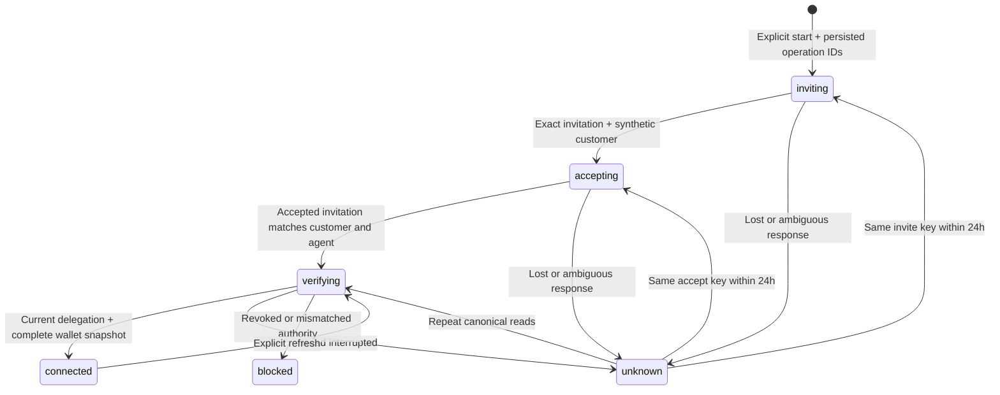

# Natural integration: sandbox accounts and balances

Updated September 26, 2026. **Enabled locally at `http://localhost:3001`; sandbox party and agent credentials passed live read-only checks.** The platform and its configured agent are ACTIVE, and both credentials resolve to the same platform. The founder supplied the agent key/ID from dashboard setup; the API probe itself does not attest that pairing. Actual customer setup/balance behavior and consumer P2P approval remain pending. The earlier production key is retained only in an unused ignored local setting and was not sent to Natural. No credential has been printed or committed, and no agent/customer/payment mutation has occurred.

**Founder release rule:** keep this integration local. Do not push or deploy it to production until the founder has tested locally and approved release. Hosted `94a2240` remains unchanged.

## What works in this slice

- `packages/natural`: typed sandbox REST clients for identity, simulated invitations, wallets, external accounts, payment requests and payments. Provisioning and agent credentials have separate clients. Money methods are low-level building blocks only.
- `packages/payments`: durable synthetic customer setup bound to a real Tallie account, plus current delegation checks and wallet snapshots. Migration013 is additive and does not modify saved splits or simulator tables.
- `/api/payments/sandbox`: account-authenticated local state. Explicit `/start`, `/retry`, `/refresh` POSTs take an empty JSON object. The browser cannot supply a provider customer, wallet, agent, permission or amount.
- Optional account-home card: **Create test account**, saved setup progress, safe continuation and refreshed test balances. Test dollars are labeled, null means unavailable, and the last-check time accompanies balances.
- `npm run natural:check`: read-only credential/platform/agent-resource probe. It never creates a customer or payment and never prints secrets/provider bodies.

No account route or worker calls payment mutations. `moneyMovementEnabled` and the ordinary status endpoint's `paymentsEnabled` remain false. Existing obligations are not activated or marked paid. No new infrastructure or paid worker is required.

## Configure and verify

1. Put the sandbox **party** key in the ignored root `.env` as `NATURAL_API_KEY`. Do not paste keys into chat. `NATURAL_PROVISIONING_API_KEY` is an explicit alias; conflicting values are rejected.
2. Run `npm run natural:check`. With only that credential present, it verifies the sandbox party and reports its nonsecret platform ID. Save that as `NATURAL_PLATFORM_PARTY_ID`.
3. Create or identify the platform's sandbox agent and its bound agent key in Natural. Save `NATURAL_AGENT_ID` and `NATURAL_AGENT_KEY`. Confirm that exact key belongs to that agent. A read of `/parties/me` or `/agents/{id}` does **not** prove credential-to-agent association; no public introspection endpoint supplies that proof. Current Natural guidance requires a user session to issue an agent key, so the party API key alone cannot bootstrap it. Use the dashboard, which handles agent creation and credential issuance together. [Agent setup](https://docs.natural.com/guides/agents/create-agent).
4. Set `NATURAL_ENVIRONMENT=sandbox`. Run the read-only check again; it checks both credential parties and agent ownership. Confirm the platform/agent is active. API success does not establish consumer-P2P approval.
5. Apply `npm run db:migrate` to the intended local database and set `NATURAL_SANDBOX_ENABLED=true`. Restart the web role. Hosted preview migration runs during startup; configure hosting secrets separately and deploy deliberately when ready.
6. Sign into Tallie, then explicitly choose **Create test account**. Natural creates a synthetic PERSON through `/simulations/invite-customer`; Tallie accepts that exact invitation, checks the canonical customer delegation/agent and reads owned wallets. It sends no real phone/email invitation. This is not real consumer KYC.
7. Record observed provider results separately from synthetic tests. Repeated clicks/reload must produce the same local connection. An unavailable wallet balance must remain unavailable. Inspect revocation/unknown recovery with disposable sandbox data before expanding access.

Only the fixed `https://api.sandbox.natural.com` origin is permitted. Keys must have the sandbox role-specific prefixes. Production keys, alternate origins, conflicting configuration and customer-as-platform substitutions fail closed. Missing configuration hides the UI and leaves actions unavailable.

For the temporary phone-only demo on a separate local port, after configuring credentials and building:

```sh
APP_MODE=beta APP_ORIGIN=http://localhost:3001 APP_HOST=127.0.0.1 PORT=3001 \
IDENTITY_PHONE_DEMO_ENABLED=true RECEIPTS_ENABLED=false MESSAGING_SEND_ENABLED=false \
node scripts/run-service.mjs web-preview
```

Open `http://localhost:3001`. This uses the local PostgreSQL account data and actual phone verification; it is separate from the synthetic UI fixtures used during development. An existing passkey account keeps its passkey sign-in. Stop this local process before reusing that port or rebuilding its active Next artifacts.

The web launcher forwards these credentials only under explicit, complete sandbox configuration. Other roles receive no Natural secrets. The free Render preview can host this synthetic setup/read workflow; it cannot supply an always-running production reconciliation worker. The current live release has not been enabled for Natural.

## Durable setup and recovery



One connection per local account stores immutable expected platform/agent/read permissions and separate invite/accept operation and idempotency keys. Persist before network access. A 30-second lease and incrementing generation fence concurrent/stale completions. Calls run outside SQL transactions. Active user/session/phone binding is rechecked before each phase and before disclosure. An in-flight response may be retained as evidence after a session expires, but the next provider phase and browser disclosure require valid authority.

Timeouts, network loss, HTTP409/429/5xx and malformed mutation responses remain uncertain. Explicit retry keeps the original key and payload; mutation retries stop 24 hours after the first submission. A failed preflight on a later attempt cannot prove an earlier attempt did nothing. Never delete a connection or substitute fresh keys to escape uncertainty. After the cutoff, leave it paused for a provider-supported investigation.

Read retries can continue beyond24 hours and recheck customer authority before wallets. Refresh is limited to one attempt per account per five seconds. Reads hide balances if authorization is revoked/mismatched. GET state displays the last saved snapshot rather than silently calling Natural on every dashboard render. Wallets must belong to the exact customer and be active standard wallets. The API exposes `hasMore` without a documented wallet cursor input, so a partial list is blocked rather than represented as complete.

## Identity and trust boundaries

Strong app sessions can use the sandbox flow. The temporary marked phone-demo session has a narrowly scoped exception for synthetic setup/read only, guarded by its existing preview/beta/phone flags and absence of passkeys. It has no financial approval authority. `requireRecentAccount` and the strong identity transaction guard still protect future money actions.

The initial customer delegation requests only `party.read`, `wallets.read` and `wallets.balance`. Money permissions cannot be supplied through the service or browser. Provider IDs, synthetic contact details, bank instructions and credentials are excluded from browser DTOs. Errors retain classifications without logging upstream bodies.

Tradeoff: separate client types run in the same web process for this test workflow. This preserves the $0 topology but is not OS-level credential separation. Production onboarding/dispatch require dedicated roles and reviewed database privileges. Synthetic invitation acceptance also differs from the production signed-acceptance-event binding; it must not be repurposed as consumer enrollment.

## Payment implementation still required

1. Confirm Natural's US consumer P2P program, fees, approved onboarding and funding/withdrawal paths. Verify actual sandbox behavior, not just the OpenAPI schema.
2. Add real-account financial tables linked to `social_shares`: immutable obligation versions, one active collection lane, payment reviews/consent and durable operations. Do not reuse simulator identities/tables.
3. Use strong recent authentication and exact payer/payee/amount/currency/source/fee review. Persist consent before dispatch. Coordinate request creation/cancel/fulfill with expense cancellation and any external handoff.
4. Add signed Standard Webhooks ingress, durable event deduplication, canonical resource reconciliation and delayed-return effects. `COMPLETED` can later become `RETURNED`; transport success alone does not settle an obligation.
5. Prove safe retry, two-user settlement, source ownership, fees, expiry, cancellation races and recovery with real sandbox evidence. Do not automatically collect earlier demo expenses when enabling the next milestone.

The current provider client supports create/read/cancel/fulfill request and payment reads. Request creation acknowledges no wallet relationship, so save its ID and fetch canonical detail before accepting the receiving-wallet binding. A fulfillment submits the exact stored request/source; it cannot override the amount. Null fees remain unknown. See [package limitations](../../packages/natural/README.md) and [the primary-source audit](../research/natural-technical-audit.md).

## Verification

```sh
npm run typecheck
npm test
npm run build
npm run natural:check # operator-only live read, after local secret configuration
```

The automated provider tests inject fetch and never contact Natural. PostgreSQL tests use isolated local schemas and cover ambiguous invite/accept responses, stable retries, concurrent starts, generation fencing, session revocation/expiry, wrong accounts/phones, platform/agent/customer/permission mismatch, signed/null balances and delegation revocation. Gateway/HTTP tests cover strict empty input, origin checks, role filtering, preflight ownership and sanitized errors. Exact aggregate/browser evidence is recorded in the implementation tracker.
