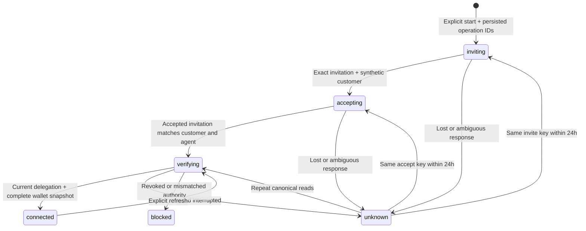

# Natural integration: sandbox accounts, balances and direct-send lab

Updated September 26, 2026. **Enabled locally at `http://localhost:3001`; authenticated Natural sandbox funding and direct sending now verified.** The platform and its configured agent are ACTIVE, and both credentials resolve to the same platform. The founder supplied the agent key/ID from dashboard setup; the read-only probe itself does not attest that pairing. A signed-in browser test completed a $25 deposit into the separate payment-capable synthetic customer and one $1 transfer to the user's original read-only test customer. Sender $24, receiver $1 and one completed transfer persisted after reload. That direct-send milestone passed 458 tests plus formatting, TypeScript and production build; the current productization check passes 701 tests across 42 files with the same gates. Consumer P2P approval is founder-confirmed; production setup, device journeys and production readiness remain pending. The earlier production key is retained only in an unused ignored local setting and was not sent to Natural. No credential has been printed or committed.

**Founder release rule:** keep this integration local. Do not push or deploy it to production until the founder has tested locally and approved release. Hosted `94a2240` remains unchanged.

## What works in this slice

- `packages/natural`: typed sandbox REST clients for identity, simulated invitations, wallets, external accounts, payment requests and payments. Provisioning and agent credentials have separate clients. The synthetic send routes now call its deposit/direct-payment methods after explicit test-dollar approval; production payment methods remain inactive.
- `packages/payments`: durable synthetic customer setup bound to a real Tallie account, plus current delegation checks and wallet snapshots. Migration013 is additive and does not modify saved splits or simulator tables.
- `/api/payments/sandbox`: account-authenticated local state. Explicit `/start`, `/retry`, `/refresh` POSTs take an empty JSON object. The browser cannot supply a provider customer, wallet, agent, permission or amount.
- Optional account-home card: **Create test account**, saved setup progress, safe continuation and refreshed test balances. Test dollars are labeled, null means unavailable, and the last-check time accompanies balances.
- A second, explicit synthetic customer in `natural_sandbox_send_connections` requests exactly `party.read`, `wallets.read`, `wallets.balance`, `payments.read` and `payments.create`. It does not upgrade or mutate the first, read-only connection. Migration014 is additive. The browser sees **Set up test sending** only in the local sandbox surface.
- Migration015 journals a single optional test deposit, short-lived exact send reviews and direct-send operations. `/api/payments/sandbox/send` exposes state, setup, fund, review and confirm actions. The UI requires a final **Send test payment** confirmation. Sending is capped at $100 per transfer and one $100-or-less test deposit per sender.
- The recipient can be the sender's separate read-only Natural test account or a connected Tallie contact who has a read-only sandbox account. No persistent group or social share is created. The direct-send lab never marks an existing split paid.
- `npm run natural:check`: read-only credential/platform/agent-resource probe. It never creates a customer or payment and never prints secrets/provider bodies.

The new local account routes can call Natural **sandbox** deposit and payment mutations after explicit UI actions. They cannot call production Natural. `moneyMovementEnabled` on the original account-setup DTO and the ordinary status endpoint's `paymentsEnabled` remain false: these flags describe real payment activation, not the separate test-dollar lab. Existing obligations are not activated or marked paid. No new infrastructure or paid worker is required for this local experiment.

## Configure and verify

1. Put the sandbox **party** key in the ignored root `.env` as `NATURAL_API_KEY`. Do not paste keys into chat. `NATURAL_PROVISIONING_API_KEY` is an explicit alias; conflicting values are rejected.
2. Run `npm run natural:check`. With only that credential present, it verifies the sandbox party and reports its nonsecret platform ID. Save that as `NATURAL_PLATFORM_PARTY_ID`.
3. Create or identify the platform's sandbox agent and its bound agent key in Natural. Save `NATURAL_AGENT_ID` and `NATURAL_AGENT_KEY`. Confirm that exact key belongs to that agent. A read of `/parties/me` or `/agents/{id}` does **not** prove credential-to-agent association; no public introspection endpoint supplies that proof. Current Natural guidance requires a user session to issue an agent key, so the party API key alone cannot bootstrap it. Use the dashboard, which handles agent creation and credential issuance together. [Agent setup](https://docs.natural.com/guides/agents/create-agent).
4. Set `NATURAL_ENVIRONMENT=sandbox`. Run the read-only check again; it checks both credential parties and agent ownership. Confirm the platform/agent is active. API success does not establish consumer-P2P approval.
5. Apply `npm run db:migrate` to the intended **local** database; migrations 013–015 add the read-only connection, separate send connection and test-send journal. Set `NATURAL_SANDBOX_ENABLED=true` in the ignored local configuration and restart the web role. Do not copy this configuration to Render or deploy this branch before the founder's local test and release approval.
6. Sign into Tallie, then explicitly choose **Create test account**. Natural creates a synthetic PERSON through `/simulations/invite-customer`; Tallie accepts that exact invitation, checks the canonical customer delegation/agent and reads owned wallets. It sends no real phone/email invitation. This is not real consumer KYC.
7. Record observed provider results separately from synthetic tests. Repeated clicks/reload must produce the same local connection. An unavailable wallet balance must remain unavailable. Inspect revocation/unknown recovery with disposable sandbox data before expanding access.

Within these sandbox clients, only the fixed `https://api.sandbox.natural.com` origin is permitted. Keys must have the sandbox role-specific prefixes. Production keys, alternate origins, conflicting configuration and customer-as-platform substitutions fail closed. Missing configuration hides the UI and leaves actions unavailable.

For the temporary phone-only demo on a separate local port, after configuring credentials and running `npm run build`:

```sh
APP_MODE=beta APP_ORIGIN=http://localhost:3001 APP_HOST=127.0.0.1 PORT=3001 \
IDENTITY_PHONE_DEMO_ENABLED=true RECEIPTS_ENABLED=false MESSAGING_SEND_ENABLED=false \
node scripts/run-service.mjs web-preview
```

Open `http://localhost:3001`. This uses the local PostgreSQL account data and actual phone verification; it is separate from the synthetic UI fixtures used during development. An existing passkey account keeps its passkey sign-in. Stop this local process before reusing that port or rebuilding its active Next artifacts.

The web launcher forwards these credentials only under explicit, complete sandbox configuration. Other roles receive no Natural secrets. The current live release has not been enabled for Natural; the free Render web process also cannot supply continuous payment reconciliation while asleep.

### Local direct-send walkthrough

This walkthrough was verified with one user's two synthetic Natural customers: a $25 deposit and a $1 completed direct transfer, leaving sender $24 and receiver $1 after reload. The distinct-friend path and later returns still require sandbox checks. Use only disposable Natural sandbox identities and test dollars.

1. On the account Home page, choose **Create test account** in the original sandbox card. Wait for a connected read-only account with an owned wallet. If setup remains uncertain, check saved state and use its **Continue setup** action; do not create another customer manually.
2. In **Send a little test money**, choose **Set up test sending**. This creates a second synthetic customer with payment permissions. If Natural rejects the invitation or delegation, stop and record its nonsecret error/status; do not edit permissions in the database or substitute a production credential.
3. Once ready, choose **Add $25 test dollars**. This is one explicit sandbox deposit, not a repeatable balance top-up. If the response is uncertain, use **Check** and the same **Retry test deposit** action only when offered; its persisted operation/key stay unchanged. Check the current wallet balance before proceeding.
4. Choose **Send test money**. Select **Your test receiving account** for a single-account test, or a connected Tallie friend with their own read-only sandbox account. Enter a small amount and optional note, inspect the exact review, then press **Send … test payment** once. A review expires after ten minutes and becomes unusable if source or recipient authority changes.
5. Refresh **Recent test sends** and the current balance. `COMPLETED` is a provider status, not a Tallie social-share settlement; a later `RETURNED` must remain visible. For an uncertain HTTP response, inspect the saved transfer through state/status. Never create a fresh review to repeat an uncertain payment.

Record actual provider observations separately: whether setup permissions were accepted, both wallet balances, funding result, send result, and any later return. Do not record credentials, phone numbers, receipts or provider payloads in the repository.

## Durable setup and recovery



Each connection type permits at most one record per Tallie account and stores immutable expected platform/agent/permission bindings plus separate invite/accept operation and idempotency keys. Persist before network access. A 30-second lease and incrementing generation fence concurrent/stale completions. Calls run outside SQL transactions. Active user/session/phone binding is rechecked before each phase and before disclosure. An in-flight response may be retained as evidence after a session expires, but the next provider phase and browser disclosure require valid authority.

Timeouts, network loss, HTTP409/429/5xx and malformed mutation responses remain uncertain. Explicit retry keeps the original key and payload; mutation retries stop 24 hours after the first submission. A failed preflight on a later attempt cannot prove an earlier attempt did nothing. Never delete a connection or substitute fresh keys to escape uncertainty. After the cutoff, leave it paused for a provider-supported investigation.

Read retries can continue beyond 24 hours and recheck customer authority before wallets. Refresh is limited to one attempt per account per five seconds. Reads hide balances if authorization is revoked/mismatched. The original setup GET displays its last saved snapshot; the send-state GET checks current delegation and reads a current provider balance, or shows unavailable if that read fails. This background read must not transition the send connection through setup `verifying`: doing so raced with funding/review commands during browser testing. Wallets must belong to the exact customer and be active standard wallets. The API exposes `hasMore` without a documented wallet cursor input, so a partial list is blocked rather than represented as complete.

## Identity and trust boundaries

Strong app sessions can use the sandbox flow. The temporary marked phone-demo session has a narrowly scoped exception for synthetic setup, test deposits and test-dollar sends, guarded by its preview/beta/phone flags, matching account/session/phone binding and absence of passkeys. Each send still requires an exact review and confirmation. This exception **must never authorize production money movement**; `requireRecentAccount` and the strong identity transaction guard remain the intended boundary for future real payment actions.

The initial customer delegation requests only `party.read`, `wallets.read` and `wallets.balance`. The separate send customer requests the five fixed permissions above. The browser cannot choose or alter either grant. Provider party/payment IDs, synthetic contact details, bank instructions and credentials are excluded from browser DTOs; browser-visible IDs identify local reviews, transfers and wallet display rows. Errors retain classifications without logging upstream bodies.

Tradeoff: separate client types run in the same web process for this test workflow. This retains the existing free topology but is not OS-level credential separation; the founder has since approved a $100/month ceiling for the next hosted stage. The send customer duplicates a synthetic identity/wallet instead of escalating the original read-only grant; that extra setup keeps the earlier consent and least-privilege boundary intact. Production onboarding/dispatch require dedicated roles and reviewed database privileges. Synthetic invitation acceptance also differs from the production signed-acceptance-event binding; it must not be repurposed as consumer enrollment.

## Test-dollar journal and recovery

- A review binds the authenticated sender, current phone hash, sender connection/wallet, recipient party, amount in USD cents and optional note. The recipient comes from the sender's verified read-only test account or an exact connected contact with a read-only account. The server constructs the review and returns no provider party IDs. The review key binds retries to the same payload; changed input requires a new review. The review expires after ten minutes.
- Confirmation rechecks the app session and both Natural delegations, wallet ownership, current available balance and destination. It saves one operation ID and idempotency key before calling `POST /payments`; concurrent confirmations of the same review see that one operation. No browser or chat message can directly submit a provider payment without this confirmation.
- The test deposit has its own persisted operation/key and is limited to one amount per sender. An uncertain deposit, or a rejected deposit with no canonical provider transfer ID, can be explicitly retried with the **same key and amount** within the original 24-hour window. A canonical failed deposit remains terminal. An expired submission lease displays as unknown and permits the same recovery; a later rejected preflight cannot erase earlier uncertainty. A send with an uncertain outcome is **not resubmitted**. State reads reconcile by canonical payment ID or by the saved operation tag in payment listings; no match remains uncertain. Unknown provider reads never become an invented success.
- Funding checks the exact customer wallet through the authorized **agent** credential; the **party** credential checks platform/customer binding and performs the deposit simulation. An actual party-key wallet read returned403 and blocked funding before this repair. Credential roles must remain explicit; a customer wallet read is not a valid platform-key preflight.
- Payment status may move from `COMPLETED` to `RETURNED`; stale completed reads cannot erase the return. The send-state response reads the current provider wallet balance for display and shows unavailable when that read fails. It never treats the setup snapshot as spendable funds. The journal is a test-command record, not an obligation ledger, refund engine or source of real balance authority.
- Reconciliation currently occurs when the signed-in user reads the local sandbox state. It has no always-on worker, signed webhook inbox or operational alerting. A sleeping web process cannot notice a late return until the next read. These limitations are acceptable only for disposable sandbox tests.

## Real-payment implementation still required

1. Confirm Natural's US consumer P2P program, fees, approved onboarding and funding/withdrawal paths. Verify actual sandbox behavior, not just the OpenAPI schema.
2. Add real-account financial tables linked to `social_shares`: immutable obligation versions, one active collection lane, payment reviews/consent and durable operations. Do not reuse simulator identities or the synthetic send journal.
3. Use strong recent authentication and exact payer/payee/amount/currency/source/fee review. Persist consent before dispatch. Coordinate request creation/cancel/fulfill with expense cancellation and any external handoff. The phone-demo test-dollar exception cannot carry over.
4. Add signed Standard Webhooks ingress, durable event deduplication, canonical resource reconciliation and delayed-return effects. `COMPLETED` can later become `RETURNED`; transport success alone does not settle an obligation.
5. Prove safe retry, two-user settlement, source ownership, fees, expiry, cancellation races and recovery with real sandbox evidence. Do not automatically collect earlier demo expenses when enabling the next milestone.

The current provider client also supports direct sandbox payment submission. Its request create/read/cancel/fulfill methods are building blocks for a later obligation-aware flow. Request creation acknowledges no wallet relationship, so save its ID and fetch canonical detail before accepting the receiving-wallet binding. A fulfillment submits the exact stored request/source; it cannot override the amount. Null fees remain unknown. See [package limitations](../../packages/natural/README.md) and [the primary-source audit](../research/natural-technical-audit.md).

## Verification

```sh
npm run typecheck
npm test
npm run build
npm run natural:check # operator-only live read, after local secret configuration
```

The automated provider tests inject fetch and never contact Natural. PostgreSQL tests use isolated local schemas and cover ambiguous invite/accept responses, stable retries, concurrent starts, generation fencing, session revocation/expiry, wrong accounts/phones, platform/agent/customer/permission mismatch, signed/null balances and delegation revocation. Send-journal tests use an injected gateway to cover exact review binding, duplicate confirmation, wrong recipients/sessions, rejected and uncertain outcomes, same-key funding retries, tagged reconciliation, fresh balances and later returns. Gateway/HTTP tests cover input, origin checks, role filtering, preflight ownership, nonmutating background state reads and sanitized errors. These are **local implementation tests**, not Natural sandbox behavior. `natural:check` supplies live read-only evidence only.

Separate authenticated sandbox evidence: a saved $25 deposit recovered through the same operation/key after an ambiguous response; the local UI reviewed and explicitly confirmed a single $1 payment to the separate test receiving account. Natural and Tallie both reached `COMPLETED`. Sender $24, receiver $1 and exactly one completed transfer persisted after reload. This is synthetic sandbox behavior, not a production or two-real-user P2P test. Exact aggregate/browser evidence and remaining gates are recorded in the implementation tracker and verification register.

## Share-linked test repayment — local walkthrough

The new P2P slice links an explicitly marked **test** expense to a fixed share. Existing/manual expenses stay outside this workflow. It uses Natural direct-wallet sandbox payments, not linked-bank request fulfillment. Production activation remains gated.

1. Both people use separate Tallie accounts in the same local environment. On the requester's Home, create their receiving test account if needed.
2. Add the friend's exact number and share the private invitation using the existing consented mechanism. Localhost links only open against the local environment; two devices require a separately approved HTTPS test deployment.
3. Create a small split (for example $2 total / $1 each), choose the split method, then select **Make this a test split** before creating requests. Each requested share is at most $100.
4. The intended friend accepts the expense invitation and opens the saved test split. Sending setup, any allowed one-time test deposit and review stay in the expense. An already-funded sender needs enough available test dollars; the one-time deposit cannot be silently replenished.
5. Verify the payee, exact share, expense and source shown by **Review test payment**, then explicitly **Pay … in test money**. The server re-derives the share; client-supplied amount or destination cannot override it.
6. Check the saved result. Both accounts show the same test-share projection and separate outstanding totals. Unknown outcomes remain reserved; use **Check test payment** or **Retry same approval** when shown. A canonical failed/returned payment permits a new review. The original requester cannot cancel a pending/unknown/completed payment.

The implemented pipeline uses current share/phone/customer binding, expense→share→review locks, an exclusive database index and immutable review/attempt snapshots. Only canonical FAILED/RETURNED with a payment ID release a reserved share. The app does not yet receive payment webhooks or reconcile while closed; use explicit status checks in this local sandbox. Failure/return tests use injected responses unless the tracker explicitly records observed provider behavior. The two-real-person/device flow still needs founder testing.

### Reproducible operator sandbox probe

`scripts/verify-sandbox-share.ts` is an opt-in service-level check using the real configured Natural sandbox and a newly isolated **localhost-only** PostgreSQL schema. It creates synthetic local identity fixtures (no phone/passkey proof), uses actual social invitations/claims, creates separate synthetic Natural accounts, deposits $5 test dollars and confirms one exact $1 share. It checks repeated confirmation, one saved send, both paid projections and exact provider wallet deltas. It never uses production credentials or modifies the main app schema. The observed September26 run passed; see the tracker for limits.

```sh
# Explicitly creates new disposable sandbox accounts and a test payment.
npx tsx scripts/verify-sandbox-share.ts --execute-sandbox-share --new

# Resume the SAME schema printed by an earlier run; never replace an uncertain attempt.
npx tsx scripts/verify-sandbox-share.ts --execute-sandbox-share --resume SCHEMA
```

The isolated schema/journal is retained, including on uncertainty. Use `--retry-same-operation` with resume only to explicitly retry eligible saved setup/deposit operations; the service preserves their keys and original retry windows. A send is reconciled, never resubmitted under a new key. The harness is absent from routine tests and deployed routes, and outputs safe aggregate statuses. No fixture login bypass is exposed to the web app.

## Durable processing and production setup follow-up

The current full gate passes **701 tests/42 files**, types, formatting and build. Migrations017–020 add worker reconciliation, signed-event inboxes, controls and a separate hosted production connection foundation. Actual read-only sandbox checks reconciled existing deposit/payment records without submitting money; the local worker is healthy. P2P approval is founder-confirmed, while production setup remains needed. Production connection uses independent fixed-origin clients and defaults off; it cannot send money. See [payment operations](payment-operations.md) for exact credentials, flags, command/retention policies, evidence and unfinished bank/debit/recovery work. Sandbox clients still reject production keys. No Natural code was pushed or deployed.
